# І. Мета

Ознайомитись з мережевими конфігураційними файлами в операційних системах на основі
Debian, навчитись налаштовувати мережу з використанням консольного текстового редактора
Vim.

# ІІ. Постановка завдання та алгоритм розв'язання

Завдання:

1. Виконати всі приклади з теоретичних відомостей (завдання 1.1).
2. Підготувати звіт (завдання 1.2).
3. Сконфігурувати інтерфейс без використання протоколу DHCP (додаткове завдання 1.4).
4. Дослідити опції в директорії `/proc/sys/net/ipv4` і продемонструвати їх вплив на
   формування пакетів (додаткове завдання 1.5).

Середовище: Debian 12 bookworm (віртуальна машина OrbStack, macOS). Основний інтерфейс
`eth0` отримує адресу 192.168.139.71/24 і маршрут за замовчуванням від DHCP, тому всі
експерименти виконано на віртуальних інтерфейсах типу dummy, щоб не втратити зв'язок
з машиною.

Алгоритм розв'язання:

1. Створити інтерфейс `eth1` типу dummy і ввімкнути його.
2. Описати статичну конфігурацію `eth1` у `/etc/network/interfaces` за допомогою Vim,
   перезапустити сервіс networking і перевірити адресу.
3. Перевірити доступність 8.8.8.8 і таблицю маршрутизації, усунути конфлікт маршрутів
   за замовчуванням параметром `metric`.
4. Винести конфігурацію в `interfaces.d/eth1`, додати скрипти в `if-pre-up.d` та
   `if-post-down.d`, перевірити їх виконання через `ifup`/`ifdown`.
5. Змінити `icmp_echo_ignore_all` та `ip_default_ttl` і перевірити результат через
   `ping` і `tcpdump`.
6. Налаштувати статичний інтерфейс `eth2` без DHCP.
7. Змінити опції `ip_no_pmtu_disc`, `tcp_timestamps`, `tcp_sack`,
   `tcp_window_scaling`, `ip_local_port_range` і порівняти перехоплені пакети до і після.

# ІІІ. Хід виконання

## 3.1. Налаштування інтерфейсу

Інтерфейс `eth1` створено командою `ip link add` з типом dummy. Одразу після створення
він вимкнений: серед прапорців немає `UP` (рис. 1).

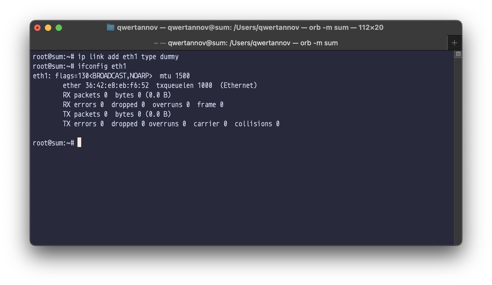

Рисунок 1 – Створення інтерфейсу eth1

Після `ip link set eth1 up` з'являються прапорці `UP` і `LOWER_UP` (рис. 2).

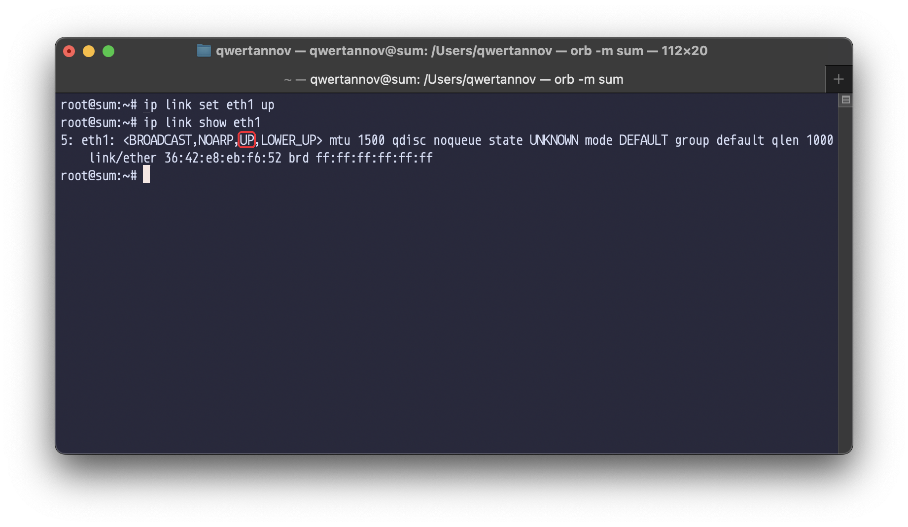

Рисунок 2 – Увімкнення інтерфейсу eth1

У Vim до файлу `/etc/network/interfaces` дописано блок статичної конфігурації `eth1`:
адреса 10.1.1.125, маска 255.0.0.0 і шлюз 10.1.1.1 (рис. 3, 4).

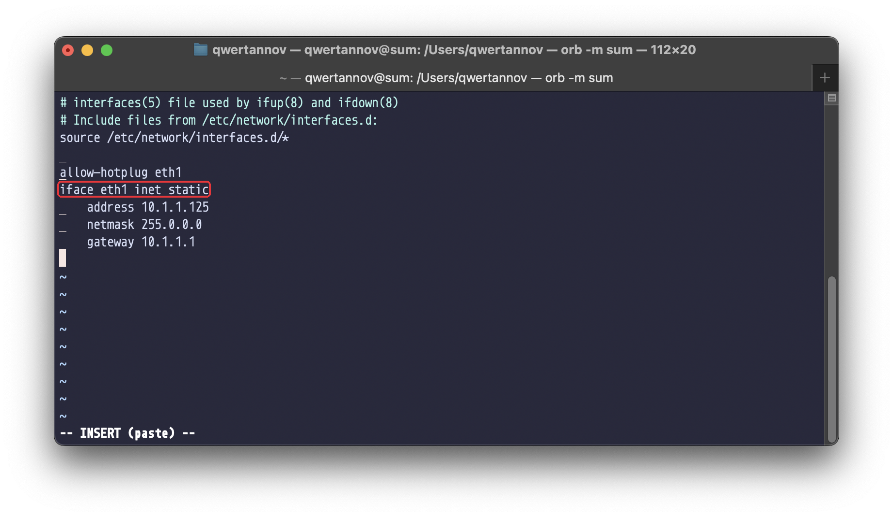

Рисунок 3 – Редагування /etc/network/interfaces у Vim

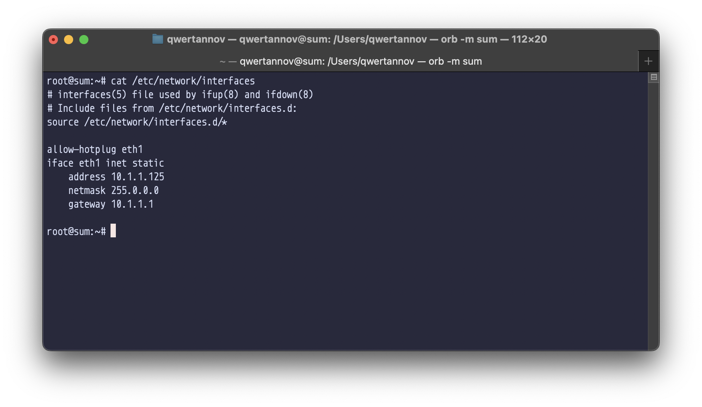

Рисунок 4 – Конфігурація eth1 у файлі interfaces

Після перезапуску сервісу networking інтерфейс отримав адресу 10.1.1.125/8 (рис. 5).

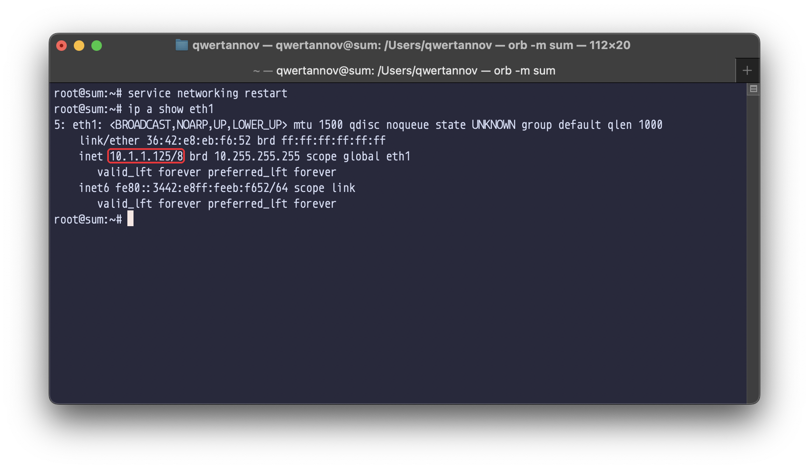

Рисунок 5 – Перезапуск сервісу networking і перевірка адреси

Пінг 8.8.8.8 після цього не проходить (рис. 6). Причина видна в таблиці маршрутизації
(рис. 7): ifupdown додав маршрут за замовчуванням через 10.1.1.1 без метрики, тобто з
метрикою 0. Маршрут через `eth0`, отриманий від DHCP, має метрику 1024, тому ядро обирає
новий маршрут. Dummy-інтерфейс відкидає всі пакети, тож відповіді не повертаються.

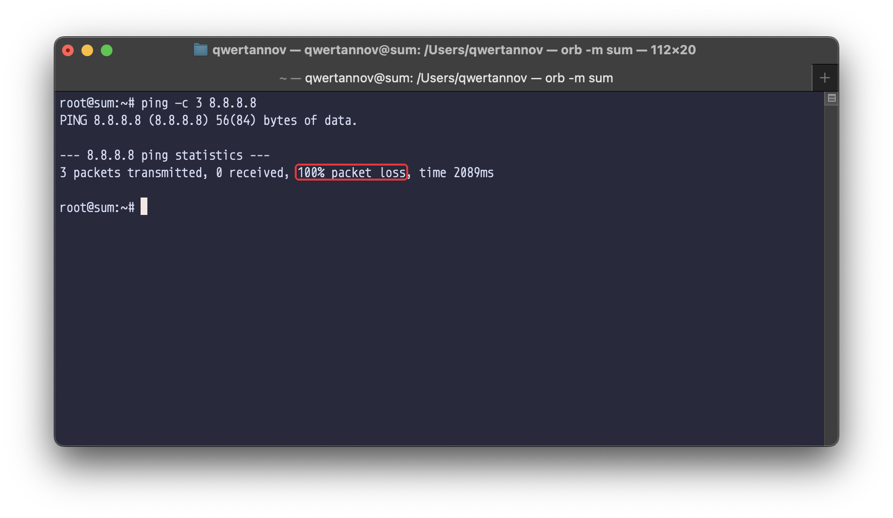

Рисунок 6 – Пінг 8.8.8.8 зі 100 % втрат

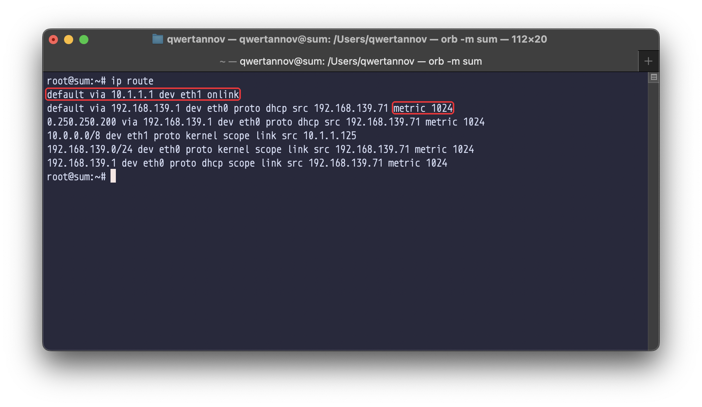

Рисунок 7 – Таблиця маршрутизації до задання метрики

Щоб маршрут через `eth1` став резервним, у конфігурацію додано `metric 2000` (рис. 8).
Значення має бути більшим за метрику робочого маршруту. На цій машині DHCP-маршрут має
метрику 1024, тому з метрикою 700 маршрут через `eth1` усе одно мав би вищий пріоритет
і пінг так само не проходив би.

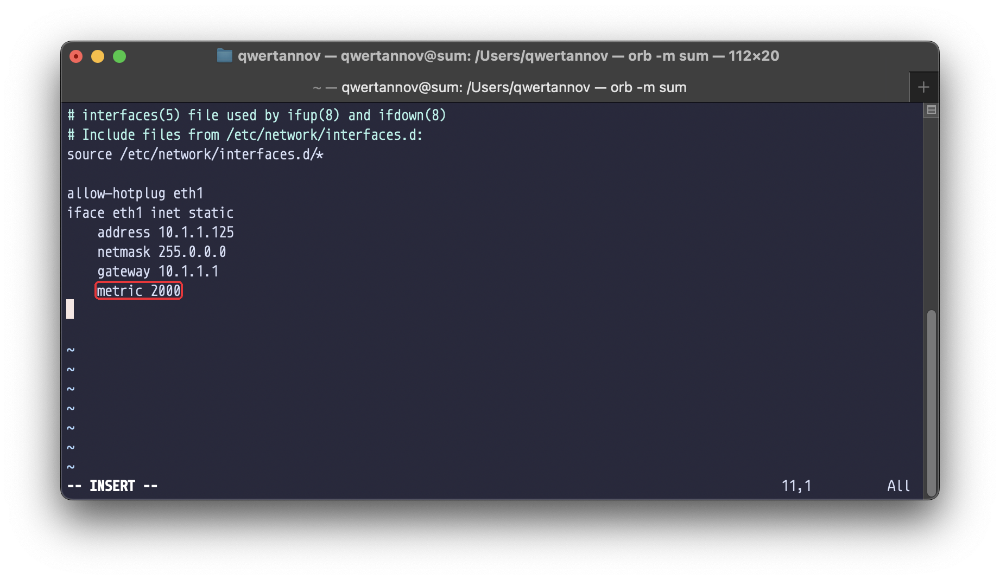

Рисунок 8 – Додавання параметра metric

Після повторного перезапуску маршрут через `eth1` стоїть другим з метрикою 2000
(рис. 9), а пінг 8.8.8.8 проходить без втрат (рис. 10).

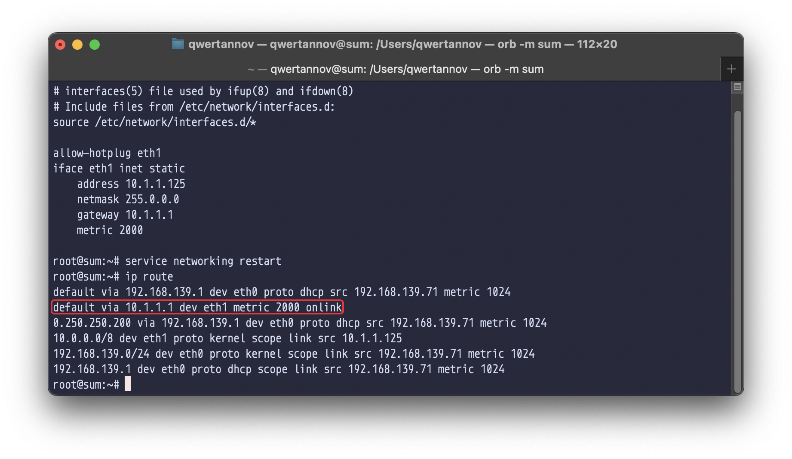

Рисунок 9 – Конфігурація і таблиця маршрутизації з метрикою 2000

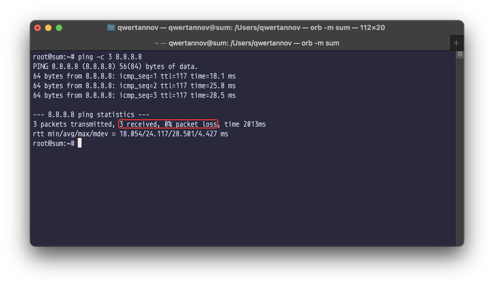

Рисунок 10 – Пінг 8.8.8.8 після задання метрики

## 3.2. Скрипти до ввімкнення та після вимкнення інтерфейсу

Блок `eth1` перенесено з `interfaces` в окремий файл `interfaces.d/eth1`. Основний файл
підключає його рядком `source /etc/network/interfaces.d/*` (рис. 11).

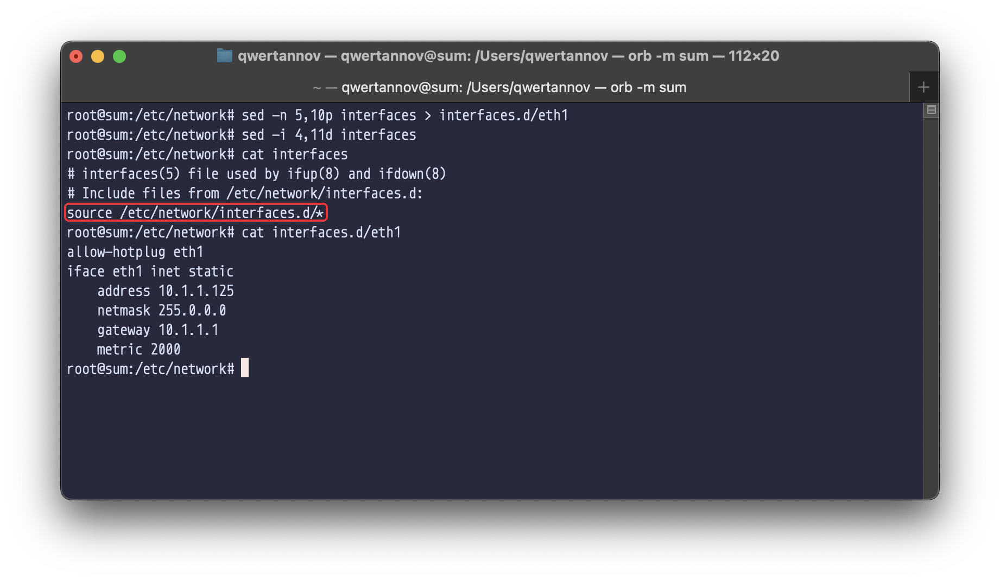

Рисунок 11 – Конфігурація eth1 в interfaces.d

У директоріях `if-pre-up.d` та `if-post-down.d` створено скрипти `eth1`, які пишуть
рядок у `/var/log/eth1.log`. ifupdown запускає ці скрипти для кожного інтерфейсу і
передає його ім'я у змінній `IFACE`, тому скрипт перевіряє, що подія стосується саме
`eth1`. Скрипти мають бути виконуваними, інакше run-parts їх пропускає (рис. 12).

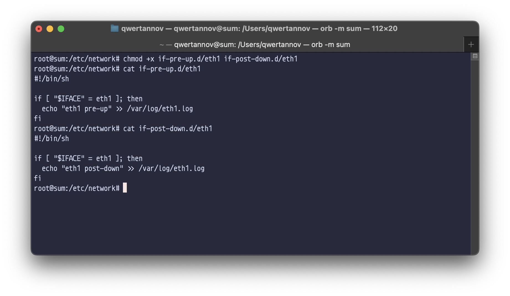

Рисунок 12 – Скрипти для eth1

До першого `ifup` журналу немає. Після `ifup eth1` у ньому з'являється запис
`eth1 pre-up`, після `ifdown eth1` – `eth1 post-down` (рис. 13).

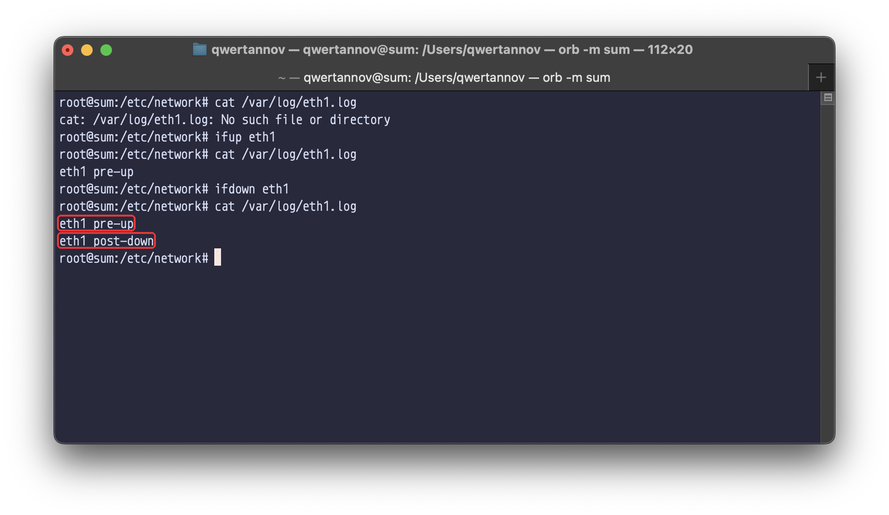

Рисунок 13 – Перевірка виконання скриптів через ifup та ifdown

## 3.3. Налаштування мережевих опцій під час роботи

Опції ядра для IPv4 лежать у `/proc/sys/net/ipv4`. Запис у файл одразу змінює поведінку
мережевого стеку.

### 3.3.1. Ігнорування ICMP echo

При `icmp_echo_ignore_all = 0` пінг 127.0.0.1 проходить (рис. 14). Після запису 1 ядро
перестає відповідати на ICMP echo request, і всі три запити лишаються без відповіді
(рис. 15). Інші типи ICMP, наприклад повідомлення про недосяжність, ця опція не
блокує. Після перевірки значення повернуто на 0.

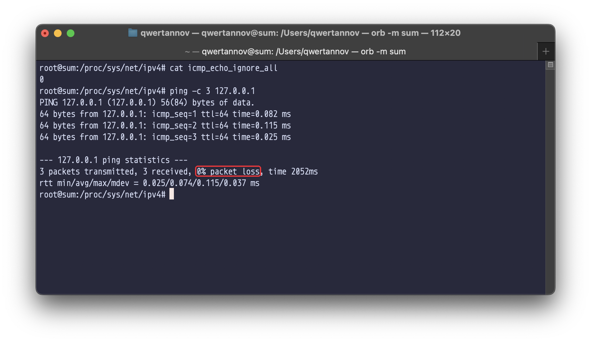

Рисунок 14 – Пінг 127.0.0.1 при icmp_echo_ignore_all = 0

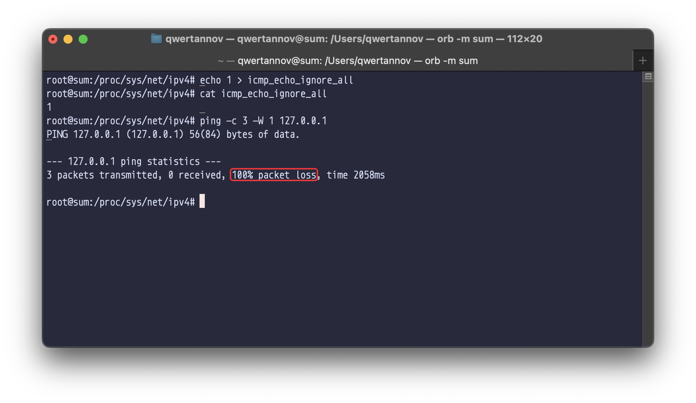

Рисунок 15 – Пінг 127.0.0.1 при icmp_echo_ignore_all = 1

### 3.3.2. Зміна TTL

Поточне значення `ip_default_ttl` – 64. tcpdump на `eth0` показує, що echo request до
8.8.8.8 виходить з `ttl 64` (рис. 16). Після запису 128 запит виходить з `ttl 128`
(рис. 17). TTL відповіді (117) не змінюється: його задає віддалений вузол, а кожен
маршрутизатор на шляху зменшує на 1.

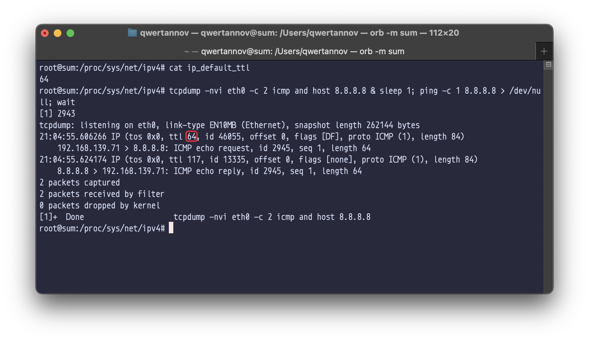

Рисунок 16 – Пакет з ip_default_ttl = 64

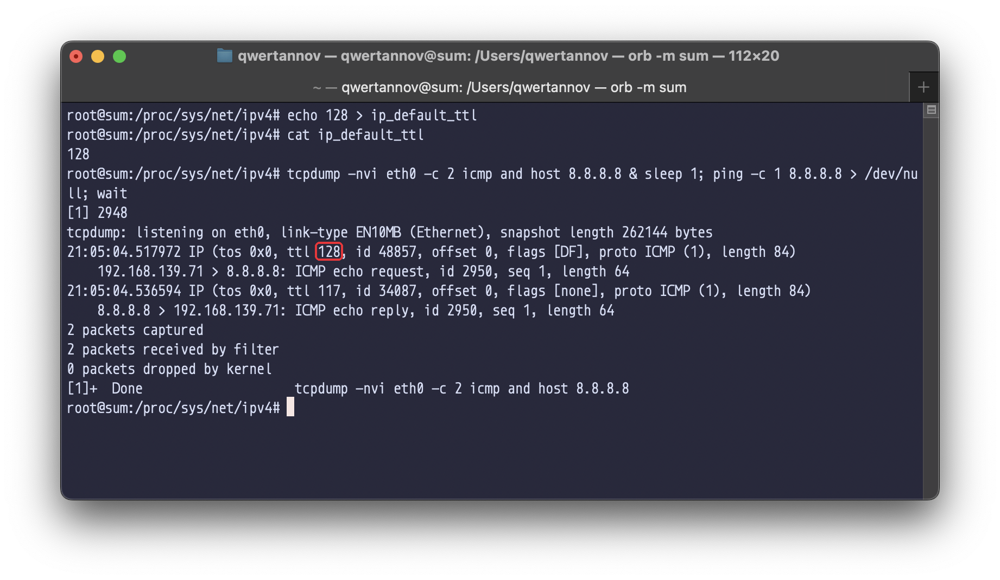

Рисунок 17 – Пакет з ip_default_ttl = 128

## 3.4. Налаштування інтерфейсу без DHCP

Інтерфейс `eth2` описано в `interfaces.d/eth2` з методом `static` (рис. 18). Директива
`auto` піднімає його під час завантаження. Сам dummy-пристрій створюється командою
`pre-up` і видаляється в `post-down`, тому до `ifup` інтерфейсу в системі немає. Адресу
задано в CIDR-записі 172.16.10.5/24 замість окремого `netmask`, а командою `up` додано
статичний маршрут до мережі 172.16.20.0/24.

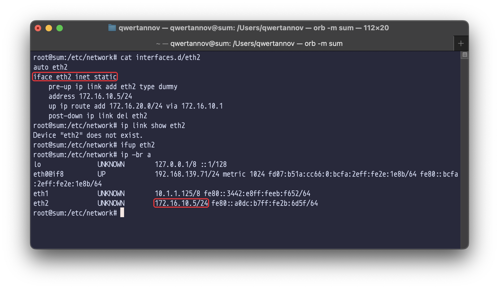

Рисунок 18 – Конфігурація і ввімкнення eth2

Адреса `eth2` має `valid_lft forever`: її не орендовано в DHCP-сервера, і вона не
спливає. Маршрути `eth2` позначені `proto kernel` або взагалі без протоколу, на відміну
від `proto dhcp` у `eth0`. Процесу dhclient у системі немає (рис. 19).

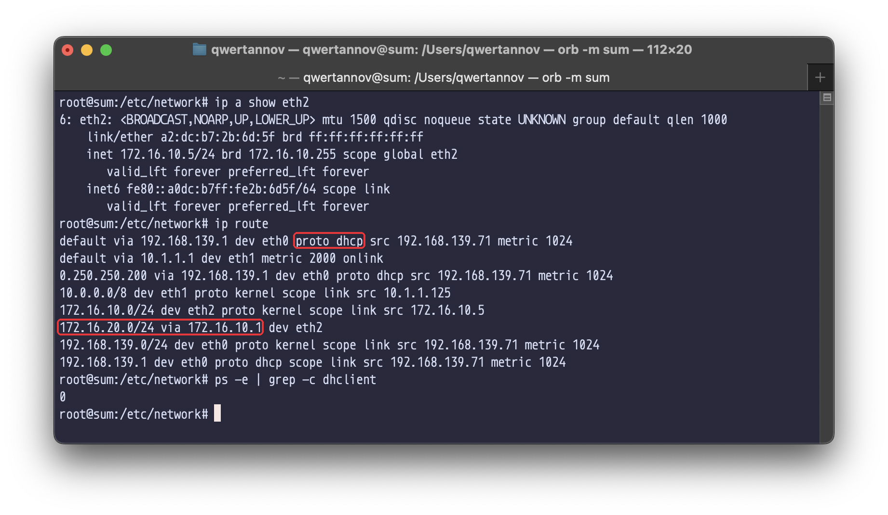

Рисунок 19 – Адреса і маршрути статичного інтерфейсу

## 3.5. Вплив опцій /proc/sys/net/ipv4 на пакети

Крім `ip_default_ttl` і `icmp_echo_ignore_all` з розділу 3.3, перевірено ще три
групи опцій. Для кожної пакет перехоплено tcpdump до і після зміни. Після перевірки
всі значення повернуто до початкових.

`ip_no_pmtu_disc` вимикає визначення MTU шляху. Поки опція дорівнює 0, ядро ставить у
вихідних пакетах прапорець DF (Don't Fragment), щоб маршрутизатор з меншим MTU
повідомив про це через ICMP. При значенні 1 прапорець зникає (`flags [none]`), і
пакет можна фрагментувати по дорозі (рис. 20).

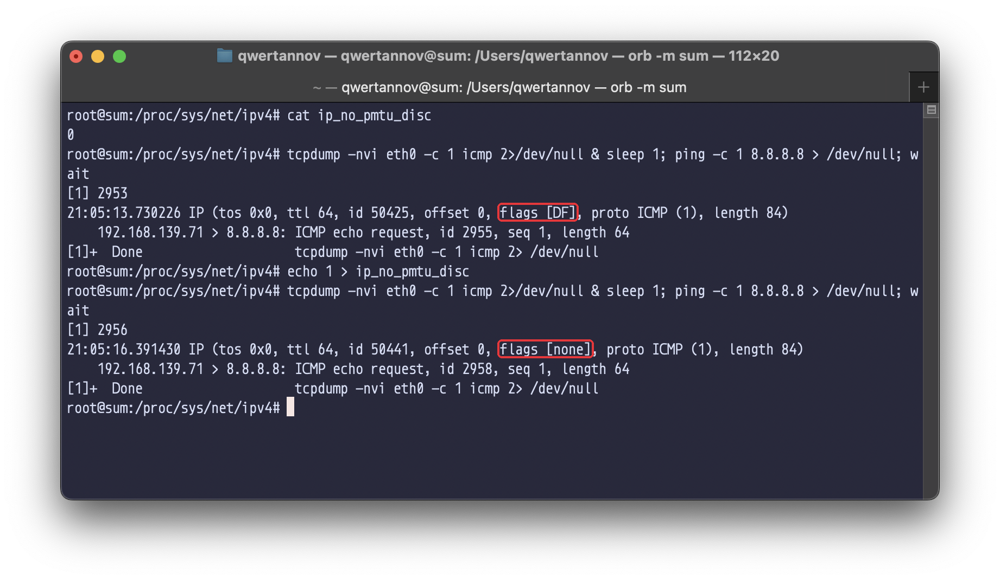

Рисунок 20 – Прапорець DF при ip_no_pmtu_disc = 0 і 1

`tcp_timestamps`, `tcp_sack` і `tcp_window_scaling` керують опціями, які клієнт
пропонує в SYN-сегменті. Зі значеннями 1 SYN до example.com містить
`mss 1460,sackOK,TS val … ecr 0,nop,wscale 10`. Після запису 0 у всі три файли
лишається тільки `mss 1460` (рис. 21). Без цих опцій вікно обмежене 64 КБ, втрачені
сегменти не можна підтвердити вибірково, а RTT оцінюється гірше.

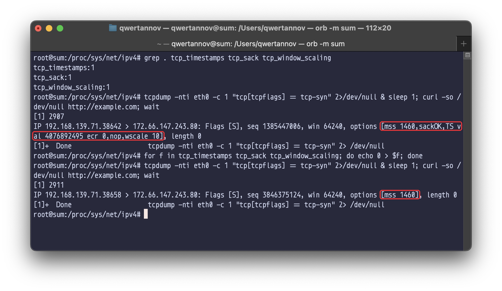

Рисунок 21 – Опції SYN-сегмента до і після вимкнення tcp_timestamps, tcp_sack,
tcp_window_scaling

`ip_local_port_range` задає діапазон портів, з якого ядро бере вихідний порт клієнтського
з'єднання. Зі стандартним діапазоном 32768–60999 з'єднання вийшло з порту 57306. Після
звуження діапазону до одного значення 50000 вихідний порт став 50000 (рис. 22).

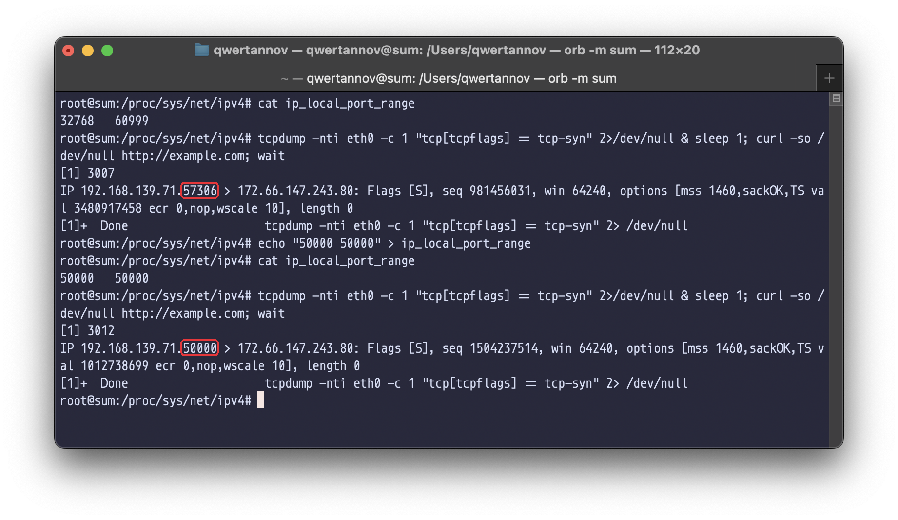

Рисунок 22 – Вихідний порт до і після зміни ip_local_port_range

# IV. Відповіді на контрольні запитання

1. Які мережеві конфігураційні файли існують?

   `/etc/network/interfaces` – опис інтерфейсів для ifupdown. `/etc/network/interfaces.d/` –
   окремі файли інтерфейсів, які підключаються директивою `source`. Директорії
   `if-pre-up.d`, `if-up.d`, `if-down.d`, `if-post-down.d` містять скрипти, що
   виконуються на відповідних етапах. `/sys/class/net/` показує інтерфейси та їх
   параметри, `/proc/sys/net/` – параметри мережевого стеку ядра, `/etc/sysctl.conf` і
   `/etc/sysctl.d/` зберігають їх постійні значення. Також до мережевих належать
   `/etc/hostname`, `/etc/hosts` і `/etc/resolv.conf`.

2. Опишіть процес конфігурування інтерфейсу.

   Інтерфейс з'являється в системі (фізичний пристрій або створений через `ip link add`).
   У `interfaces` чи `interfaces.d` для нього описують блок `iface` з методом (`static`,
   `dhcp`, `loopback`) та параметрами: адреса, маска, шлюз, метрика, команди
   `pre-up`/`up`/`down`/`post-down`. Потім `ifup` або перезапуск сервісу networking
   виконує скрипти `if-pre-up.d`, вмикає інтерфейс, призначає адресу і маршрути, після
   чого виконує `if-up.d`. Результат перевіряють командами `ip a`, `ip route` і `ping`.

3. Яка відмінність між ключовими словами auto/allow-hotplug при конфігуруванні
   інтерфейсу?

   Інтерфейси з `auto` піднімає `ifup -a` під час завантаження системи і при старті
   сервісу networking, навіть якщо пристрою ще немає (тоді `ifup` завершиться помилкою).
   Інтерфейси з `allow-hotplug` піднімаються за подією udev, коли ядро виявляє
   пристрій, тобто тільки коли він справді є. `auto` підходить для постійних
   інтерфейсів, `allow-hotplug` – для знімних пристроїв (USB-адаптери) та інтерфейсів,
   що з'являються пізніше.

4. Для чого можуть бути корисні скрипти, які знаходяться в if-pre-up (та аналогічних
   директоріях)?

   Вони дають виконати довільні дії на кожному етапі життя інтерфейсу: створити
   віртуальний пристрій чи VLAN перед ввімкненням, завантажити правила файрвола,
   налаштувати додаткові маршрути або DNS після ввімкнення, запустити чи зупинити
   VPN-сервіс, зберегти стан і записати подію в журнал перед вимкненням. Скрипт
   отримує ім'я інтерфейсу та метод у змінних `IFACE`, `METHOD`, `MODE`, тому одну
   логіку можна застосувати до різних інтерфейсів.

5. Опишіть будь-які 5 опцій, які знаходяться в директорії /proc/sys/net/ipv4.

   - `ip_default_ttl` – початкове значення TTL у вихідних IP-пакетах (типово 64).
   - `icmp_echo_ignore_all` – при 1 ядро не відповідає на ICMP echo request.
   - `ip_forward` – при 1 вузол пересилає пакети між інтерфейсами, тобто працює як
     маршрутизатор.
   - `ip_no_pmtu_disc` – при 1 вимикає визначення MTU шляху, пакети йдуть без
     прапорця DF.
   - `ip_local_port_range` – діапазон локальних портів для вихідних з'єднань.
   - `tcp_syncookies` – захист від SYN-флуду: при переповненні черги з'єднань сервер
     кодує стан у номері послідовності SYN-ACK замість зберігати його.

6. Чи збережуться зміни в файлах директорії /proc/sys/net/ipv4 після перезавантаження
   системи?

   Ні. `/proc` – віртуальна файлова система, її файли відображають змінні ядра в
   оперативній пам'яті, і після перезавантаження ядро стартує з типовими значеннями.
   Щоб зміна була постійною, її записують у `/etc/sysctl.conf` або файл у
   `/etc/sysctl.d/` (наприклад, `net.ipv4.ip_default_ttl = 128`), і systemd-sysctl
   застосовує його під час завантаження.

# V. Висновки

У роботі налаштовано мережеві інтерфейси Debian через конфігураційні файли ifupdown і
редактор Vim.

1. Статичний інтерфейс `eth1` налаштовано через `/etc/network/interfaces`. Шлюз без
   метрики перебив робочий маршрут за замовчуванням і зв'язок зник. Метрика 2000, більша
   за 1024 у DHCP-маршруту, зробила маршрут резервним і відновила зв'язок.
2. Конфігурацію винесено в `interfaces.d`, а скрипти `if-pre-up.d` та `if-post-down.d`
   спрацювали на `ifup` і `ifdown`, що видно з журналу.
3. Інтерфейс `eth2` налаштовано без DHCP: адреса і маршрути статичні, dummy-пристрій
   створюється й видаляється командами `pre-up` і `post-down`.
4. Опції `/proc/sys/net/ipv4` змінюють пакети одразу: `ip_default_ttl` задає TTL,
   `ip_no_pmtu_disc` прибирає DF, `tcp_timestamps`, `tcp_sack` і `tcp_window_scaling`
   прибирають опції із SYN, `ip_local_port_range` визначає вихідний порт,
   `icmp_echo_ignore_all` вимикає відповіді на пінг. Ці зміни діють до
   перезавантаження.
