# І. Мета

Ознайомитись з мережевими інструментами в Linux, які використовуються для відладки та
налаштування мережі.

# ІІ. Постановка завдання та алгоритм розв'язання

Завдання:

1. Підготувати середовище з двох Docker-контейнерів host1 і host2 (завдання 2.1).
2. Вручну налаштувати зв'язок між host1 і host2 через брідж і пару veth-інтерфейсів
   (завдання 2.2).
3. Заблокувати відповіді на пінг на host1 (завдання 2.3).
4. Підняти на host1 простий веб-сервер на netcat і зробити до нього запит з host2
   (завдання 2.4).
5. Сконфігурувати `eth1.1` та `eth1.2` через файл interfaces (додаткове завдання 2.5).
6. Дослідити інші випадки використання утиліт (додаткове завдання 2.6).
7. Дослідити network namespaces (додаткове завдання 2.7).

Середовище: Debian 12 (OrbStack, macOS), Docker 20.10 і docker-compose 1.29, контейнери
на образі ubuntu:20.04.

Алгоритм розв'язання:

1. Описати образ з мережевими утилітами в Dockerfile, а два привілейовані контейнери з
   фіксованими адресами 10.10.0.2 і 10.10.0.3 – у docker-compose.yml. Запустити їх і
   перевірити зв'язок між ними.
2. У кожному контейнері створити брідж `br0` і пару veth `eth1.1`/`eth1.2`, включити в
   брідж `eth0` і `eth1.1`, призначити `eth1.2` адресу з мережі 10.11.0.0/24.
3. Перевірити пінг між адресами 10.11.0.1 і 10.11.0.2 до і після ввімкнення бріджів.
4. Знайти через `sysctl` опцію, яка вимикає відповіді на ICMP echo, встановити її на
   host1 і перевірити пінг з host2.
5. Запустити на host1 скрипт, що в циклі віддає HTML-сторінку через `nc -l`, знайти
   відкритий порт у `netstat` і зробити запит з host2.
6. Описати ту саму конфігурацію host1 в `/etc/network/interfaces.d` і підняти її
   командою `ifup`.
7. Перевірити `ethtool`, `nmap`, `tcpdump`, `ping -f`, `arping`, `ip neigh` та
   `iptables` на створеній мережі.
8. Створити network namespace, з'єднати його з host2 парою veth і налаштувати
   маршрутизацію.

# ІІІ. Хід виконання

## 3.1. Підготовка середовища

Образ будується з ubuntu:20.04, у нього доставлено утиліти, потрібні в роботі: `iproute2`,
`net-tools`, `bridge-utils`, `ifupdown`, `ethtool`, `nmap`, `netcat`, `tcpdump`,
`iptables`, `arping` (рис. 1).

У docker-compose.yml описано два сервіси з одного образу. Кожен має власне ім'я хоста й
контейнера, фіксовану адресу в мережі `default` і режим `privileged`. Без нього контейнер
не може створювати мережеві пристрої та змінювати параметри ядра. `tty: true` тримає
`bash` запущеним, щоб контейнер не завершувався одразу після старту. Мережа `default`
– Docker-брідж з підмережею 10.10.0.0/24 (рис. 1, 2).

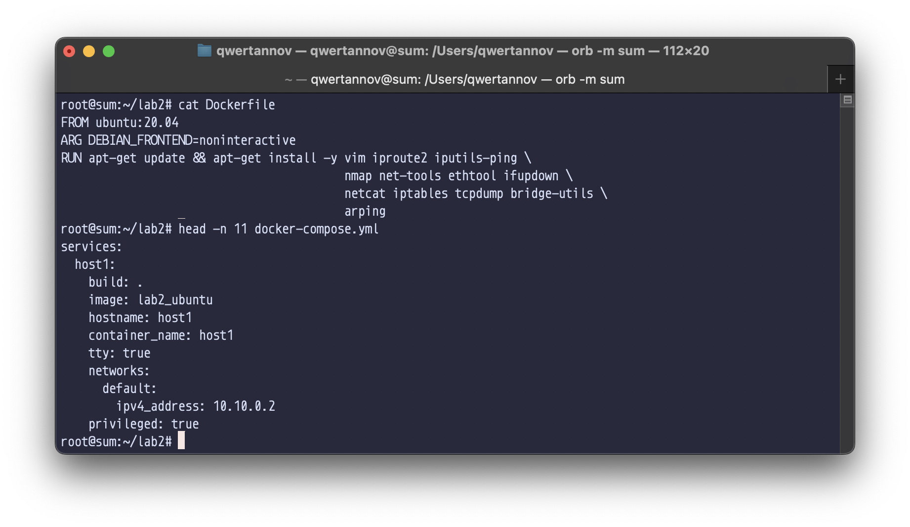

Рисунок 1 – Dockerfile і початок docker-compose.yml

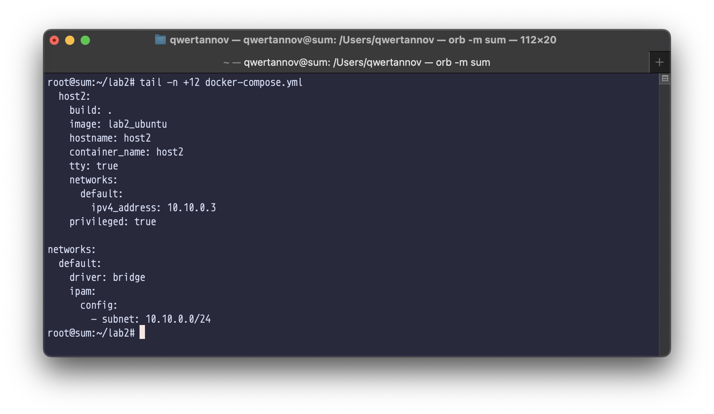

Рисунок 2 – Кінець docker-compose.yml

`docker-compose up -d --build` збирає образ і створює обидва контейнери (рис. 3).
`docker-compose ps` показує, що вони працюють (рис. 4).

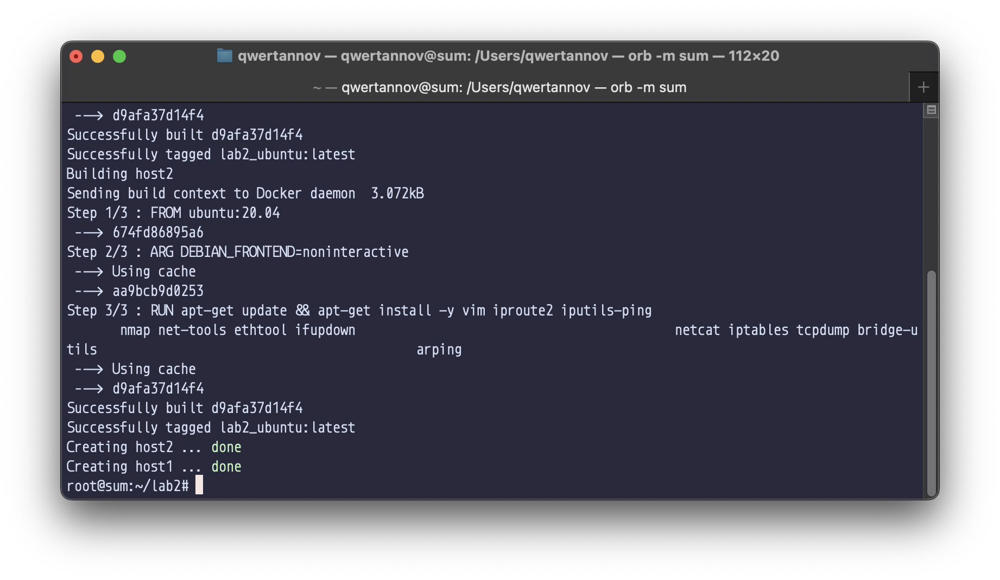

Рисунок 3 – Збірка образу й запуск контейнерів

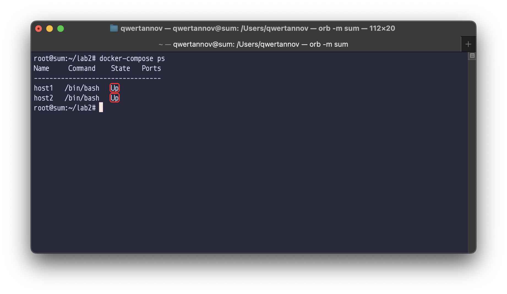

Рисунок 4 – Стан контейнерів host1 і host2

Усередині host1 ім'я host2 резолвиться вбудованим DNS Docker в адресу 10.10.0.3, пінг
проходить без втрат (рис. 5).

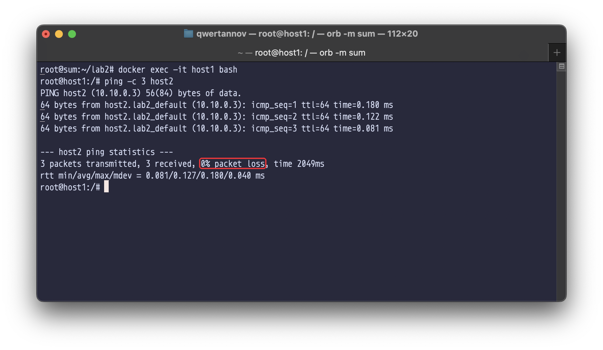

Рисунок 5 – Пінг host2 з host1

## 3.2. Ручне налаштування зв'язку між host1 і host2

На host1 створено брідж `br0` і пару veth: `eth1.1` і `eth1.2` – два кінці одного
віртуального кабелю. Усі нові інтерфейси вимкнені, `br0` поки не має портів (рис. 6).

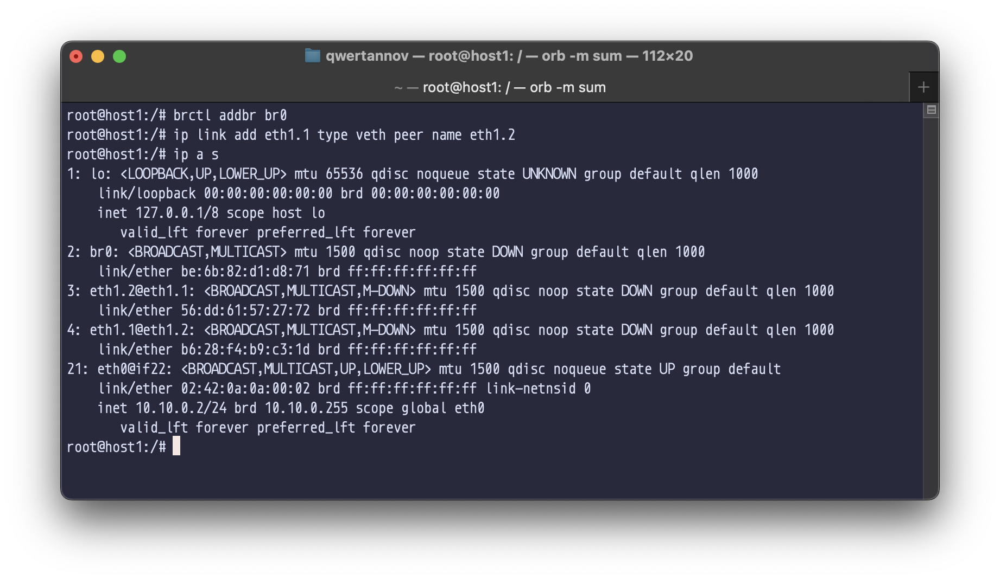

Рисунок 6 – Створення br0 і пари eth1.1/eth1.2 на host1

У брідж включено `eth0` і `eth1.1`. Брідж узяв MAC-адресу `eth0`, це видно з
ідентифікатора `8000.02420a0a0002` (рис. 7).

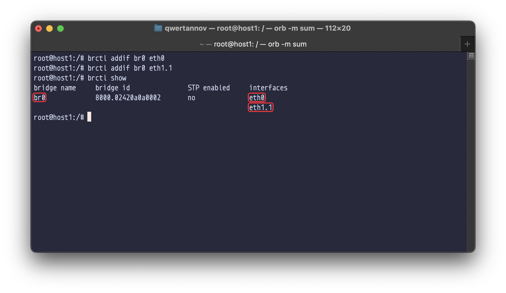

Рисунок 7 – Включення eth0 і eth1.1 у br0

Інтерфейсу `eth1.2` призначено адресу 10.11.0.1/24 (рис. 8), після чого обидва кінці
veth увімкнено. У `eth1.1` з'явилося `master br0`, тобто він працює як порт бріджу і
власної адреси не має (рис. 9).

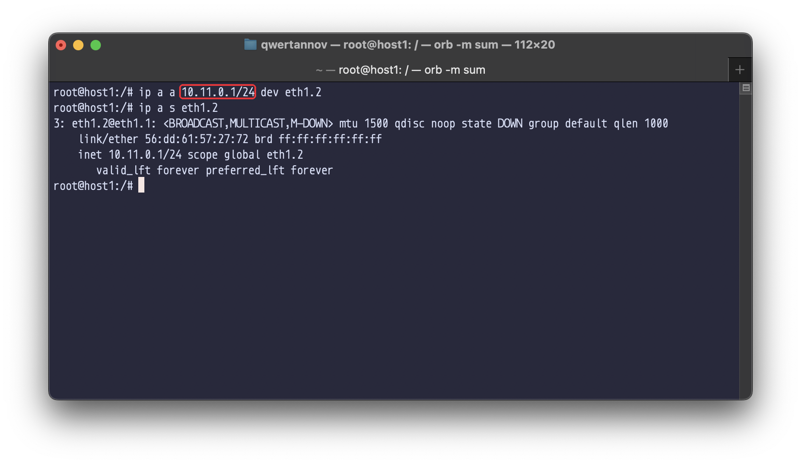

Рисунок 8 – Адреса 10.11.0.1/24 на eth1.2

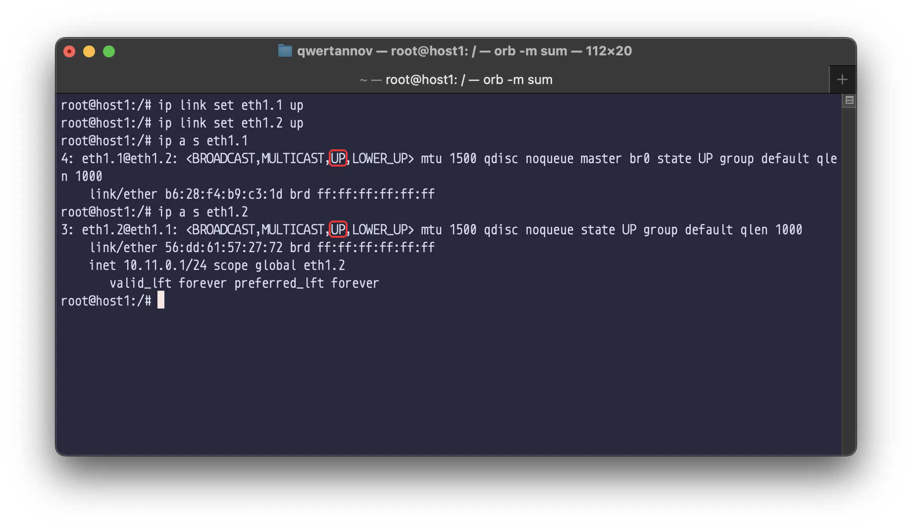

Рисунок 9 – Ввімкнення інтерфейсів eth1.1 і eth1.2 на host1

На host2 виконано ті самі кроки з адресою 10.11.0.2/24 (рис. 10).

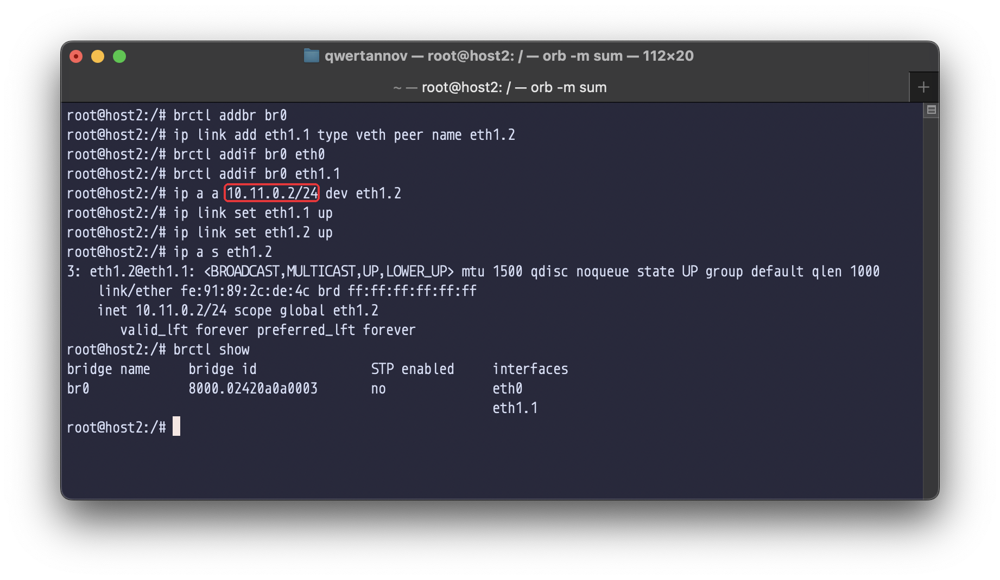

Рисунок 10 – Налаштування бріджу й інтерфейсів на host2

Пінг 10.11.0.1 з host2 не проходить: `Destination Host Unreachable` (рис. 11). `br0`
в обох контейнерах вимкнений і кадри не пересилає, тож ARP-запит з `eth1.2` не виходить
далі `eth1.1`. Без відповіді на ARP ядро не знає MAC-адреси отримувача і повідомляє, що
вузол недосяжний.

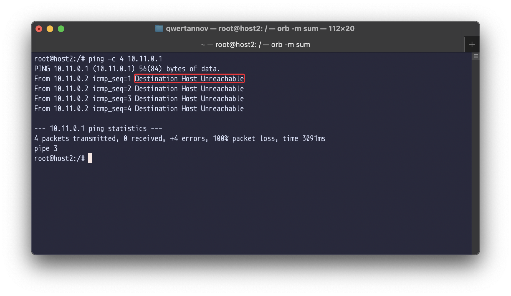

Рисунок 11 – Пінг 10.11.0.1 до ввімкнення бріджів

Після `ip link set br0 up` на host2 (рис. 12) і на host1 (рис. 13) пінг проходить без
втрат (рис. 14). Шлях пакета: `eth1.2` → `eth1.1` → `br0` → `eth0` host2 → Docker-брідж
→ `eth0` host1 → `br0` → `eth1.1` → `eth1.2`. Мережа 10.11.0.0/24 працює поверх тієї
самої L2-мережі, що й 10.10.0.0/24.

Рисунок 12 – Ввімкнення br0 на host2

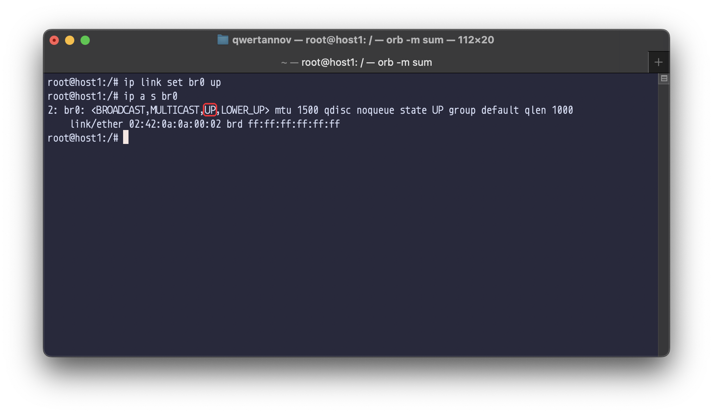

Рисунок 13 – Ввімкнення br0 на host1

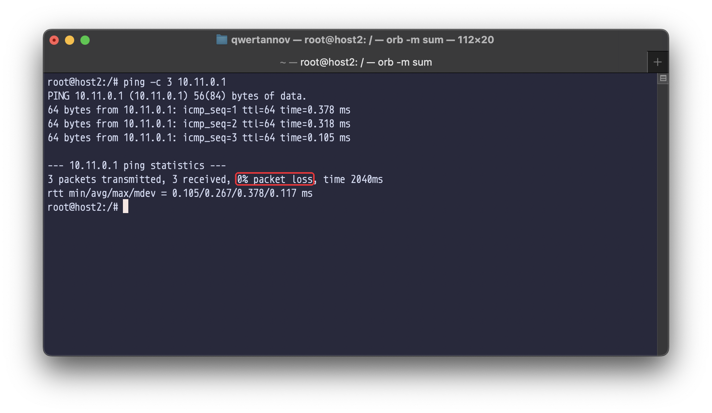

Рисунок 14 – Пінг 10.11.0.1 після ввімкнення бріджів

## 3.3. Блокування пінгу на host1

`sysctl -a` виводить усі параметри ядра, фільтр за `ipv4.icmp` залишає опції ICMP. За
відповіді на echo request відповідає `net.ipv4.icmp_echo_ignore_all`, зараз 0 (рис. 15).

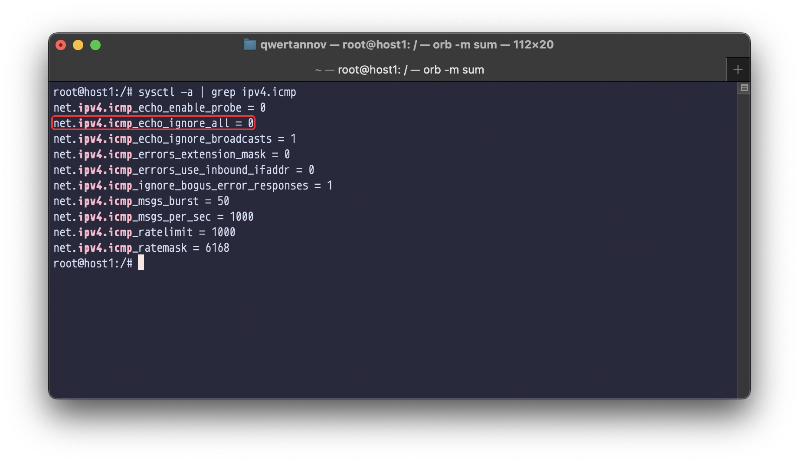

Рисунок 15 – Опції ICMP для IPv4

Значення змінено на 1 (рис. 16). Після цього всі три запити з host2 лишаються без
відповіді (рис. 17). На відміну від рис. 11 помилок `Destination Host Unreachable`
немає: ARP працює, пакети доходять до host1, але ядро host1 їх мовчки відкидає.

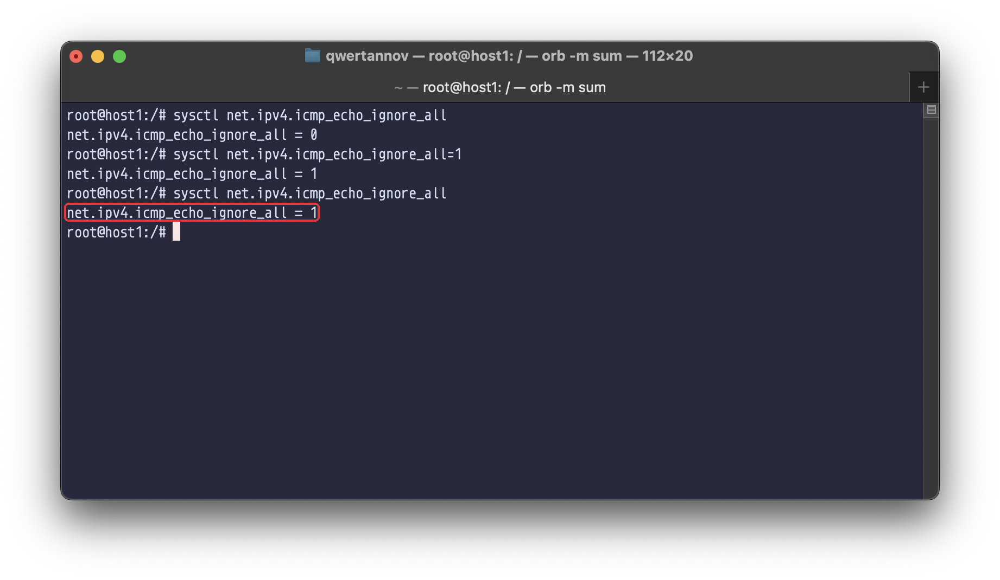

Рисунок 16 – Встановлення icmp_echo_ignore_all = 1

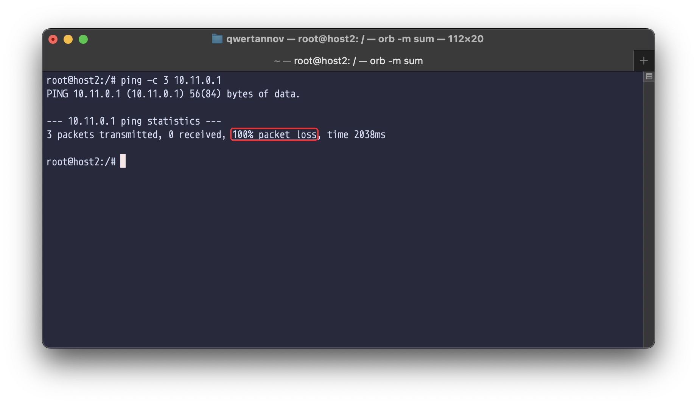

Рисунок 17 – Пінг 10.11.0.1 при icmp_echo_ignore_all = 1

## 3.4. Веб-сервер на netcat

У `/tmp` на host1 лежить сторінка `index.html` і скрипт `server.sh`. У нескінченному
циклі скрипт формує HTTP-відповідь із заголовком `Content-Length` і вмістом сторінки та
передає її в `nc -l -p 8080`. netcat чекає на одне з'єднання, віддає відповідь і
завершується, після чого цикл запускає його знову. Скрипт запущено у фоні (рис. 18).

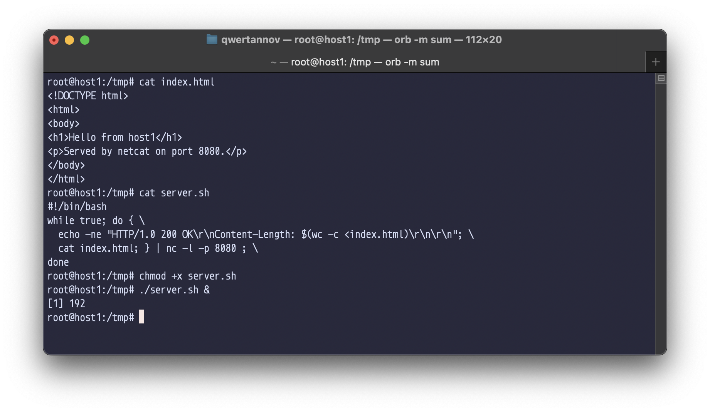

Рисунок 18 – Сторінка, скрипт сервера і його запуск

`netstat -lpnut` показує TCP-сокет у стані `LISTEN` на `0.0.0.0:8080`, яким володіє
процес `nc` (рис. 19).

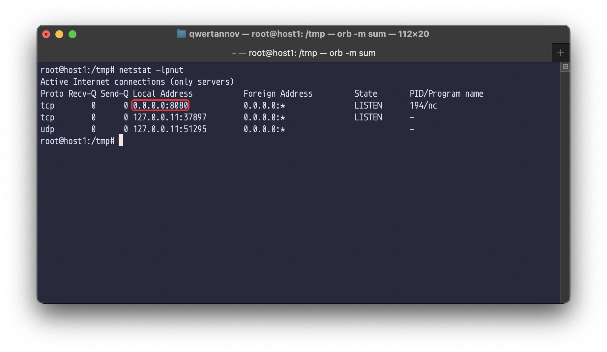

Рисунок 19 – Порт 8080 у netstat на host1

З host2 `nc` підключається до 10.11.0.1:8080 і отримує відповідь `HTTP/1.0 200 OK` зі
сторінкою (рис. 20). Опція `-w 1` закриває з'єднання після секунди без даних.

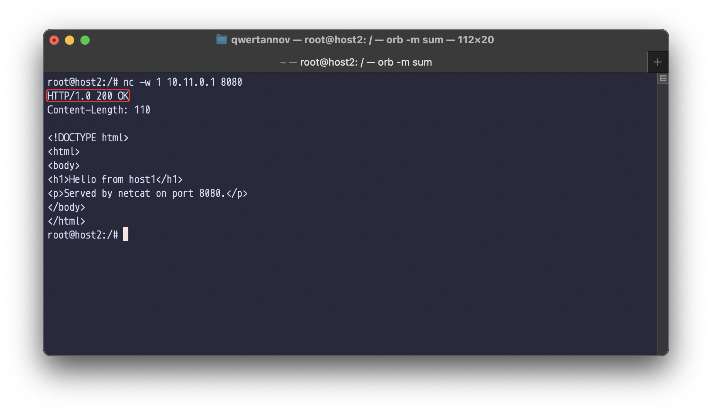

Рисунок 20 – HTTP-запит до host1 через nc

## 3.5. Конфігурація через файл interfaces

Ручну конфігурацію host1 прибрано й описано в `/etc/network/interfaces.d/lab2` (рис. 21).
Блок `eth1.2` створює пару veth командою `pre-up` і видаляє її в `post-down`. Блок `br0`
задає порти директивою `bridge_ports`, її обробляє скрипт з пакета bridge-utils у
`if-pre-up.d`. `bridge_fd 0` і `bridge_maxwait 0` прибирають затримку перед тим, як
порти почнуть пересилати кадри. `ifquery` показує, як ifupdown розібрав блок `eth1.2`:
маску й broadcast-адресу він вивів з `/24`.

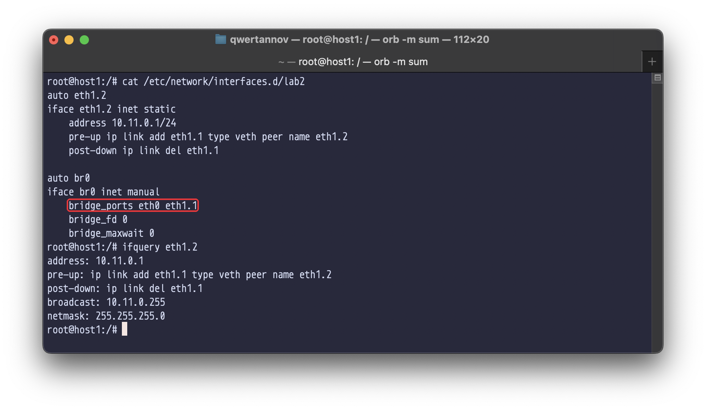

Рисунок 21 – Конфігурація eth1.2 і br0 у файлі interfaces

`ifup -a` піднімає обидва блоки з `auto`. Результат той самий, що й після ручних команд
(рис. 22), і пінг з host2 проходить (рис. 23).

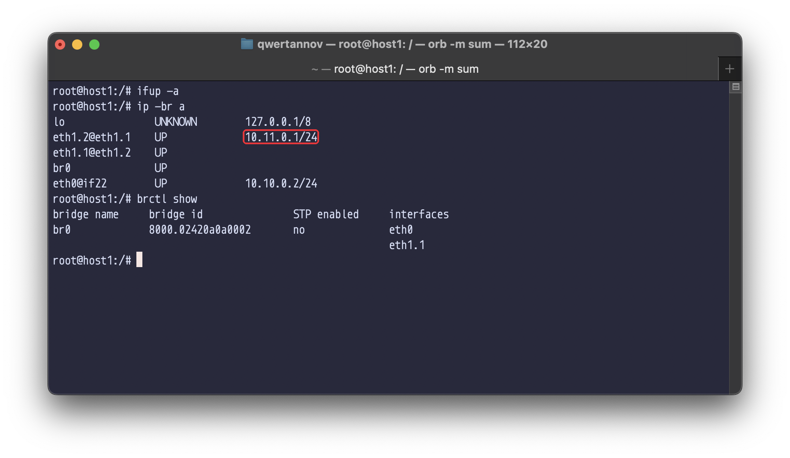

Рисунок 22 – Інтерфейси після ifup -a

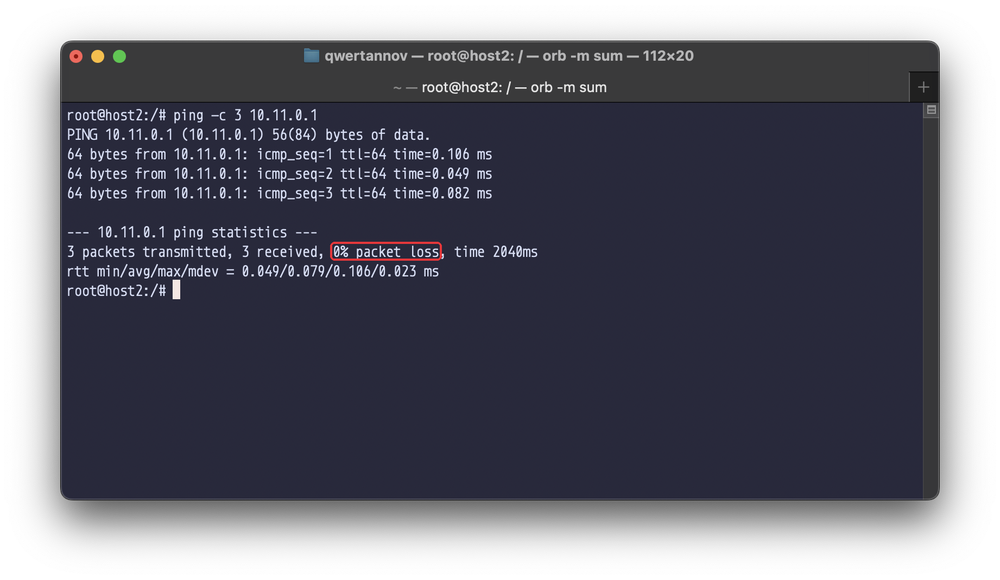

Рисунок 23 – Пінг 10.11.0.1 після налаштування через interfaces

## 3.6. Інші випадки використання утиліт

`ethtool -i` показує драйвер інтерфейсу: `eth1.2` – віртуальний пристрій `veth`.
Для `eth0` ethtool повідомляє швидкість 10000 Мб/с, повний дуплекс і наявність лінку
(рис. 24).

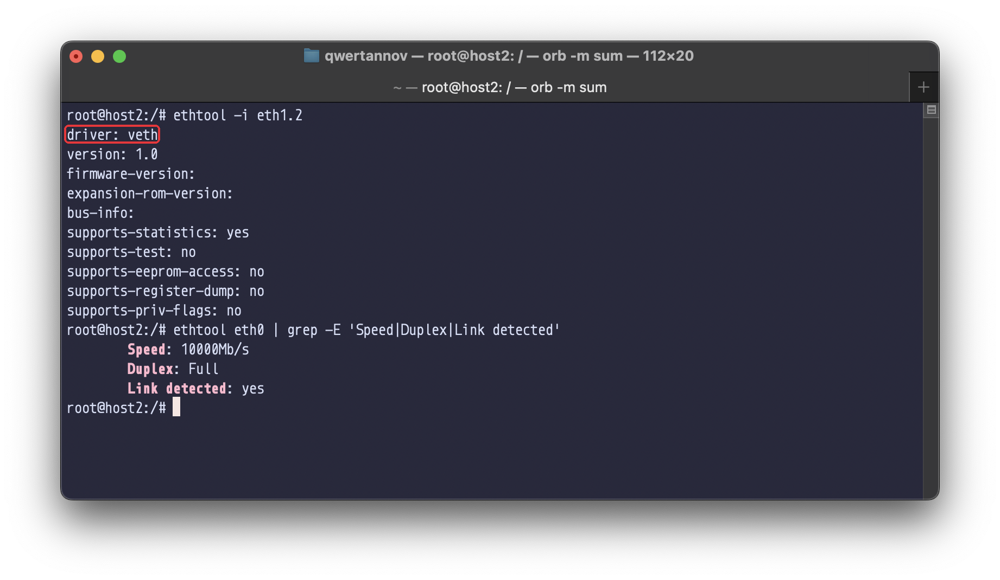

Рисунок 24 – Драйвер і параметри лінку в ethtool

`nmap` просканував порти 1–10000 на host1 і знайшов відкритим тільки 8080, де працює
сервер з розділу 3.4. MAC-адресу вузла nmap визначив через ARP, бо вузол в одній
L2-мережі зі сканером (рис. 25).

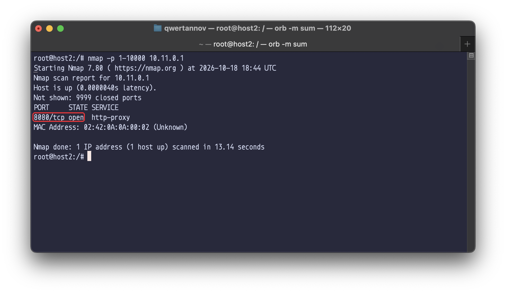

Рисунок 25 – Сканування портів host1

`tcpdump` на `eth1.2` перехопив два echo request від host2 і два echo reply від host1
(рис. 26). Фільтр `icmp` відсіює ARP та інший трафік, а `-c 4` зупиняє захоплення після
четвертого пакета.

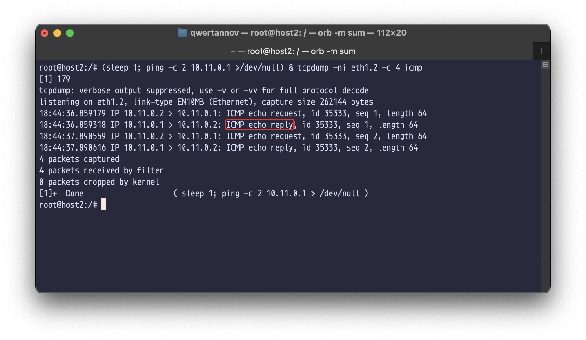

Рисунок 26 – Перехоплення ICMP через tcpdump

`ping -f` надсилає наступний запит одразу після відповіді, не чекаючи секунду. 1000
запитів пройшли за 6 мс без втрат (рис. 27). На реальній мережі такий режим
використовують для навантажувального тестування, а як атаку на вузол – для ICMP-флуду.

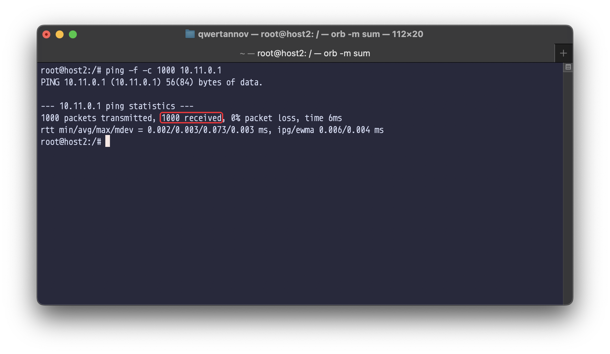

Рисунок 27 – Flood-пінг host1

`arping` надсилає ARP-запити напряму, без IP. На кожен із трьох запитів прийшло по дві
відповіді з різних MAC (рис. 28). Запит через брідж доходить і до `br0` (MAC
`02:42:0a:0a:00:02`), і до `eth1.2` (MAC `26:2c:38:a1:0d:2b`). Linux типово відповідає
на ARP за будь-яку свою адресу з будь-якого інтерфейсу. `ip neigh` показує, що в
ARP-кеш host2 потрапила адреса `br0`. Записи для 10.10.0.2 і 10.10.0.1 мають стан
`FAILED`, бо `eth0` host2 тепер порт бріджу і власною адресою не користується.

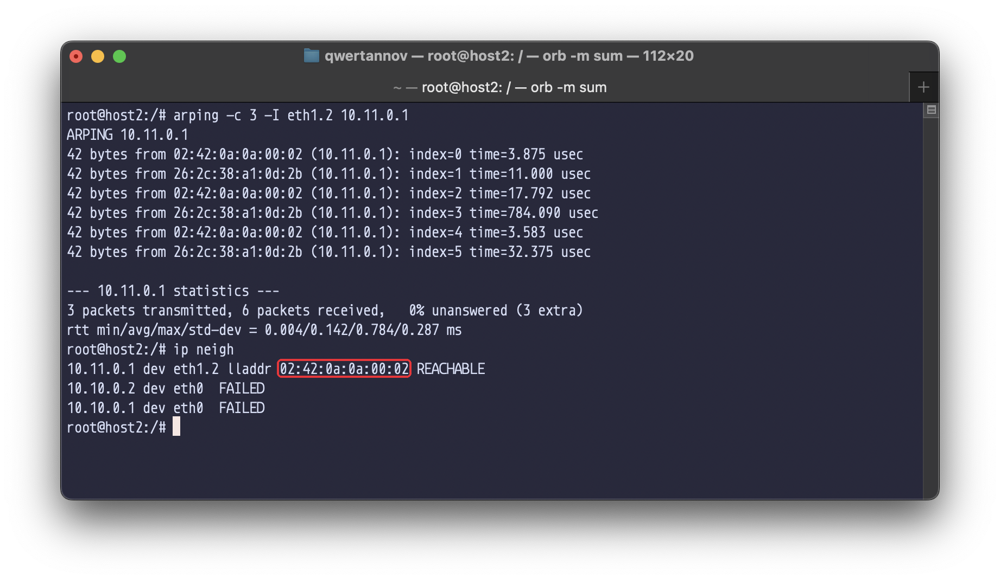

Рисунок 28 – ARP-запити й таблиця сусідів host2

На host1 додано правило `iptables`, яке відхиляє TCP-з'єднання на порт 8080 (рис. 29).
`nc -zv` з host2 тепер отримує `Connection refused` (рис. 30), хоча сервер і далі слухає
порт: відповідь формує netfilter до того, як пакет дійде до сокета. Після перевірки
правило видалено.

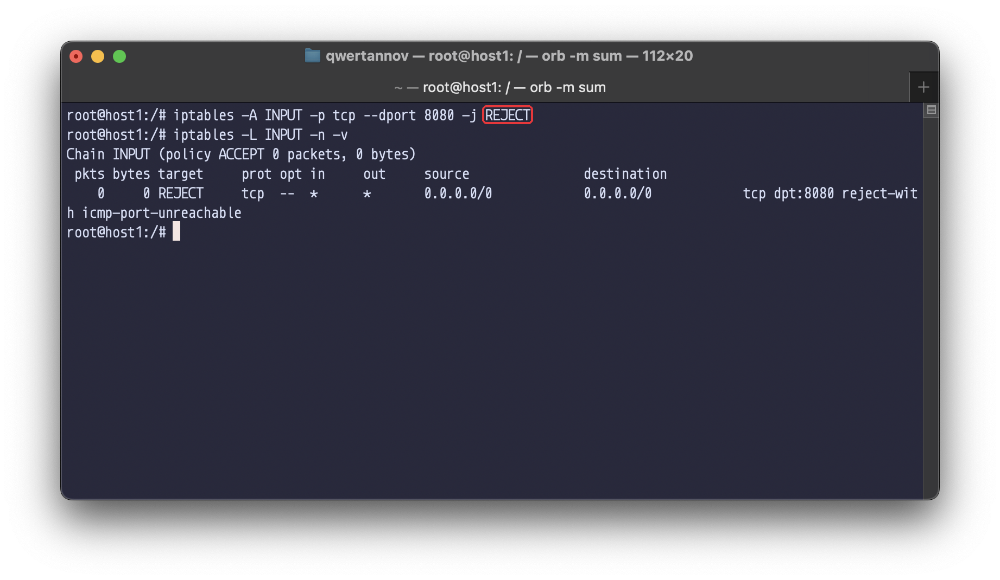

Рисунок 29 – Правило REJECT для порту 8080 на host1

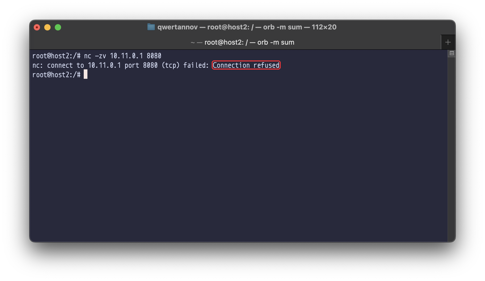

Рисунок 30 – Підключення до порту 8080 після додавання правила

## 3.7. Network namespaces

На host2 створено namespace `red` і пару veth. Кінець `veth-r` перенесено в `red`, тож
у `ip -br a` host2 він більше не видно, а всередині `red` є тільки він і власний
вимкнений `lo` (рис. 31). Namespace має окремий набір інтерфейсів, адрес, маршрутів і
правил netfilter.

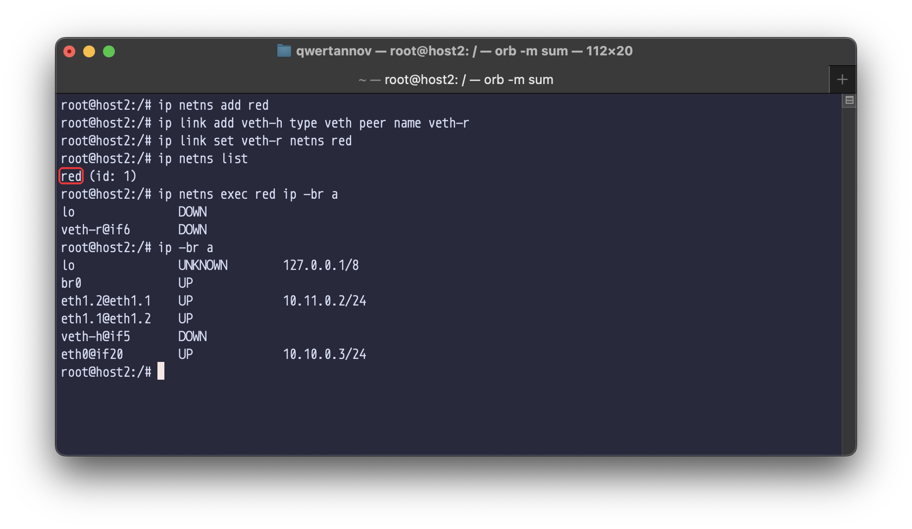

Рисунок 31 – Створення namespace red і перенесення veth-r

Кінцям veth призначено адреси 10.12.0.1/24 на host2 і 10.12.0.2/24 у `red`. Після
ввімкнення інтерфейсів пінг між ними проходить (рис. 32).

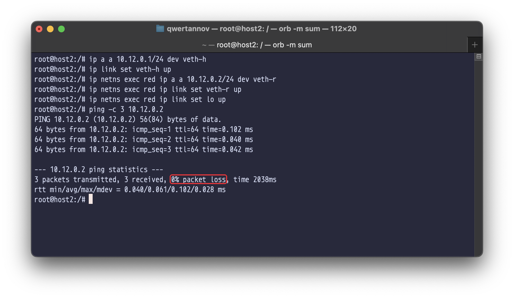

Рисунок 32 – Зв'язок між host2 і namespace red

Таблиця маршрутизації `red` містить тільки маршрут до 10.12.0.0/24, тому адреса
10.11.0.2 з нього недосяжна: `Network is unreachable` (рис. 33). Після додавання
маршруту за замовчуванням через 10.12.0.1 пінг проходить. Пересилання між інтерфейсами
тут не потрібне, бо 10.11.0.2 – локальна адреса host2.

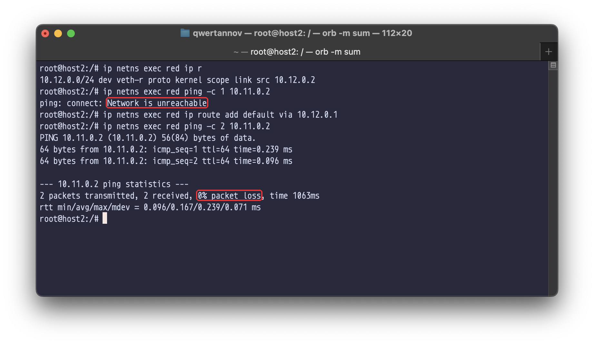

Рисунок 33 – Маршрут за замовчуванням у namespace red

# IV. Відповіді на контрольні запитання

1. Які 3 утиліти найважливіші та цікавіші на вашу думку?

   `ip` замінює `ifconfig`, `route`, `arp` і `brctl`: однією утилітою можна налаштувати
   інтерфейси, адреси, маршрути, сусідів і namespaces. `tcpdump` показує, що реально
   проходить через інтерфейс. Без нього не видно, чи пакет не дійшов, чи на нього не
   відповіли, як на рис. 11 і 17. `nc` відкриває і приймає TCP- та UDP-з'єднання з
   командного рядка. Ним можна перевірити порт, передати файл або, як у розділі 3.4,
   зібрати простий сервер.

2. Як може використовуватись ICMP протокол?

   ICMP передає службові повідомлення IP. Echo request і echo reply використовує `ping`
   для перевірки доступності вузла й вимірювання затримки. Destination Unreachable
   повідомляє, що вузол, мережа чи порт недосяжні (рис. 11). Time Exceeded надсилає
   маршрутизатор, коли TTL пакета закінчився, на цьому побудований `traceroute`.
   Fragmentation Needed використовується для визначення MTU шляху, Redirect підказує
   вузлу кращий шлюз. ICMP також використовують для атак: flood-пінг перевантажує
   вузол, а розсилка echo на broadcast-адресу з підробленою адресою відправника (smurf)
   спрямовує відповіді на жертву. Тому відповіді на echo обмежують параметрами
   `icmp_echo_ignore_all`, `icmp_echo_ignore_broadcasts`, `icmp_ratelimit` або
   правилами файрвола.

3. Навіщо було потрібно створювати bridge в контейнерах?

   Пара veth з'єднує тільки свої два кінці всередині одного контейнера. Щоб `eth1.2`
   опинився в одній L2-мережі з `eth1.2` іншого контейнера, кінець `eth1.1` треба
   з'єднати з `eth0`, який веде в Docker-мережу. Брідж працює як віртуальний комутатор:
   пересилає кадри між портами за MAC-адресами. У результаті ARP і IP-пакети мережі
   10.11.0.0/24 проходять через ту саму Docker-мережу, що й 10.10.0.0/24, без
   маршрутизації між ними.

4. Чому неможливо пропінгувати інтерфейс, який знаходиться в bridge?

   Інтерфейс, включений у брідж, перестає бути самостійним IP-інтерфейсом. Усі кадри,
   які він приймає, ядро передає обробнику бріджу, і в IP-стек вони потрапляють уже від
   імені `br0`. Адреса, що лишилась на порту, не обслуговується. Це видно на рис. 28:
   host2 не може отримати ARP-відповідь від 10.10.0.2 і 10.10.0.1, бо його власний
   `eth0` тепер порт бріджу. Щоб вузол залишався доступним, адресу переносять з порту на
   сам брідж.

5. Як виглядає процес налаштування маршрутизації?

   Коли інтерфейсу призначають адресу, ядро саме додає маршрут до його підмережі
   (`proto kernel`, рис. 33). Маршрути до інших мереж додають через
   `ip route add <мережа> via <шлюз>`, маршрут за замовчуванням – через
   `ip route add default via <шлюз>`. Якщо до однієї мережі є кілька маршрутів,
   обирається найдовший префікс, а за однакового префікса – менша метрика. Щоб вузол
   пересилав пакети між інтерфейсами, тобто працював як маршрутизатор, потрібно
   ввімкнути `net.ipv4.ip_forward`, а на віддалених вузлах додати зворотний маршрут.
   Постійні маршрути описують у `/etc/network/interfaces` (`gateway`, `up ip route add`)
   або в конфігурації іншого менеджера мережі. Результат перевіряють командами
   `ip route`, `ip route get` і `ping`.

# V. Висновки

У роботі за допомогою консольних утиліт Linux налаштовано мережу між двома
Docker-контейнерами.

1. Контейнери host1 і host2 описано в docker-compose.yml з фіксованими адресами в
   мережі 10.10.0.0/24, зв'язок між ними перевірено пінгом.
2. Мережу 10.11.0.0/24 побудовано вручну з бріджів і пар veth. Поки бріджі вимкнені,
   ARP не проходить і вузол недосяжний. Після `ip link set br0 up` пінг працює.
3. `net.ipv4.icmp_echo_ignore_all = 1` вимикає відповіді на пінг, при цьому інший
   трафік до вузла проходить.
4. На `nc` зібрано простий HTTP-сервер, його порт знайдено через `netstat`, запит з
   host2 повернув сторінку.
5. Ту саму конфігурацію описано у файлі interfaces і піднято через `ifup`.
6. `ethtool`, `nmap`, `tcpdump`, `ping -f`, `arping` та `iptables` показали параметри
   лінку, відкриті порти, перехоплені пакети, ARP-відповіді з обох інтерфейсів бріджу й
   відмову в з'єднанні через netfilter.
7. Network namespace ізолює мережевий стек: з нього доступні тільки ті мережі, до яких
   у його таблиці є маршрут.
