# І. Мета

Розібрати протокол SCTP, його переваги у порівнянні з TCP; навчитися встановлювати SSH
з'єднання.

# ІІ. Постановка завдання та алгоритм розв'язання

Завдання:

1. Підготувати середовище з двох Docker-контейнерів host1 і host2 з підтримкою SCTP,
   SSH і socat (завдання 3.1).
2. Обмінятися повідомленням між SCTP-сервером і клієнтом на Python, записати дамп і
   описати за ним процедуру передачі даних (завдання 3.2).
3. Налаштувати SSH-over-SCTP між host2 і host1, перевірити з'єднання за дампом і через
   нього заблокувати ICMP на host1 (завдання 3.3).
4. Розробити власну утиліту для передачі файлів по SCTP (додаткове завдання 3.4).
5. Дослідити, які сервіси можна тунелювати через SCTP (додаткове завдання 3.5).

Середовище: Debian 12 (OrbStack, macOS), Docker 20.10 і docker-compose 1.29, контейнери
на образі ubuntu:20.04. Трафік записується `tcpdump` на бріджі Docker-мережі й
аналізується `tshark` – консольною версією Wireshark.

Алгоритм розв'язання:

1. Описати в Dockerfile образ з мережевими утилітами, бібліотекою pysctp, socat і
   OpenSSH-сервером. Запустити два привілейовані контейнери з адресами 10.10.0.2 і
   10.10.0.3 у мережі з бріджем `br-lab3`.
2. Запустити на host1 SCTP-сервер, що повертає отримані дані, а на host2 – клієнт, що
   надсилає рядок і друкує відповідь. Під час обміну записати трафік на `br-lab3` і
   розібрати чанки асоціації.
3. Дозволити вхід root по паролю в sshd на host1 і перевірити звичайне SSH-підключення.
4. На host1 запустити socat, що приймає SCTP на порту 11111 і передає дані на TCP-порт
   22. На host2 – socat, що приймає TCP на порту 1337 і передає дані по SCTP на
   10.10.0.2:11111. Підключитися з host2 до `localhost:1337` і перевірити дамп.
5. Через SSH-сесію в тунелі встановити на host1 `net.ipv4.icmp_echo_ignore_all = 1`.
6. Написати утиліту, яка передає метадані файлу й вміст різними SCTP-потоками і
   перевіряє контрольну суму, та тунелювати через SCTP HTTP і scp.

# ІІІ. Хід виконання

## 3.1. Підготовка середовища

Образ будується з ubuntu:20.04 (рис. 1). Крім утиліт з попередньої роботи, у нього
встановлено pysctp 0.7.2 – обгортку над SCTP-сокетами ядра, socat і OpenSSH-сервер.
Модуль pysctp збирається з вихідних кодів, тому потрібні `gcc`, `python3-dev` і
`libsctp-dev`. Пакет `systemd` дає `/usr/sbin/init`, який запускається як процес 1 і
піднімає sshd як службу. Пароль root – `12345`.

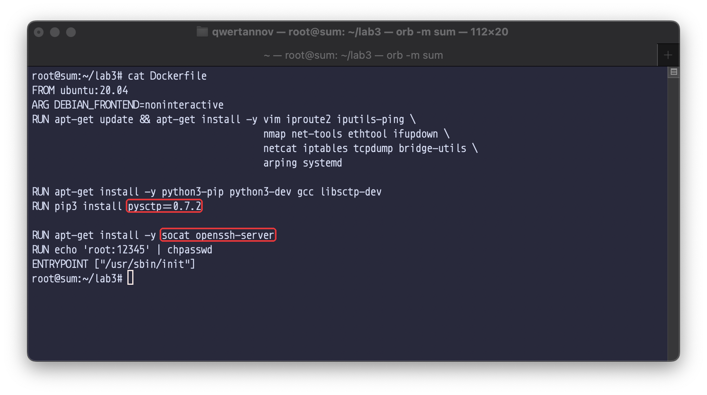

Рисунок 1 – Dockerfile

docker-compose.yml описує два привілейовані контейнери з одного образу з фіксованими
адресами (рис. 2, 3). Мережа `default` – Docker-брідж з підмережею 10.10.0.0/24. Опція
`com.docker.network.bridge.name` задає бріджу ім'я `br-lab3`, на ньому записується
трафік між контейнерами.

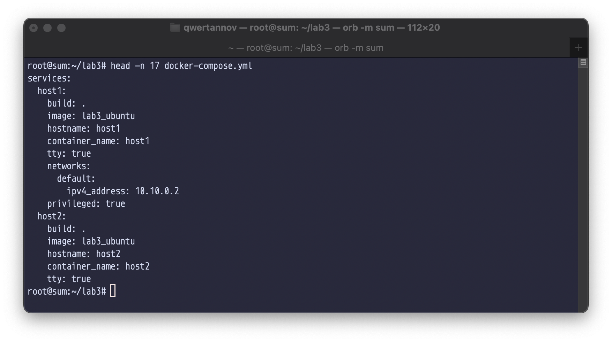

Рисунок 2 – Опис host1 у docker-compose.yml

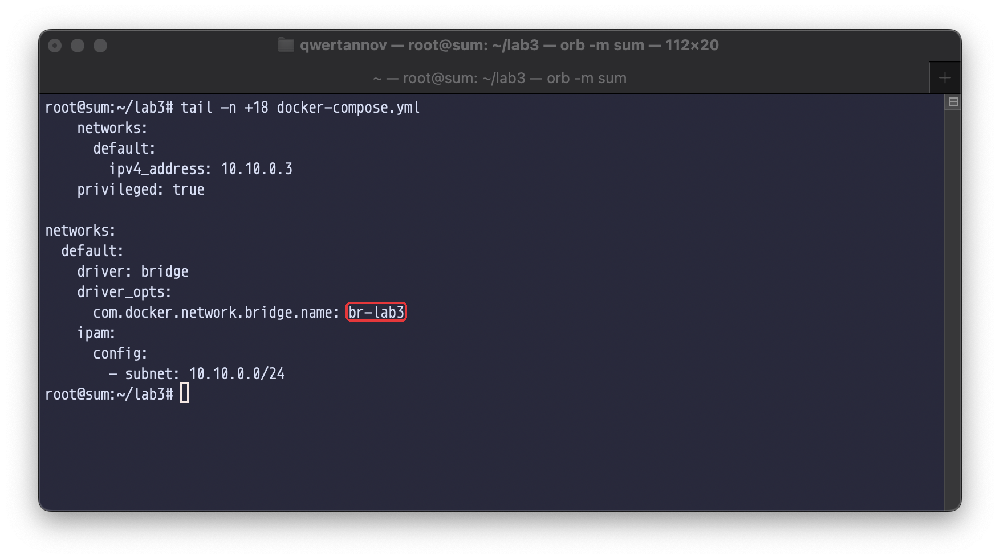

Рисунок 3 – Опис host2 і мережі в docker-compose.yml

Обидва контейнери працюють, sshd на host1 запущено як службу systemd (рис. 4).

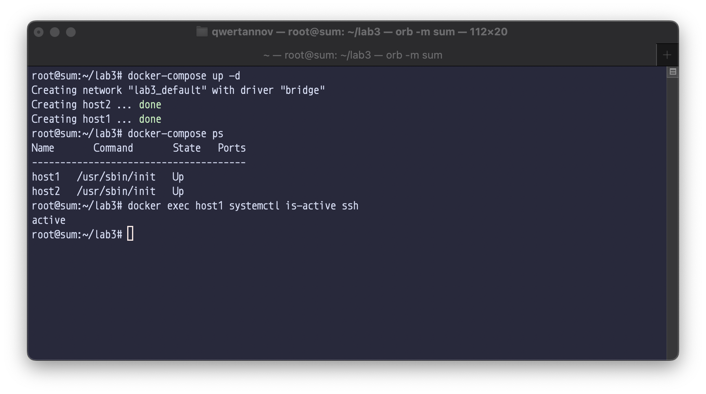

Рисунок 4 – Запуск контейнерів і стан sshd

## 3.2. Дамп SCTP-пакетів

`server.py` на host1 створює SCTP-сокет у стилі «один до одного»
(`sctpsocket_tcp`), слухає порт 12345 і повертає клієнту кожне отримане повідомлення
(рис. 5). `client.py` на host2 підключається до 10.10.0.2:12345, надсилає рядок
`Hello, server!` і друкує відповідь (рис. 6).

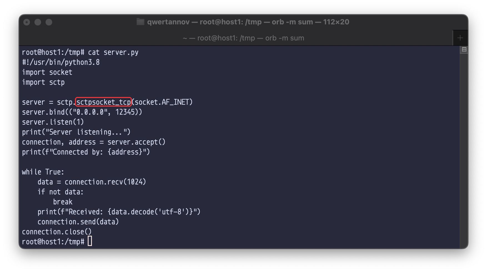

Рисунок 5 – Скрипт server.py на host1

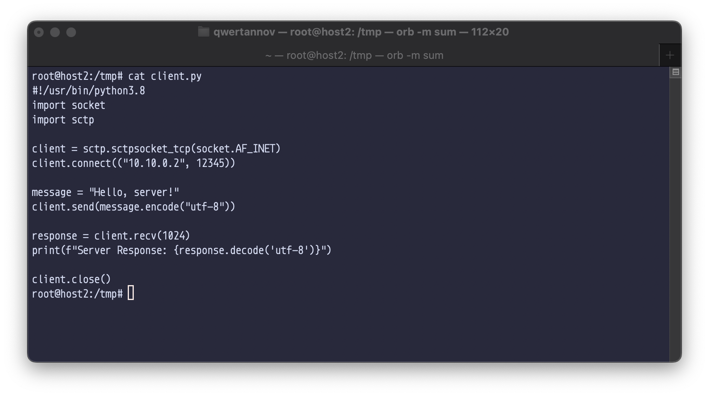

Рисунок 6 – Скрипт client.py на host2

На бріджі `br-lab3` запущено запис SCTP-трафіку, потім сервер і клієнт (рис. 7). Сервер
прийняв асоціацію з 10.10.0.3, отримав рядок і повернув його, клієнт надрукував
відповідь. У дамп потрапило 11 пакетів.

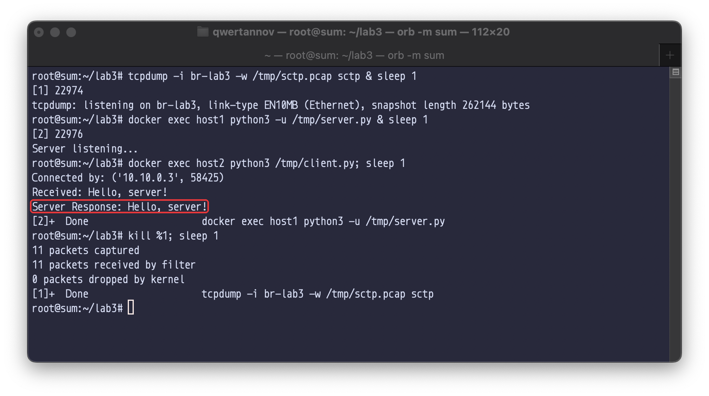

Рисунок 7 – Обмін повідомленням між client.py і server.py

Дамп містить повний життєвий цикл асоціації (рис. 8):

1. Пакети 1–4 – чотиристороннє встановлення асоціації. Клієнт надсилає `INIT` зі своїм
   тегом (Initiate tag), кількістю потоків і початковим TSN. Сервер відповідає
   `INIT_ACK`, у якому передає свій тег і cookie зі станом асоціації, сам стан при цьому
   не зберігає. Клієнт повертає cookie в `COOKIE_ECHO`, сервер перевіряє його підпис,
   створює асоціацію і підтверджує `COOKIE_ACK`.
2. Пакет 5 – `DATA` з рядком клієнта, пакет 6 – `SACK` сервера з підтвердженням TSN 0 і
   розміром вільного буфера приймача (Arwnd).
3. Пакети 7–8 – відповідь сервера і її підтвердження. TSN в кожному напрямку свій, тому
   відповідь теж має TSN 0.
4. Пакети 9–11 – закриття асоціації: `SHUTDOWN`, `SHUTDOWN_ACK`, `SHUTDOWN_COMPLETE`.
   На відміну від TCP, SCTP не підтримує напівзакритий стан: після `SHUTDOWN` жодна
   сторона нових даних не надсилає.

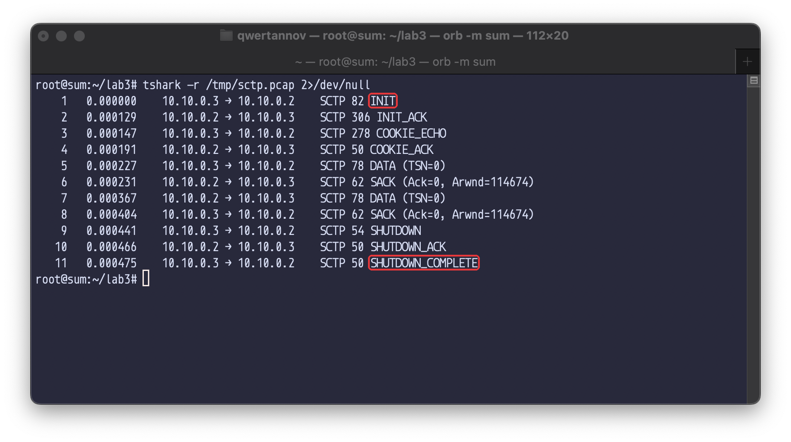

Рисунок 8 – Дамп обміну між client.py і server.py

У чанку `INIT` клієнт пропонує 10 вихідних потоків і приймає до 65535 вхідних (рис. 9).
Initiate tag 0x55ce1313 сервер ставить у поле Verification tag кожного пакета до
клієнта. Пакет з іншим тегом отримувач відкидає, так SCTP захищається від пакетів
сторонніх асоціацій і підміни з'єднання. Сам `INIT` йде з тегом 0, бо тег сервера
клієнту ще невідомий.

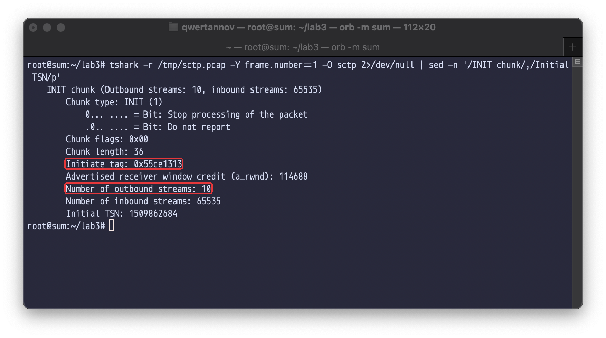

Рисунок 9 – Параметри чанка INIT

Чанк `DATA` несе 14 байт рядка `Hello, server!` (рис. 10). Прапорці B і E означають, що
повідомлення вмістилося в один чанк, U = 0 – доставка впорядкована. Повідомлення йде
потоком 0 з порядковим номером у потоці (SSN) 0.

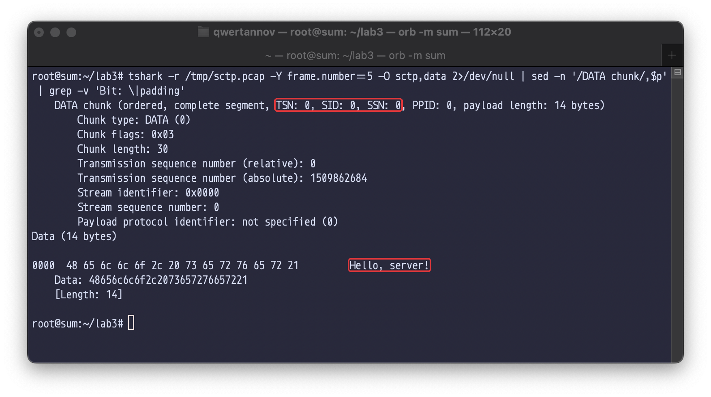

Рисунок 10 – Чанк DATA з повідомленням клієнта

## 3.3. Налаштування SSH-over-SCTP

За замовчуванням sshd дозволяє root лише вхід за ключем (`prohibit-password`). У кінець
`sshd_config` додано `PermitRootLogin yes` (рис. 11). sshd бере перше знайдене значення
параметра, а рядок з `prohibit-password` закоментований, тож діє доданий.

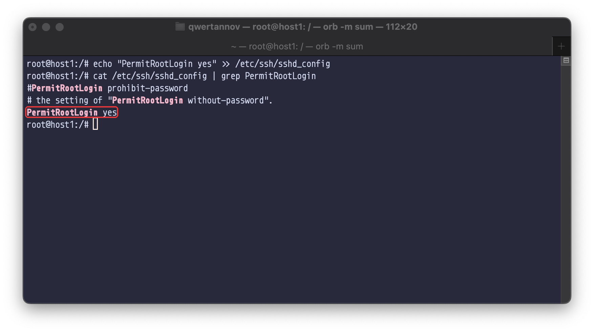

Рисунок 11 – Дозвіл входу root у sshd_config

Після перезапуску sshd служба активна й слухає порт 22 (рис. 12). Звичайне
SSH-підключення з host2 на 10.10.0.2 проходить (рис. 13).

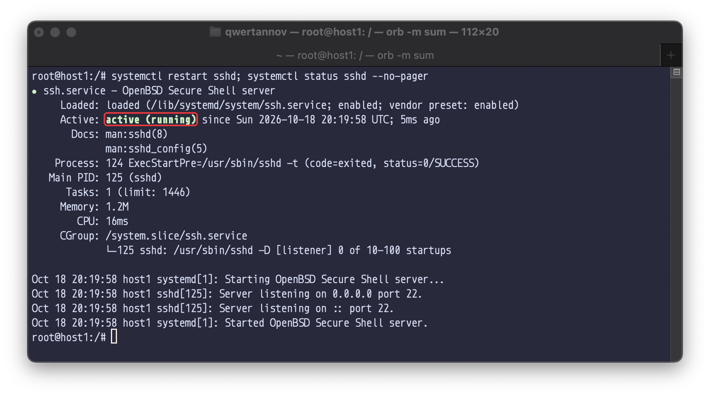

Рисунок 12 – Перезапуск sshd на host1

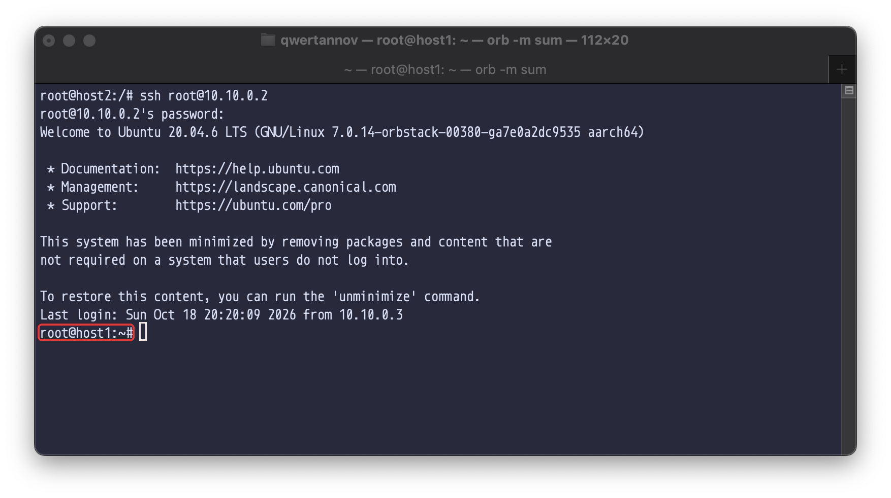

Рисунок 13 – SSH-підключення до host1 напряму

Тунель складається з двох екземплярів socat. На host1 socat слухає SCTP-порт 11111 і
для кожної асоціації (`fork`) відкриває TCP-з'єднання з `localhost:22` (рис. 14). На
host2 socat слухає TCP-порт 1337 і для кожного з'єднання відкриває SCTP-асоціацію з
10.10.0.2:11111 (рис. 15). OpenSSH працює тільки поверх TCP, тому на обох кінцях SSH
бачить звичайне TCP-з'єднання, а між контейнерами дані йдуть по SCTP.

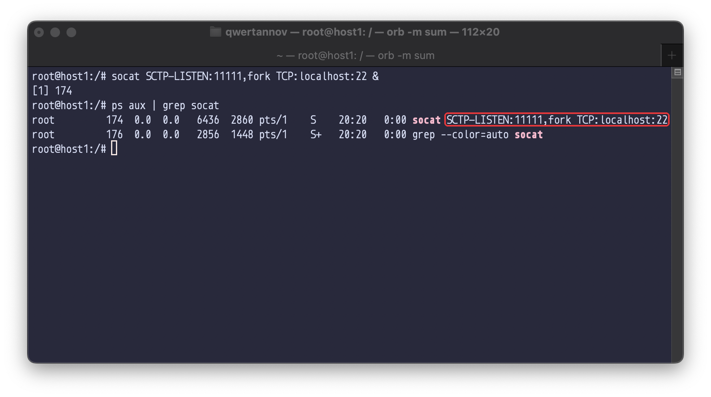

Рисунок 14 – socat на host1: SCTP 11111 → TCP 22

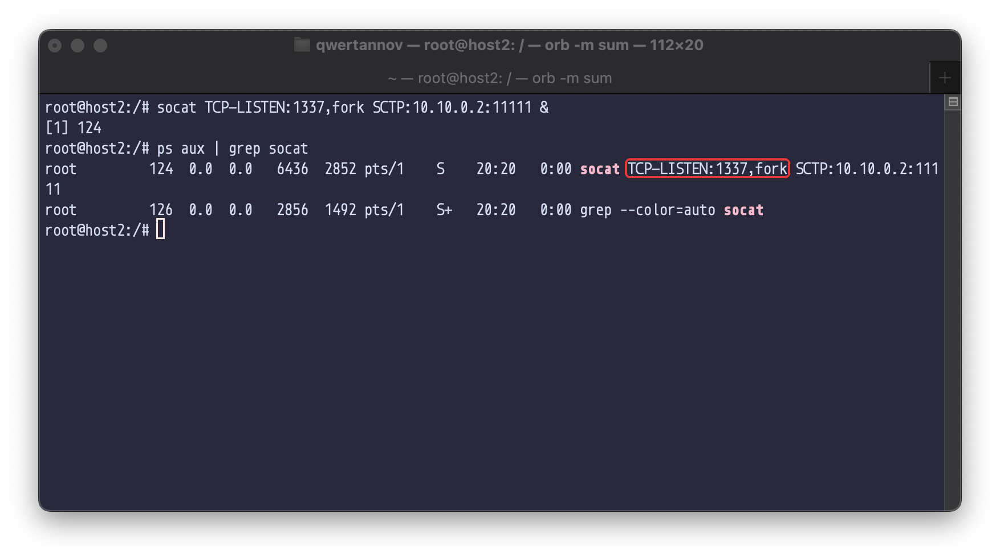

Рисунок 15 – socat на host2: TCP 1337 → SCTP 10.10.0.2:11111

На бріджі запущено запис усього трафіку, без фільтра за протоколом (рис. 16).

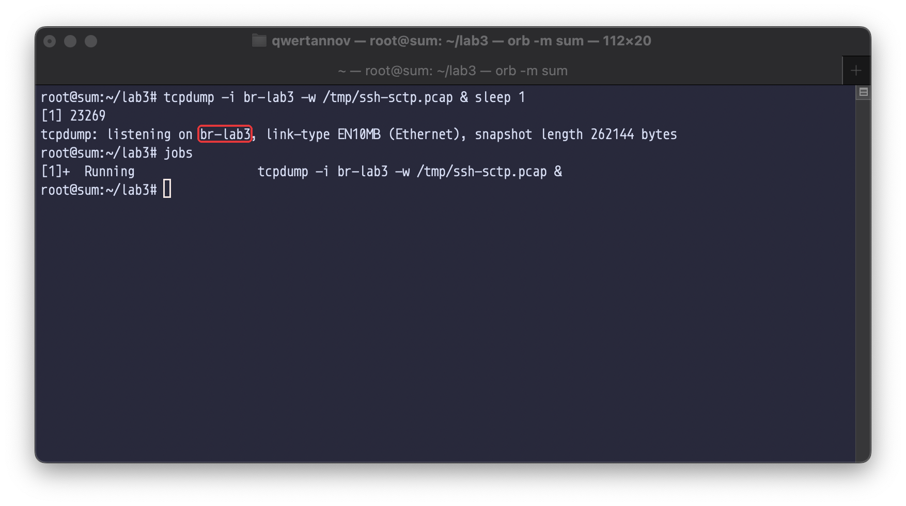

Рисунок 16 – Запуск запису трафіку на br-lab3

`ssh root@localhost -p 1337` на host2 відкриває сесію на host1 (рис. 17). Для sshd це
локальне підключення: TCP-з'єднання з ним відкриває socat на самому host1.

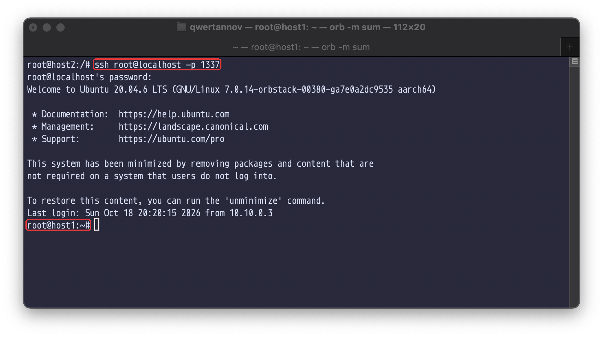

Рисунок 17 – SSH-підключення до host1 через SCTP-тунель

Через цю сесію на host1 встановлено `net.ipv4.icmp_echo_ignore_all = 1`. Пінг
`localhost` на самому host1 втрачає всі три пакети (рис. 18).

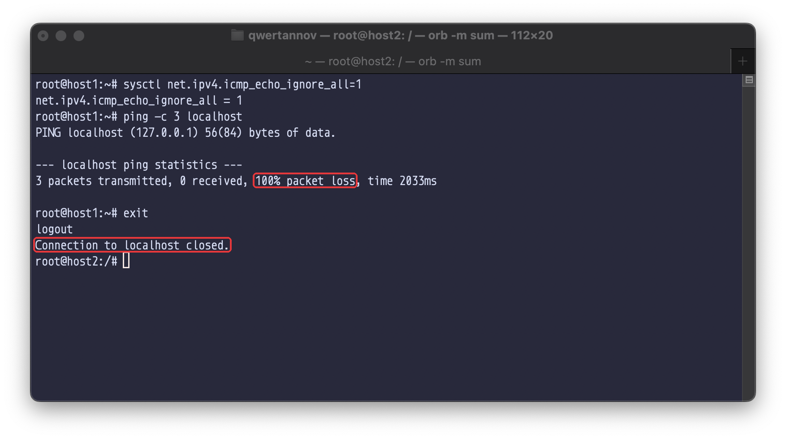

Рисунок 18 – Блокування ICMP на host1 через SSH-сесію

У дампі тунелю на бріджі немає жодного TCP-сегмента (рис. 19). Сесія відкривається
тим самим чотиристороннім встановленням асоціації, далі SSH-дані йдуть чанками `DATA`.
Пакет 9 містить повідомлення SSH, яке не вмістилося в один чанк: воно розбите на
фрагменти з TSN 1 і 2 (`Message Fragment`). Пакети 12–14 поєднують `SACK` для одного
напрямку з `DATA` для іншого, SCTP пакує кілька чанків в один пакет.

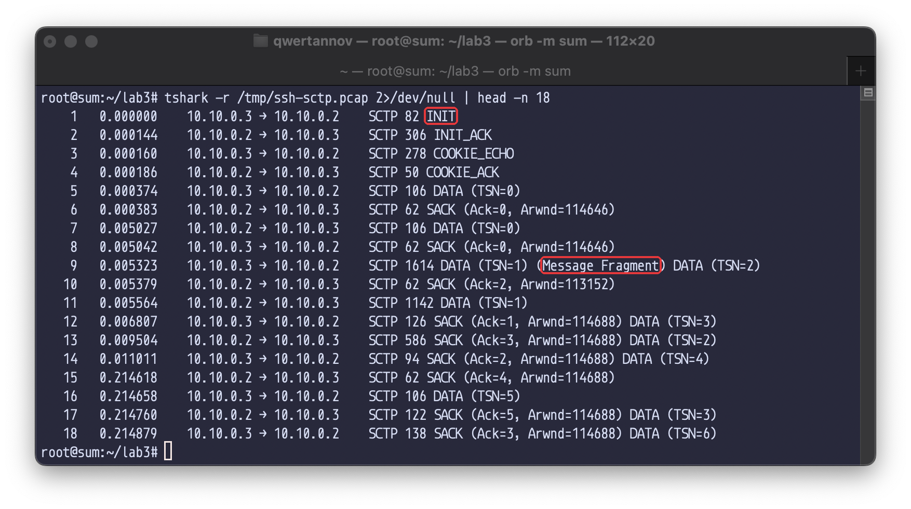

Рисунок 19 – Початок дампу SSH-сесії через тунель

Статистика протоколів підтверджує, що всі 60 кадрів запису – SCTP (рис. 20). Вкладені
рядки `sctp`/`data` – це пакети з кількома чанками.

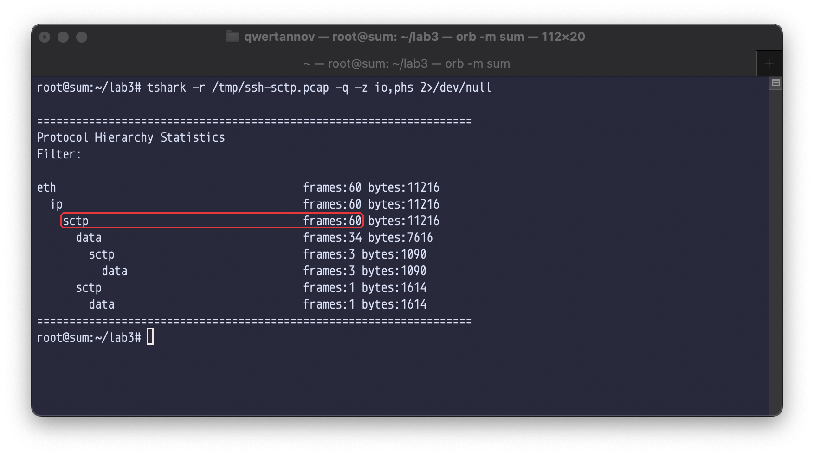

Рисунок 20 – Ієрархія протоколів у дампі тунелю

Перші DATA-чанки в обох напрямках несуть рядок ідентифікації протоколу SSH
`SSH-2.0-OpenSSH_8.2p1 Ubuntu-4ubuntu0.13` (рис. 21). Він передається відкрито, весь
наступний обмін уже зашифрований SSH. Отже, всередині SCTP-асоціації йде звичайна
SSH-сесія.

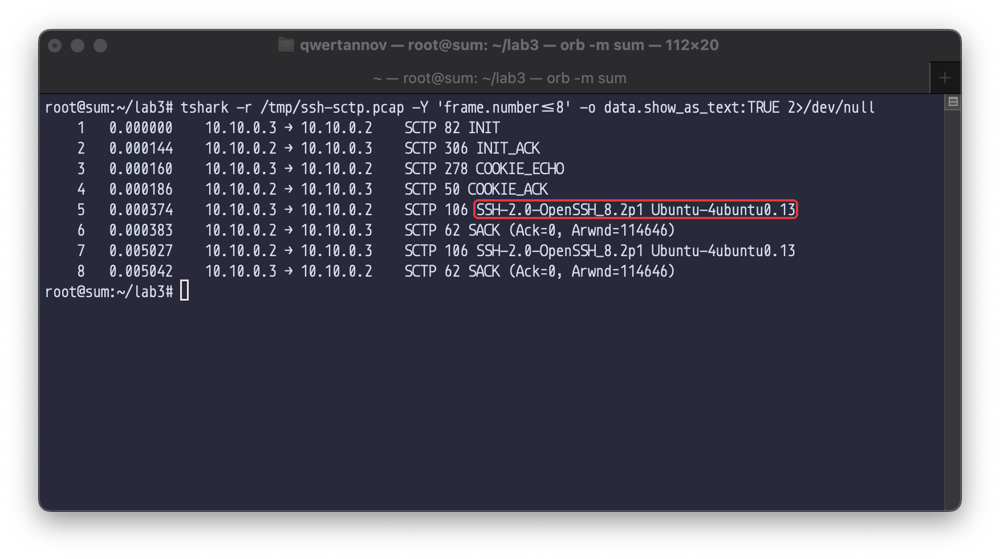

Рисунок 21 – Рядок ідентифікації SSH у DATA-чанках

Блокування діє і для інших вузлів: пінг 10.10.0.2 з host2 теж втрачає всі пакети
(рис. 22).

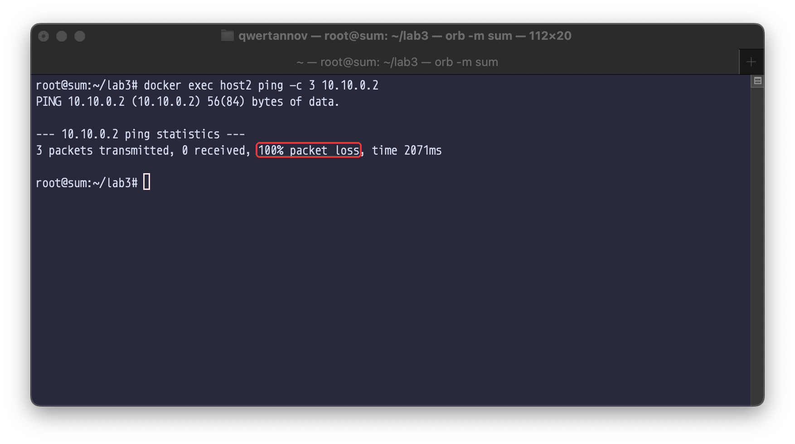

Рисунок 22 – Пінг host1 з host2 після блокування ICMP

## 3.4. Утиліта для передачі файлів по SCTP

Утиліта `sctpcp.py` (додаток А) використовує дві можливості SCTP, яких немає в TCP:
межі повідомлень і кілька потоків в одній асоціації. Відправник спершу надсилає потоком 0
JSON з ім'ям, розміром і SHA-256 файлу, потім вміст потоком 1 повідомленнями по 16 КБ.
Окремого кадрування не потрібно: одне повідомлення відправника – одне повідомлення
отримувача. Ядро може віддати велике повідомлення кількома частинами, тому приймач
склеює їх до прапорця `MSG_EOR`. Номер потоку приймач бачить після підписки на подію
`data_io`. Після отримання файлу приймач рахує SHA-256 і відповідає потоком 0 `OK` або
повідомленням про розбіжність.

З host2 на host1 передано файл з 1 000 000 випадкових байт (рис. 23). Приймач отримав
метадані потоком 0 і вміст – 62 повідомленнями потоком 1, контрольна сума збіглася.

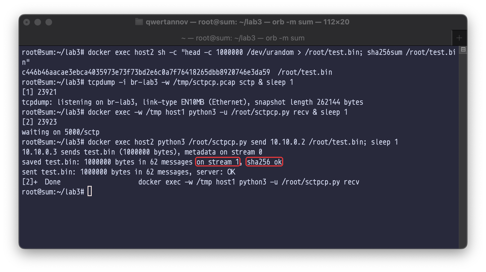

Рисунок 23 – Передача файлу утилітою sctpcp.py

SHA-256 файлу на host1 збігається з вихідним (рис. 24). У дампі 2 DATA-чанки потоку 0
(метадані й відповідь) і 760 чанків потоку 1. Повідомлення по 16 КБ більші за MTU, тому
SCTP ділить кожне на кілька чанків і збирає на приймачі.

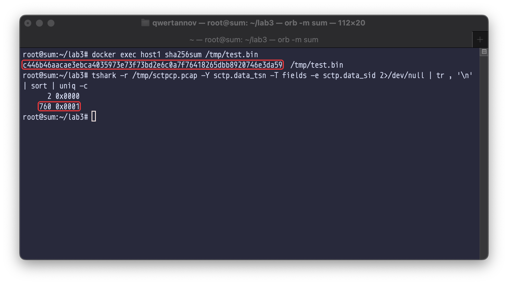

Рисунок 24 – Контрольна сума на host1 і розподіл DATA-чанків за потоками

## 3.5. Сервіси для тунелювання через SCTP

socat перетворює TCP-з'єднання на SCTP-асоціацію і назад, тому через такий тунель можна
пропустити будь-який сервіс поверх TCP, що працює з одним з'єднанням. Для перевірки на
host1 запущено HTTP-сервер Python на порту 8000 і пару socat 8081/TCP → 8080/SCTP →
8000/TCP. GET-запит з host2 через тунель повертає `HTTP/1.0 200 OK` і вміст `server.py`
(рис. 25).

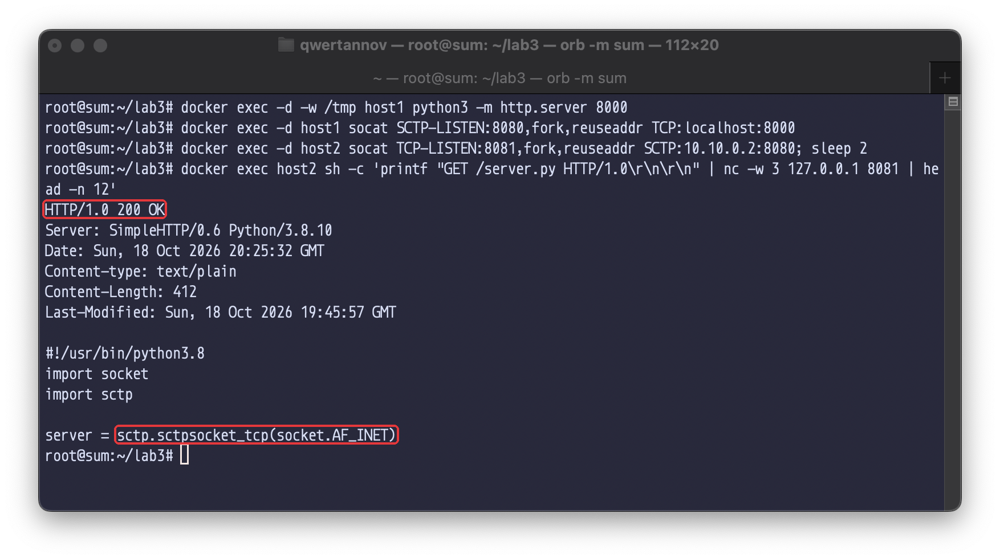

Рисунок 25 – HTTP-запит через SCTP-тунель

SSH-тунель з розділу 3.3 переносить і сервіси, які працюють поверх SSH. Файл з розділу
3.4 скопійовано через `scp -P 1337`, його SHA-256 на host1 збігається з вихідним
(рис. 26). Так само працюють sftp, rsync через SSH і прокидання портів `ssh -L`/`-R`.

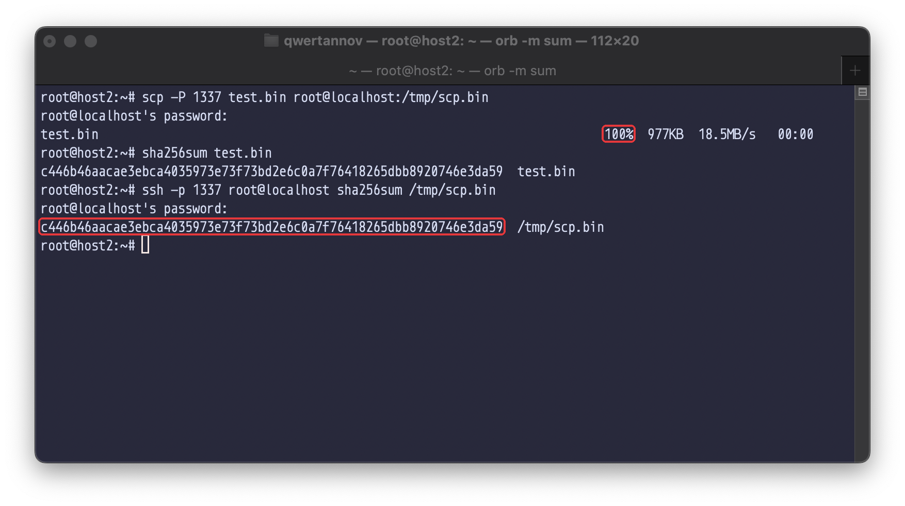

Рисунок 26 – Копіювання файлу scp через SSH-over-SCTP

Через тунель можна передавати й інші TCP-сервіси, наприклад SMTP, IMAP, бази даних,
NETCONF, Telnet до мережевого обладнання. Обмеження такі:

- протоколи, які відкривають додаткові з'єднання на динамічних портах (активний FTP,
  SIP з RTP), потребують окремого тунелю на кожен порт;
- UDP-сервіси (DNS, SNMP, syslog) socat може передати, але межі датаграм на TCP-кінцях
  тунелю губляться, тому їх краще передавати по SCTP напряму;
- сам тунель не шифрує трафік: для відкритих протоколів його треба поєднувати з SSH або
  TLS, як у розділі 3.3.

SCTP без тунелю використовують там, де потрібна стійкість до відмови каналу: сигналізація
SS7 поверх IP (SIGTRAN, M3UA), Diameter, інтерфейси S1-MME і X2 у мережах LTE, канали
даних WebRTC (SCTP поверх DTLS).

# IV. Відповіді на контрольні запитання

1. Що таке SCTP?

   SCTP (Stream Control Transmission Protocol) – протокол транспортного рівня з надійною
   доставкою, орієнтований на повідомлення. Між двома вузлами він встановлює асоціацію,
   у якій може бути кілька незалежних потоків, а кожна сторона може мати кілька
   IP-адрес. Пакет складається із загального заголовка (порти, Verification tag,
   контрольна сума CRC32c) і чанків: керуючих (`INIT`, `SACK`, `HEARTBEAT`,
   `SHUTDOWN`) і `DATA` з даними користувача. Спочатку SCTP створювали для передачі
   телефонної сигналізації поверх IP.

2. Які ключові відмінності між SCTP та TCP?

   TCP передає неструктурований потік байтів, SCTP зберігає межі повідомлень (рис. 23).
   В одній асоціації SCTP кілька потоків, і втрата пакета затримує тільки свій потік, а
   в TCP одна втрата зупиняє доставку всього, що йде після неї. SCTP підтримує
   multi-homing: асоціація переживає відмову однієї з адрес, бо `HEARTBEAT` перевіряє
   запасні шляхи. Встановлення асоціації чотиристороннє з cookie (рис. 8), сервер не
   зберігає стану до `COOKIE_ECHO`, тому потік підроблених `INIT` не вичерпує його
   пам'ять, як SYN-flood у TCP. Verification tag
   захищає від сторонніх пакетів. Повідомлення можна доставляти і без упорядкування. У
   SCTP немає напівзакритого з'єднання, `SACK` у ньому вибіркове з самого початку.

3. Чому SCTP не набув широкого використання?

   Головна причина – мережеве обладнання. NAT і міжмережеві екрани в домашніх і
   корпоративних мережах розуміють TCP і UDP, а SCTP переписати не можуть, тому він
   часто просто не проходить через інтернет. Підтримка в ОС неоднорідна: у Linux є
   модуль ядра, у Windows і macOS вбудованого стека немає. Більшість програм і бібліотек
   написано під сокети TCP і UDP, тому перехід потребує зміни коду, а переваги SCTP
   потрібні вузькому колу задач. Нові протоколи з потоками й без блокування черги
   (QUIC) будують поверх UDP саме тому, що UDP проходить через існуюче обладнання.

4. Чому є необхідність прокладання тунелю?

   OpenSSH і більшість сервісів працюють тільки поверх TCP і не вміють відкривати
   SCTP-сокети. Тунель дає змогу використати транспорт SCTP, не змінюючи ні клієнта, ні
   сервер: socat на кожному кінці перетворює TCP-з'єднання на SCTP-асоціацію (рис. 14,
   15). Крім того, тунель може пройти там, де пряме з'єднання заборонене, наприклад якщо
   фільтр пропускає тільки потрібний SCTP-порт. Тунелювання також ховає вихідний
   протокол: на рис. 20 у дампі видно тільки SCTP.

5. Яку роль може відігравати SCTP для задачі конфігурування мережі?

   Конфігурування часто виконується в момент збою, коли частина каналів не працює.
   Завдяки multi-homing керуюча сесія з двома адресами на різних інтерфейсах не
   рветься при відмові одного з них, а `HEARTBEAT` швидко виявляє, що шлях зник. Окремі
   потоки дають змогу передавати команди, телеметрію й файли конфігурації одночасно, не
   блокуючи одне одного. Межі повідомлень спрощують протоколи керування: кожна команда –
   окреме повідомлення. Cookie при встановленні асоціації і Verification tag
   підвищують стійкість керуючого каналу до атак. Нарешті, як показано в розділі 3.3, SCTP-тунель дає змогу
   використовувати звичні SSH і scp для налаштування вузлів.

# V. Висновки

У роботі налаштовано передачу даних по SCTP між двома Docker-контейнерами і
SSH-підключення поверх SCTP-тунелю.

1. Контейнери host1 і host2 з pysctp, socat і OpenSSH-сервером описано в
   docker-compose.yml. Ядро OrbStack підтримує SCTP модулем, який завантажується при
   першому відкритті SCTP-сокета.
2. Дамп обміну між server.py і client.py показав повний цикл асоціації: чотиристороннє
   встановлення з cookie, `DATA` з підтвердженням `SACK` і закриття через `SHUTDOWN`.
3. Тунель з двох екземплярів socat перетворює TCP-з'єднання SSH на SCTP-асоціацію. У
   дампі тунелю всі 60 кадрів – SCTP, а в DATA-чанках видно рядок ідентифікації SSH.
4. Через SSH-сесію в тунелі на host1 вимкнено відповіді на ICMP echo, пінг з host1 і
   host2 втрачає всі пакети.
5. Утиліта sctpcp.py передає метадані й вміст файлу різними потоками і перевіряє
   SHA-256. Файл 1 000 000 байт передано без розбіжностей.
6. Через SCTP-тунель працюють HTTP і scp. Сервіси з одним TCP-з'єднанням
   тунелюються без змін, протоколам з динамічними портами потрібні окремі тунелі.

# Додаток А. Утиліта sctpcp.py

```python
#!/usr/bin/python3.8
"""Передача файлу по SCTP: метадані потоком 0, вміст потоком 1."""

import hashlib
import json
import os
import socket
import sys

import sctp

PORT = 5000
CHUNK = 16384
META, DATA = 0, 1
USAGE = """usage: sctpcp.py recv [port]
       sctpcp.py send host[:port] file"""


def recv_msg(conn):
    # велике повідомлення ядро віддає частинами, остання позначена MSG_EOR
    parts = []
    while True:
        _, flags, part, notif = conn.sctp_recv(CHUNK)
        parts.append(part)
        if flags & socket.MSG_EOR or not part:
            return b"".join(parts), notif.stream


def send(target, path):
    host, _, port = target.partition(":")
    size = os.path.getsize(path)
    digest = hashlib.sha256(open(path, "rb").read()).hexdigest()
    sock = sctp.sctpsocket_tcp(socket.AF_INET)
    sock.initparams.num_ostreams = 2
    sock.connect((host, int(port or PORT)))
    meta = {"name": os.path.basename(path), "size": size, "sha256": digest}
    sock.sctp_send(json.dumps(meta).encode(), stream=META)
    sent = 0
    with open(path, "rb") as f:
        while block := f.read(CHUNK):
            sock.sctp_send(block, stream=DATA)
            sent += 1
    reply = sock.sctp_recv(1024)[2].decode()
    sock.close()
    print(f"sent {meta['name']}: {size} bytes in {sent} messages, "
          f"server: {reply}")


def recv(port):
    server = sctp.sctpsocket_tcp(socket.AF_INET)
    server.initparams.num_ostreams = 2
    server.bind(("0.0.0.0", port))
    server.listen(1)
    print(f"waiting on {port}/sctp")
    conn, addr = server.accept()
    # без цієї підписки ядро не повідомляє номер потоку
    conn.events.data_io = True
    conn.events.flush()
    msg, stream = recv_msg(conn)
    meta = json.loads(msg)
    print(f"{addr[0]} sends {meta['name']} ({meta['size']} bytes), "
          f"metadata on stream {stream}")
    h = hashlib.sha256()
    got = msgs = 0
    streams = set()
    with open(meta["name"], "wb") as f:
        while got < meta["size"]:
            block, stream = recv_msg(conn)
            streams.add(stream)
            f.write(block)
            h.update(block)
            got += len(block)
            msgs += 1
    ok = h.hexdigest() == meta["sha256"]
    conn.sctp_send(b"OK" if ok else b"CHECKSUM MISMATCH", stream=META)
    conn.close()
    data_streams = ", ".join(map(str, sorted(streams)))
    print(f"saved {meta['name']}: {got} bytes in {msgs} messages "
          f"on stream {data_streams}, sha256 {'ok' if ok else 'mismatch'}")


if __name__ == "__main__":
    if len(sys.argv) >= 2 and sys.argv[1] == "recv":
        recv(int(sys.argv[2]) if len(sys.argv) > 2 else PORT)
    elif len(sys.argv) == 4 and sys.argv[1] == "send":
        send(sys.argv[2], sys.argv[3])
    else:
        sys.exit(USAGE)
```
