# І. Мета

Отримати навички роботи з протоколом SNMP, його конфігурування та розібрати приклади
використання.

# ІІ. Постановка завдання та алгоритм розв'язання

Завдання:

1. Підготувати середовище з двох Docker-контейнерів host1 і host2 з пакетами SNMP
   (завдання 4.1).
2. Налаштувати на host1 SNMP-агент: створити користувача SNMPv3, зробити агент доступним
   на всіх інтерфейсах, перезапустити службу (завдання 4.2).
3. З host2 прочитати всі параметри агента, інформацію про ОС, IP-адреси й процеси,
   підключити MIB-файли, змінити alias інтерфейсу та ім'я хоста.
4. Написати скрипт моніторингу мережі (додаткове завдання 4.4).
5. Додати власний MIB (додаткове завдання 4.5).

Середовище: Debian 12 (OrbStack, macOS), Docker 20.10 і docker-compose 1.29, контейнери
на образі ubuntu:20.04 з Net-SNMP 5.8.

Алгоритм розв'язання:

1. Описати в Dockerfile образ з мережевими утилітами, systemd, OpenSSH-сервером і
   пакетами `snmp`, `snmpd`, `libsnmp-dev`. Запустити два привілейовані контейнери з
   адресами 10.10.0.2 і 10.10.0.3 у мережі з бріджем `br-lab4`.
2. На host1 (агент) створити користувача SNMPv3 з автентифікацією MD5 і шифруванням AES,
   замінити в `snmpd.conf` адресу прослуховування на `udp:161` і перезапустити `snmpd`.
3. На host2 (менеджер) виконувати запити `snmpwalk`, `snmpget` і `snmpset` до
   10.10.0.2 з рівнем безпеки `authNoPriv`.
4. Встановити на host2 `snmp-mibs-downloader` і ввімкнути завантаження MIB, щоб OID
   показувались символьними іменами.
5. Записати через `snmpset` значення `ifAlias.1` і `sysName.0` та перевірити їх
   повторним читанням.
6. Написати скрипт, що періодично опитує агент і рахує швидкість трафіку на `eth0`.
7. Описати власний MIB-модуль у гілці `enterprises`, віддавати його значення через
   директиву `pass` у `snmpd` і читати їх з host2 за іменами з MIB.

# ІІІ. Хід виконання

## 4.1. Налаштування середовища

Образ будується з ubuntu:20.04 (рис. 1). Крім мережевих утиліт, у нього встановлено
OpenSSH-сервер і пакети SNMP: `snmpd` – агент, `snmp` – клієнтські утиліти (`snmpget`,
`snmpwalk`, `snmpset`, `snmptranslate`), `libsnmp-dev` – бібліотека Net-SNMP і скрипт
`net-snmp-config`. Пакет `systemd` дає `/usr/sbin/init`, який запускається як процес 1 і
керує `snmpd` як службою.

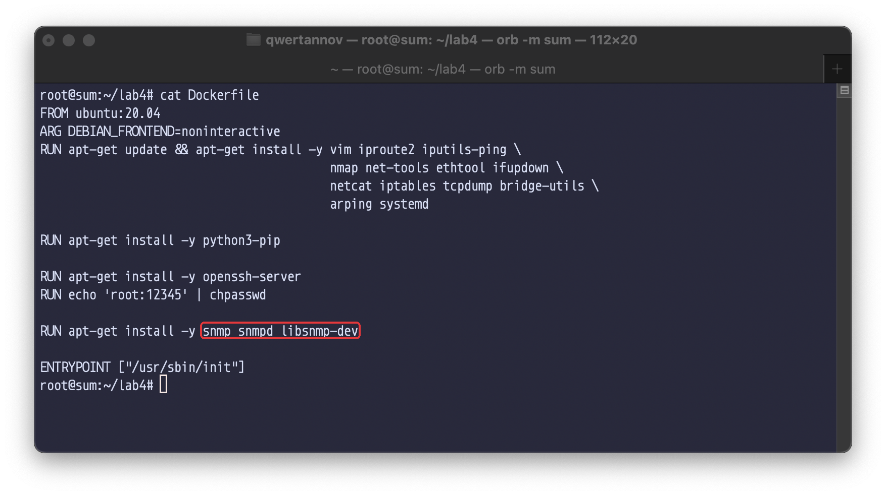

Рисунок 1 – Dockerfile

docker-compose.yml описує два привілейовані контейнери з одного образу з фіксованими
адресами (рис. 2, 3). host1 виконує роль керованого пристрою з агентом, host2 –
станції керування. Мережа `default` – Docker-брідж з підмережею 10.10.0.0/24 і
ім'ям `br-lab4`.

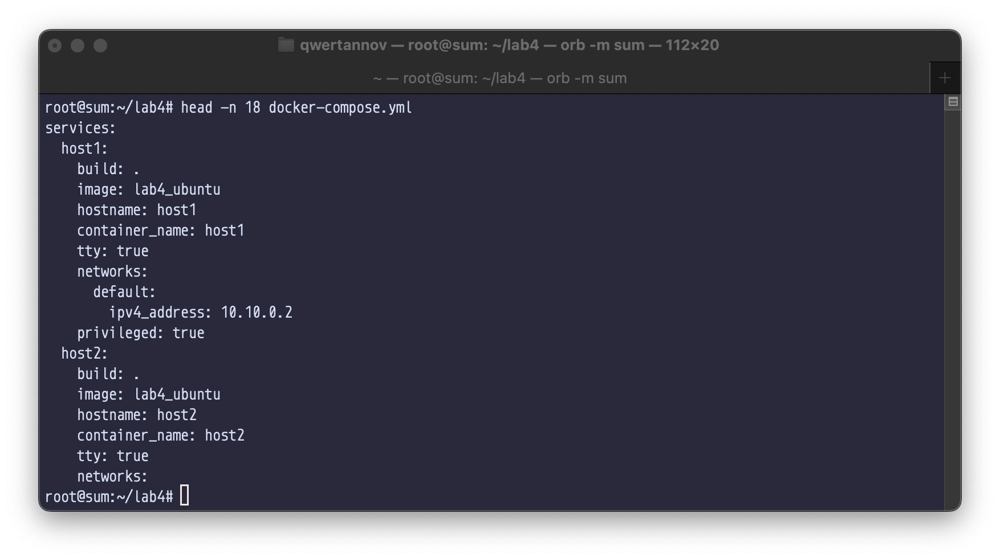

Рисунок 2 – Опис host1 у docker-compose.yml

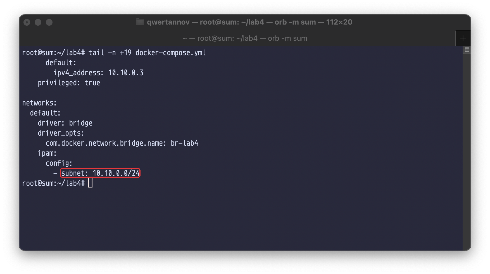

Рисунок 3 – Опис host2 і мережі в docker-compose.yml

Обидва контейнери запущено (рис. 4).

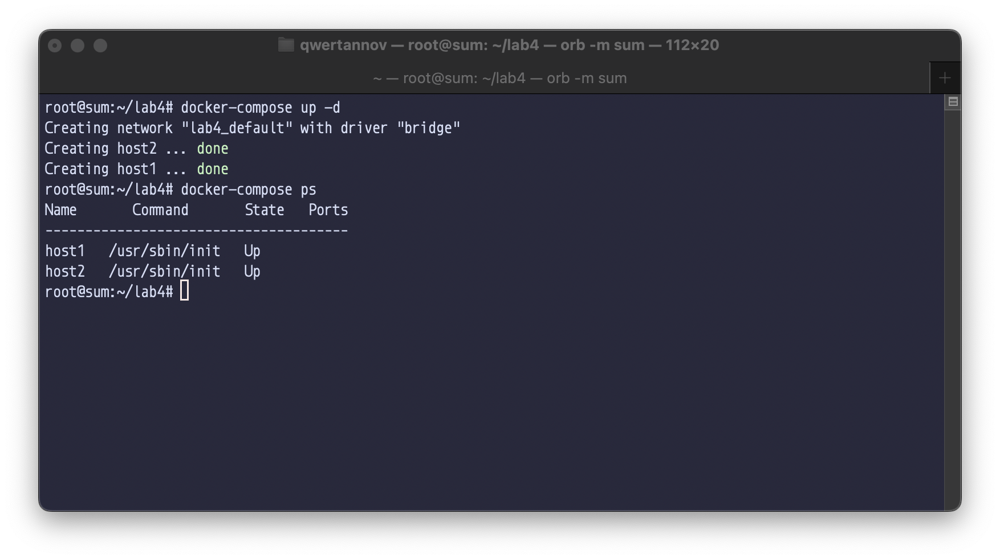

Рисунок 4 – Запуск контейнерів

## 4.2. Налаштування SNMP

Одразу після запуску контейнера служба `snmpd` не працює (рис. 5). У типовому
`snmpd.conf` агент слухає `127.0.0.1` і `[::1]`, а в Docker-мережі без IPv6 адреси
`::1` немає, тому `snmpd` не може відкрити цей сокет і завершується з кодом 1.

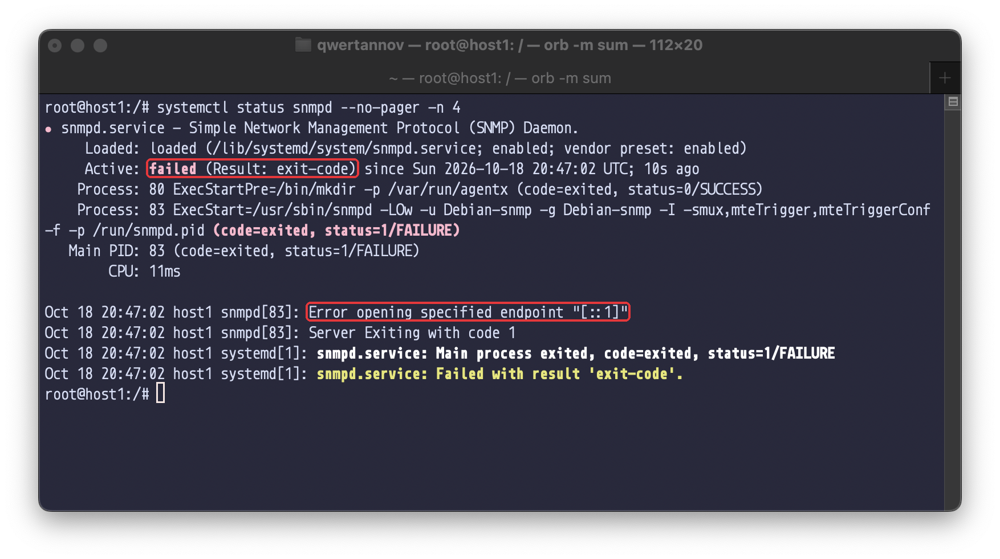

Рисунок 5 – Стан snmpd після запуску контейнера

Користувача SNMPv3 `sokolov` створено командою `net-snmp-config --create-snmpv3-user` з
паролем автентифікації (`-A`, алгоритм MD5) і паролем шифрування (`-X`, алгоритм AES)
(рис. 6). Скрипт додає рядок `createUser` у файл постійних даних
`/var/lib/snmp/snmpd.conf` і `rwuser sokolov` – право читання й запису – у
`/usr/share/snmp/snmpd.conf`. Перед цим `snmpd` зупинено: при завершенні агент
перезаписує файл постійних даних і стер би доданий рядок. Під час першого старту
`snmpd` перетворює `createUser` на запис `usmUser` з ключами, локалізованими під
engineID агента, тому паролі у файлі відкритим текстом не лишаються.

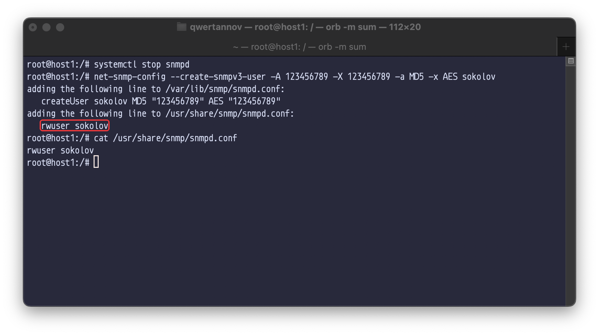

Рисунок 6 – Створення користувача SNMPv3

Щоб агент приймав запити з інших вузлів, рядок `agentaddress 127.0.0.1,[::1]` у
`/etc/snmp/snmpd.conf` закоментовано й додано `agentaddress udp:161` – UDP-порт 161 на
всіх IPv4-адресах (рис. 7).

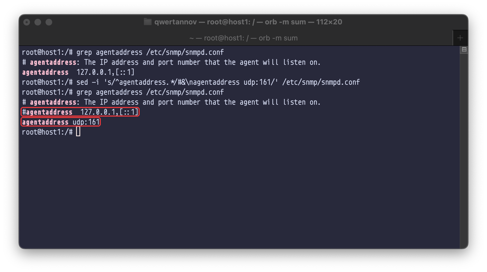

Рисунок 7 – Адреса прослуховування агента

Після перезапуску служба активна, `snmpd` слухає `0.0.0.0:161` (рис. 8).

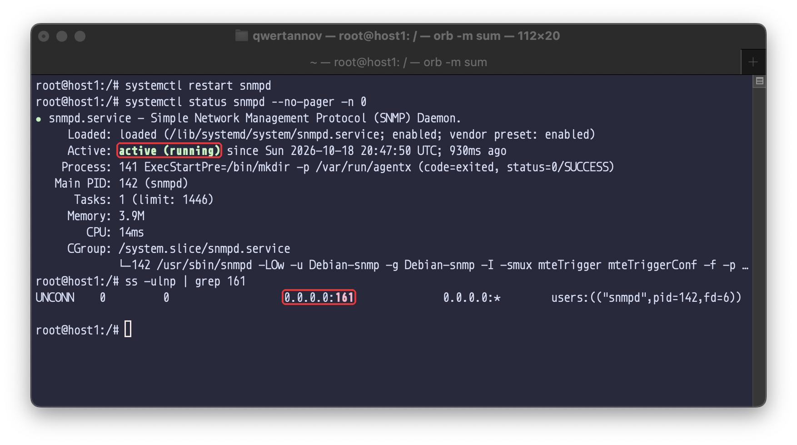

Рисунок 8 – Перезапуск і стан snmpd

### Читання параметрів агента

Усі запити виконуються з host2 до 10.10.0.2 з рівнем безпеки `authNoPriv`: повідомлення
підписуються ключем, отриманим з пароля MD5, але не шифруються. Пароль `-X` на цьому
рівні не використовується, для шифрування AES потрібен рівень `authPriv`.

`snmpwalk` без OID обходить типовий корінь – гілку `mib-2` (`iso.3.6.1.2.1`) –
послідовними запитами GetNext (рис. 9). Спочатку йде група `system` (`iso.3.6.1.2.1.1`): опис системи,
ідентифікатор агента, час роботи, контакт, ім'я `host1`, розташування. Значення контакту й
розташування взято з типового `snmpd.conf`. Усього в гілці понад 2600 змінних, їх
кількість змінюється разом зі списком процесів і з'єднань.

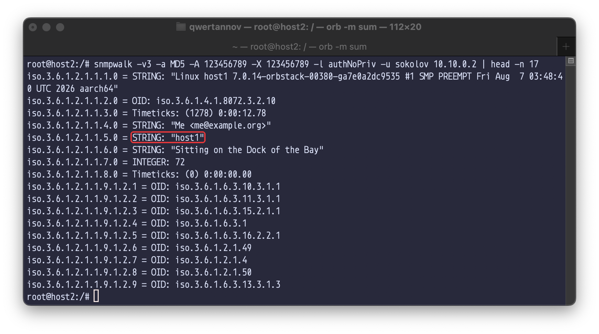

Рисунок 9 – Початок обходу гілки mib-2 агента

`snmpget` для `iso.3.6.1.2.1.1.1.0` (`sysDescr.0`) повертає рядок `uname -a` хоста:
ядро OrbStack 7.0.14, архітектура aarch64 (рис. 10). Ядро спільне для всіх
контейнерів, тому в рядку ядро віртуальної машини OrbStack, а не Ubuntu.

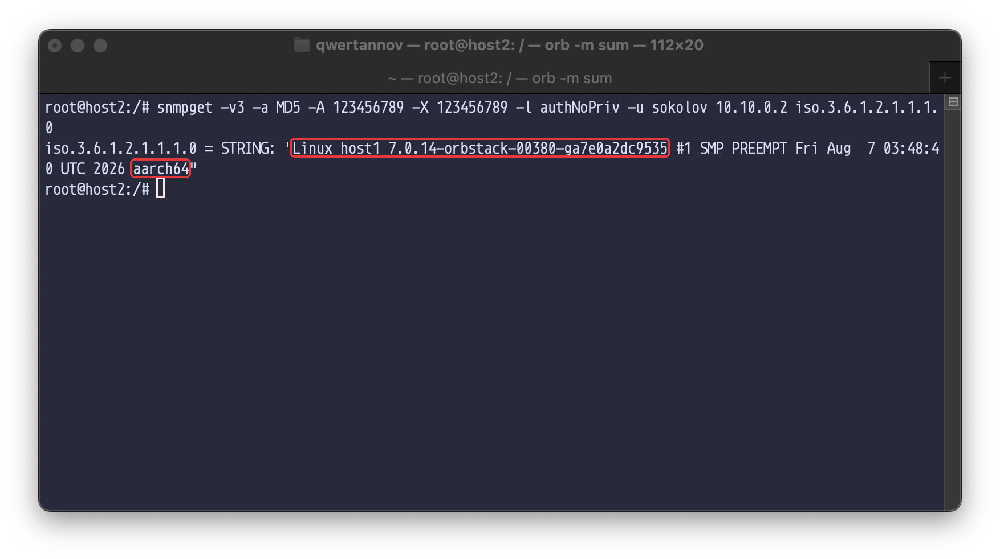

Рисунок 10 – Інформація про операційну систему

Стовпець `ipAdEntAddr` таблиці адрес (`iso.3.6.1.2.1.4.20.1.1`) містить IP-адреси
host1: 10.10.0.2 на `eth0` і 127.0.0.1 на `lo` (рис. 11). Адреса є і значенням, і
індексом рядка таблиці, тому вона повторюється в кінці OID.

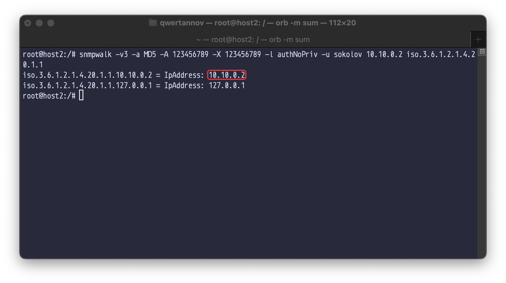

Рисунок 11 – IP-адреси host1

Таблиця `hrSWRunTable` з HOST-RESOURCES-MIB описує процеси, стовпець `hrSWRunPath`
(`iso.3.6.1.2.1.25.4.2.1.4`) – шлях до програми, індекс – PID (рис. 12). На host1
працюють `init` з PID 1, служби systemd, sshd і сам `snmpd`.

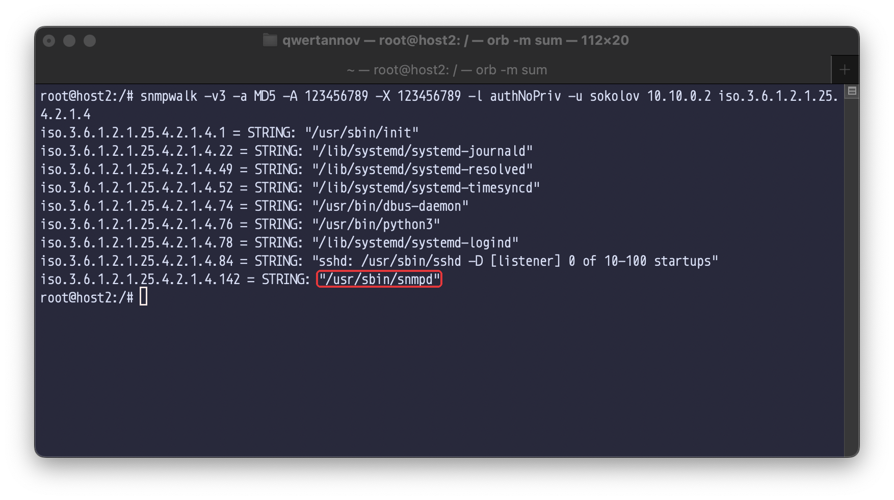

Рисунок 12 – Процеси host1

### Підключення MIB-файлів

Через ліцензійні обмеження MIB-файли не входять у пакети Debian і Ubuntu, а в
`/etc/snmp/snmp.conf` їх завантаження вимкнено рядком `mibs :`. Пакет
`snmp-mibs-downloader` завантажує стандартні MIB з IETF та IANA (рис. 13). Після того як
рядок `mibs :` закоментовано, `snmptranslate` перетворює OID у символьні імена й назад:
`iso.3.6.1.2.1.4.1.0` – це `IP-MIB::ipForwarding.0`, а `IF-MIB::ifAlias.1` –
`.1.3.6.1.2.1.31.1.1.1.18.1`.

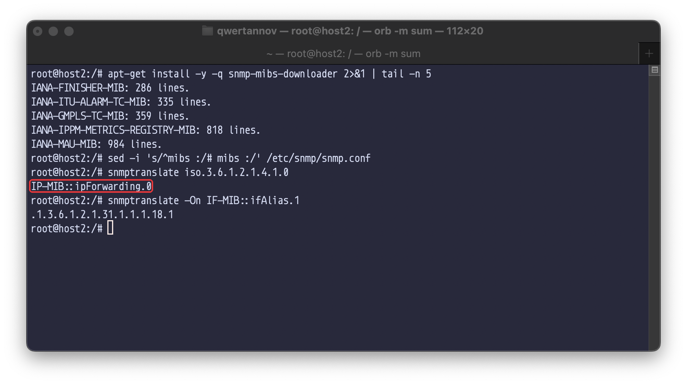

Рисунок 13 – Встановлення MIB-файлів і трансляція OID

### Зміна alias інтерфейсу

`ifAlias` – доступний для запису стовпець таблиці `ifXTable`, в який адміністратор
записує опис інтерфейсу. Для інтерфейсу 1 (`lo`) значення спочатку порожнє, `snmpset` з
типом `s` (рядок) записує `hello`, повторне читання це підтверджує (рис. 14).

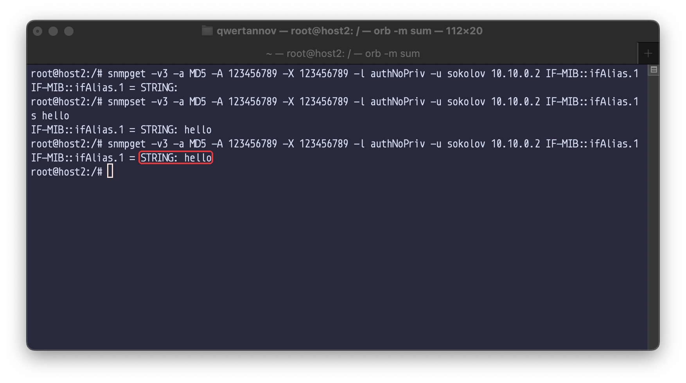

Рисунок 14 – Зміна ifAlias.1

### Зміна імені хоста

`sysName.0` записано з повним символьним шляхом
`.iso.org.dod.internet.mgmt.mib-2.system.sysName.0`: значення змінилося з `host1` на
`host3` (рис. 15). Net-SNMP зберігає нове значення у файлі постійних даних як
`psysname host3`, тому воно переживає перезапуск агента. Системне ім'я хоста при цьому
не змінюється: `hostname` на host1 і далі повертає `host1`. Запис дозволено, бо в
`snmpd.conf` немає директиви `sysName` – значення, задані в конфігурації, через SNMP
доступні лише для читання.

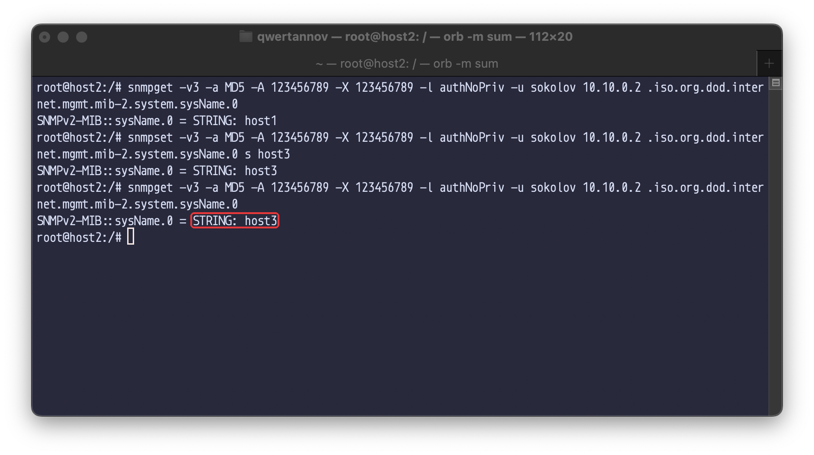

Рисунок 15 – Зміна sysName.0

## 4.4. Скрипт моніторингу мережі

Скрипт `monitor.sh` (додаток А) працює на станції керування і опитує агент кожні
`INTERVAL` секунд. Спочатку він знаходить в `ifDescr` індекс інтерфейсу `eth0` і читає
ім'я агента. Далі в кожному циклі одним запитом `snmpget` забирає 64-бітні лічильники
`ifHCInOctets` і `ifHCOutOctets`, кількість процесів `hrSystemProcesses` і середнє
навантаження за хвилину `laLoad.1` з UCD-SNMP-MIB. Швидкість прийому й передачі – різниця
лічильників між опитуваннями, поділена на інтервал. 64-бітні лічильники взято тому, що
32-бітний `ifInOctets` на такій швидкості переповнюється за кілька секунд.

Для перевірки з host2 запущено flood-пінг пакетами по 1400 байт на 15 с і моніторинг з
інтервалом 5 с (рис. 16). Перші три виміри показують до 531 199 КіБ/с в обох напрямках
(запити й відповіді ICMP однакового розміру), після зупинки пінгу трафік падає до
0,1 КіБ/с – це самі SNMP-запити. Інтервал узято 5 с, бо `snmpd` кешує таблицю
інтерфейсів на кілька секунд: при опитуванні раз на секунду лічильник змінювався лише в
кожному третьому вимірі.

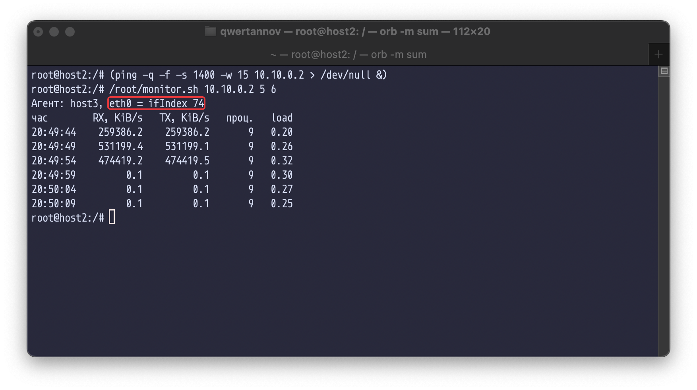

Рисунок 16 – Робота скрипта моніторингу під навантаженням

## 4.5. Власний MIB

Модуль SOKOLOV-LAB4-MIB (додаток Б) описує гілку `sokolovLab4` під
`enterprises` (`.1.3.6.1.4.1.99999`) з чотирма скалярними об'єктами тільки для читання:
власник хоста (`labOwner`), кількість TCP-з'єднань у стані ESTABLISHED
(`labTcpEstablished`), доступна пам'ять у КіБ (`labMemAvailable`) і відсоток зайнятого
місця на кореневій файловій системі (`labRootUsedPercent`).

Значення віддає скрипт `lab4mib.py` (додаток В), підключений до агента директивою
`pass .1.3.6.1.4.1.99999.1 /usr/local/bin/lab4mib.py` (рис. 17). На кожен запит у цій
гілці `snmpd` запускає скрипт: `-g OID` для Get, `-n OID` для GetNext, `-s OID` для Set.
Скрипт друкує три рядки – OID відповіді, тип і значення. На запит Set він відповідає
`not-writable`.

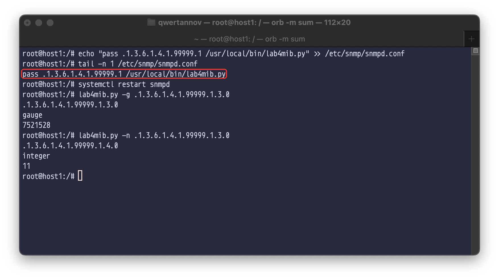

Рисунок 17 – Підключення обробника pass на host1

Без MIB-файлу на host2 об'єкти видно лише як `SNMPv2-SMI::enterprises.99999.1.N.0`
(рис. 18). Після копіювання `SOKOLOV-LAB4-MIB.txt` у `/usr/share/snmp/mibs` і
підключення модуля опцією `-m +SOKOLOV-LAB4-MIB` ті самі значення показані з іменами й
одиницями виміру з MIB.

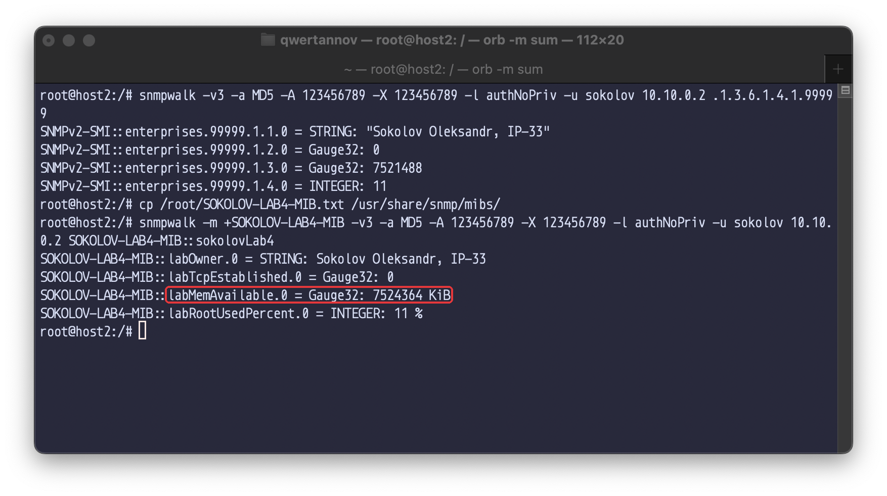

Рисунок 18 – Об'єкти власного MIB без опису і з ним

`snmptranslate -Tp` будує дерево модуля з типами й правами доступу (`-R--` – тільки
читання) (рис. 19). Спроба записати `labOwner.0` завершується помилкою `notWritable`.

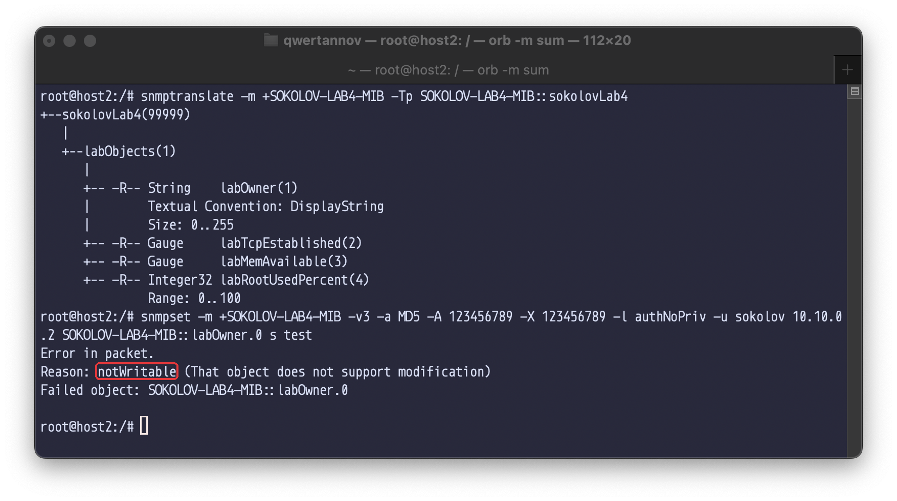

Рисунок 19 – Дерево SOKOLOV-LAB4-MIB і спроба запису

# IV. Відповіді на контрольні запитання

1. Що таке SNMP?

   SNMP (Simple Network Management Protocol) – протокол прикладного рівня для
   моніторингу й керування мережевими пристроями. Агент на пристрої надає дані у вигляді
   змінних, описаних у MIB, а менеджер читає їх запитами Get/GetNext/GetBulk і змінює
   запитами Set. Про події агент повідомляє сам повідомленнями Trap або Inform. Запити
   йдуть по UDP на порт 161, повідомлення – на порт 162 менеджера.

2. Яка різниця між MIB та OID?

   OID – ідентифікатор одного об'єкта: послідовність чисел, що задає шлях у глобальному
   дереві імен, наприклад `1.3.6.1.2.1.1.5.0`. MIB – опис групи таких об'єктів мовою
   SMI: імена, типи, права доступу, одиниці виміру, структура таблиць. MIB-файл
   (рис. 19) дає змогу менеджеру перетворити OID на ім'я `SNMPv2-MIB::sysName.0` і
   правильно показати значення. Агент відповідає за OID і без MIB-файлу на менеджері
   (рис. 18).

3. Як розшифрувати MIB iso.3.6.1.2?

   `iso(1).org(3).dod(6).internet(1).mgmt(2)` – гілка стандартних об'єктів керування
   Інтернету. Під нею розташована `mib-2(1)` з групами `system(1)`, `interfaces(2)`,
   `ip(4)`, `host(25)` тощо. Наприклад, `iso.3.6.1.2.1.1.5.0` – це
   `mgmt.mib-2.system.sysName.0` (рис. 15). Поряд з `mgmt` у гілці `internet` є
   `private(4)` з `enterprises(1)`, де виробники й організації описують власні MIB
   (рис. 18).

4. Назвіть будь-які 3 SNMP команди та поясніть їх призначення.

   `snmpget` читає значення конкретних OID запитом Get (рис. 10). `snmpwalk` обходить
   піддерево запитами GetNext, поки не вийде за його межі (рис. 11, 12). `snmpset`
   записує значення заданого типу запитом Set (рис. 14, 15). Також `snmptranslate`
   перетворює OID та імена з MIB без звернення до агента (рис. 13), а `snmptrap`
   надсилає повідомлення Trap.

5. Які ключові відмінності між SNMPv1, SNMPv2c та SNMPv3?

   SNMPv1 захищається лише рядком community, який передається відкритим текстом, і має
   тільки 32-бітні лічильники. SNMPv2c лишає ту саму модель community, але додає запит
   GetBulk для швидкого читання таблиць, 64-бітні лічильники (`ifHCInOctets`, рис. 16),
   повідомлення Inform з підтвердженням і детальніші коди помилок. SNMPv3 замінює
   community на модель безпеки на основі користувачів (USM): автентифікацію повідомлень
   (MD5, SHA), шифрування (DES, AES), захист від повторення за часом і engineID, а також
   розмежування доступу до гілок дерева (VACM). Рівні безпеки: `noAuthNoPriv`,
   `authNoPriv` (використано в роботі) і `authPriv`.

# V. Висновки

У роботі налаштовано SNMP-агент у Docker-контейнері і виконано з другого контейнера
читання й зміну його параметрів по SNMPv3.

1. Контейнери host1 і host2 з пакетами Net-SNMP описано в docker-compose.yml. Типова
   конфігурація `snmpd` в контейнері не запускається, бо в мережі немає IPv6-адреси
   `::1`. Заміна адреси прослуховування на `udp:161` одночасно виправила запуск і
   відкрила агент для інших вузлів.
2. Створено користувача SNMPv3 з автентифікацією MD5 і правом запису. Запити з рівнем
   `authNoPriv` з host2 повернули опис ОС, IP-адреси, список процесів і понад 2600
   змінних гілки `mib-2`.
3. Після встановлення `snmp-mibs-downloader` утиліти показують символьні імена об'єктів.
4. Через `snmpset` змінено `ifAlias.1` і `sysName.0`. Нове ім'я зберігається у
   файлі постійних даних агента, системне ім'я хоста лишається незмінним.
5. Скрипт моніторингу за 64-бітними лічильниками інтерфейсу показав навантаження від
   flood-пінгу до 531 199 КіБ/с і його зникнення після зупинки.
6. Власний MIB з чотирма об'єктами підключено через `pass`, з host2 значення
   читаються за іменами з MIB, запис відхиляється з `notWritable`.

# Додаток А. Скрипт monitor.sh

```bash
#!/bin/bash
# Usage: monitor.sh [host] [interval_s] [count]
HOST=${1:-10.10.0.2}
INTERVAL=${2:-2}
COUNT=${3:-10}
AUTH=(-v3 -a MD5 -A 123456789 -X 123456789 -l authNoPriv -u sokolov)

get() { snmpget "${AUTH[@]}" -Oqv "$HOST" "$@"; }

IDX=$(snmpwalk "${AUTH[@]}" -Oq "$HOST" .1.3.6.1.2.1.2.2.1.2 | awk '$2 == "eth0" { n = split($1, a, "."); print a[n] }')
if [ -z "$IDX" ]; then
    echo "$HOST: агент не відповідає або немає eth0" >&2
    exit 1
fi
echo "Агент: $(get .1.3.6.1.2.1.1.5.0), eth0 = ifIndex $IDX"
echo "час        RX, KiB/s   TX, KiB/s   проц.   load"

read -r RX0 TX0 < <(get .1.3.6.1.2.1.31.1.1.1.6.$IDX .1.3.6.1.2.1.31.1.1.1.10.$IDX | xargs)
for ((i = 0; i < COUNT; i++)); do
    sleep "$INTERVAL"
    read -r RX TX PROCS LOAD < <(get .1.3.6.1.2.1.31.1.1.1.6.$IDX .1.3.6.1.2.1.31.1.1.1.10.$IDX \
        .1.3.6.1.2.1.25.1.6.0 .1.3.6.1.4.1.2021.10.1.3.1 | tr -d '"' | xargs)
    awk -v t="$(date +%T)" -v dr=$((RX - RX0)) -v dt=$((TX - TX0)) -v s="$INTERVAL" -v p="$PROCS" -v l="$LOAD" \
        'BEGIN { printf "%-8s  %10.1f  %10.1f  %6s  %5s\n", t, dr / 1024 / s, dt / 1024 / s, p, l }'
    RX0=$RX TX0=$TX
done
```

# Додаток Б. Модуль SOKOLOV-LAB4-MIB

```text
SOKOLOV-LAB4-MIB DEFINITIONS ::= BEGIN

IMPORTS
    MODULE-IDENTITY, OBJECT-TYPE, Integer32, Gauge32, enterprises
        FROM SNMPv2-SMI
    DisplayString
        FROM SNMPv2-TC;

sokolovLab4 MODULE-IDENTITY
    LAST-UPDATED "202610180000Z"
    ORGANIZATION "KPI FICT, IP-33"
    CONTACT-INFO "Sokolov Oleksandr"
    DESCRIPTION  "Lab 4 MIB: host state for SNMP monitoring."
    ::= { enterprises 99999 }

labObjects OBJECT IDENTIFIER ::= { sokolovLab4 1 }

labOwner OBJECT-TYPE
    SYNTAX      DisplayString
    MAX-ACCESS  read-only
    STATUS      current
    DESCRIPTION "Who maintains this host."
    ::= { labObjects 1 }

labTcpEstablished OBJECT-TYPE
    SYNTAX      Gauge32
    MAX-ACCESS  read-only
    STATUS      current
    DESCRIPTION "Number of TCP connections in ESTABLISHED state."
    ::= { labObjects 2 }

labMemAvailable OBJECT-TYPE
    SYNTAX      Gauge32
    UNITS       "KiB"
    MAX-ACCESS  read-only
    STATUS      current
    DESCRIPTION "MemAvailable from /proc/meminfo."
    ::= { labObjects 3 }

labRootUsedPercent OBJECT-TYPE
    SYNTAX      Integer32 (0..100)
    UNITS       "%"
    MAX-ACCESS  read-only
    STATUS      current
    DESCRIPTION "Used space on the root filesystem."
    ::= { labObjects 4 }

END
```

# Додаток В. Обробник lab4mib.py

```python
#!/usr/bin/env python3
"""Обробник pass для snmpd: значення об'єктів SOKOLOV-LAB4-MIB."""
import shutil
import sys

BASE = ".1.3.6.1.4.1.99999.1"


def tcp_established():
    n = 0
    for path in ("/proc/net/tcp", "/proc/net/tcp6"):
        try:
            with open(path) as f:
                n += sum(1 for line in f.readlines()[1:] if line.split()[3] == "01")
        except OSError:
            pass
    return n


def mem_available():
    with open("/proc/meminfo") as f:
        for line in f:
            if line.startswith("MemAvailable:"):
                return int(line.split()[1])
    return 0


def root_used_percent():
    du = shutil.disk_usage("/")
    return round(du.used * 100 / du.total)


OBJECTS = {
    1: ("string", lambda: "Sokolov Oleksandr, IP-33"),
    2: ("gauge", tcp_established),
    3: ("gauge", mem_available),
    4: ("integer", root_used_percent),
}


def suffix(oid):
    return oid[len(BASE) + 1:].split(".") if oid.startswith(BASE + ".") else []


def reply(n):
    kind, fn = OBJECTS[n]
    print(f"{BASE}.{n}.0\n{kind}\n{fn()}")


def main():
    if len(sys.argv) < 3:
        return
    mode, oid = sys.argv[1], sys.argv[2]
    parts = suffix(oid)
    if mode == "-g":
        if len(parts) == 2 and parts[1] == "0" and parts[0].isdigit() and int(parts[0]) in OBJECTS:
            reply(int(parts[0]))
    elif mode == "-n":
        if not oid.startswith(BASE) or oid == BASE:
            reply(1)
            return
        n = int(parts[0]) if parts and parts[0].isdigit() else 0
        nxt = n if len(parts) == 1 else n + 1
        if nxt in OBJECTS:
            reply(nxt)
    elif mode == "-s":
        print("not-writable")


main()
```
