# І. Мета

Отримати навички конфігурування мережі із використанням Ansible, навчитися створювати
playbooks.

# ІІ. Постановка завдання та алгоритм розв'язання

Завдання:

1. Підготувати середовище з двох Docker-контейнерів host1 і host2 (завдання 4.1).
2. Встановити Ansible на host1, описати host2 в інвентарі й налаштувати доступ по SSH за
   ключем (завдання 4.2).
3. Змінити адресу й маску інтерфейсу eth1 у файлі `/etc/network/interfaces` на host2
   за допомогою playbook (завдання 4.3).
4. Створити playbook, що створює й налаштовує інтерфейс eth1 і блокує ICMP на host2
   (завдання 4.4).
5. Написати скрипт моніторингу мережі з використанням Ansible (додаткове завдання 3.4).
6. Створити playbook для налаштування firewall та обмеження пропускної здатності
   (додаткове завдання 3.5).

Середовище: Debian 12 (OrbStack, macOS), Docker 20.10 і docker-compose 1.29, контейнери
на образі ubuntu:20.04, Ansible 5.10 (ansible-core 2.12.10).

Алгоритм розв'язання:

1. Описати в Dockerfile образ з мережевими утилітами, systemd, OpenSSH-сервером і
   пакетом `software-properties-common`. Запустити два привілейовані контейнери з
   адресами 10.10.0.2 і 10.10.0.3 у мережі з бріджем `br-lab5`.
2. На host1 (керуючий вузол) підключити PPA `ansible/ansible`, встановити Ansible і
   записати host2 в інвентар `/etc/ansible/hosts` під іменем `server1`.
3. Згенерувати на host1 пару ключів RSA, додати публічний ключ до `authorized_keys`
   користувача root на host2, дозволити в `sshd_config` вхід root і вимкнути вхід за
   паролем.
4. Створити на host2 dummy-інтерфейс eth1 зі статичною адресою в `interfaces`. Playbook
   з модулем `lineinfile` замінює рядки `address` і `netmask`, а обробник перезапускає
   службу `networking`.
5. Видалити eth1 і його конфігурацію ad-hoc командами Ansible. Другий playbook
   створює eth1, призначає адресу 10.11.0.2/24 і вмикає ігнорування ICMP echo,
   перевіряючи результат кожного кроку.
6. Скрипт моніторингу через ad-hoc команду Ansible читає лічильники інтерфейсу eth0 і
   кількість TCP-з'єднань на всіх вузлах інвентарю та рахує швидкість трафіку.
7. Playbook з тегами `firewall` і `bandwidth` налаштовує правила iptables з політикою
   DROP і обмежує вихідну смугу eth0 дисципліною черги `tbf`. Результат перевірити
   `nc` та `iperf3`.

# ІІІ. Хід виконання

## 4.1. Налаштування середовища

Образ будується з ubuntu:20.04 (рис. 1). OpenSSH-сервер потрібен, бо Ansible керує
вузлами по SSH і не ставить на них агентів. `software-properties-common` дає команду
`add-apt-repository` для підключення PPA. Пакет `systemd` дає `/usr/sbin/init`, який
запускається як процес 1 і керує службами `ssh` і `networking`.

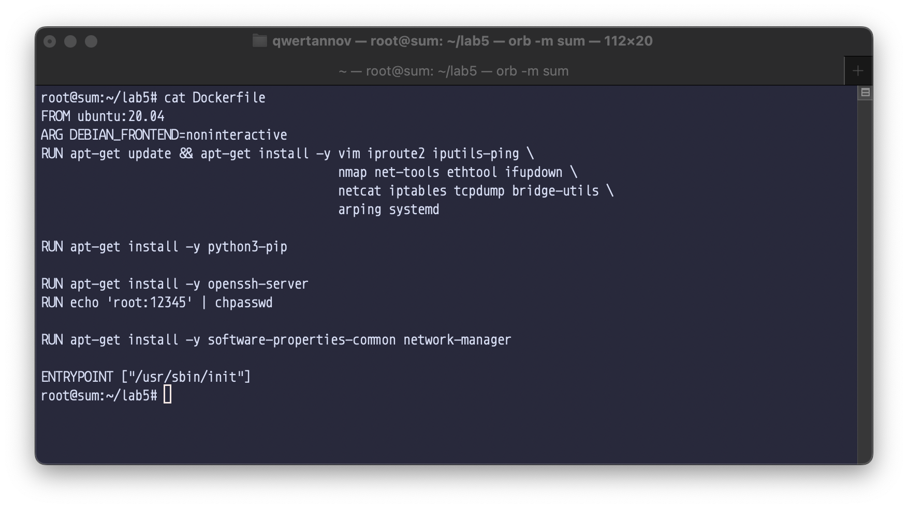

Рисунок 1 – Dockerfile

docker-compose.yml описує два привілейовані контейнери з одного образу з фіксованими
адресами (рис. 2, 3). host1 – керуючий вузол з Ansible, host2 – керований. Привілейований
режим потрібен, щоб на host2 можна було створювати інтерфейси, змінювати параметри ядра
мережі, правила iptables і дисципліни черг.

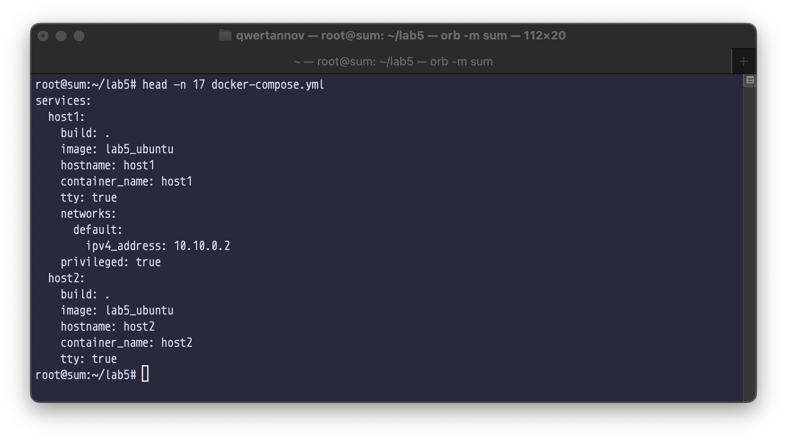

Рисунок 2 – Опис host1 у docker-compose.yml

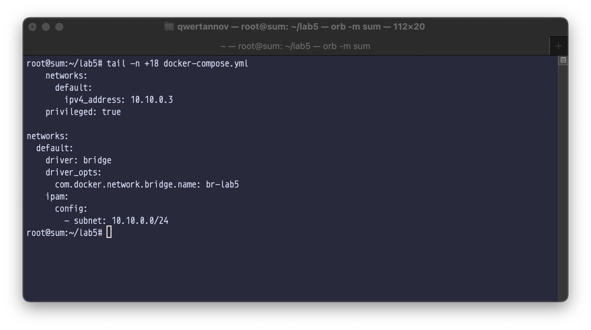

Рисунок 3 – Опис host2 і мережі в docker-compose.yml

Обидва контейнери запущено (рис. 4).

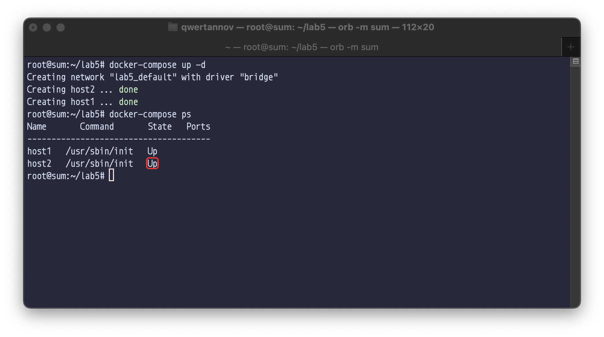

Рисунок 4 – Запуск контейнерів

## 4.2. Налаштування Ansible

PPA `ansible/ansible` містить свіжіші версії Ansible, ніж репозиторій Ubuntu 20.04.
`add-apt-repository` додає джерело і ключ підпису та оновлює списки пакетів (рис. 5).
Пакет `ansible` у PPA не залежить від архітектури, тому індекс для arm64 теж є.

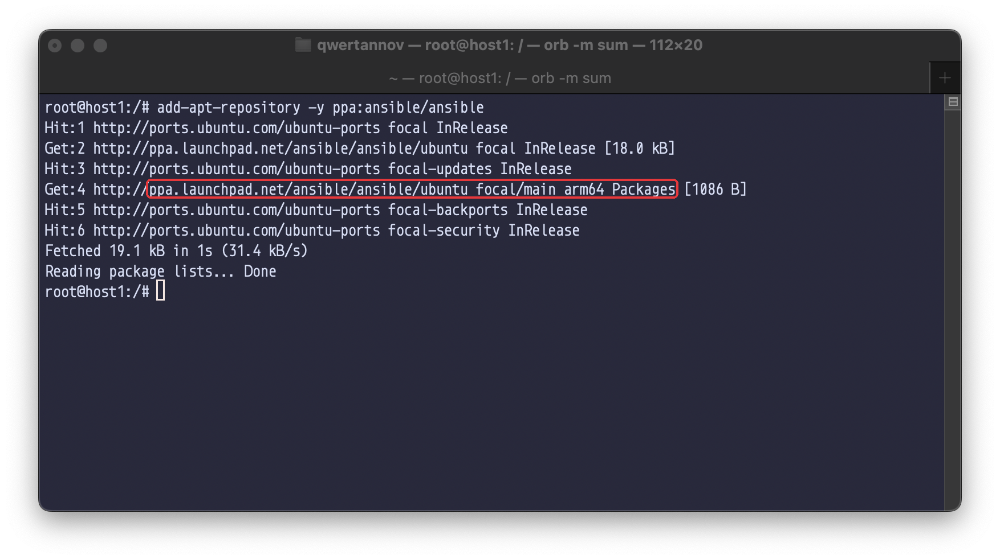

Рисунок 5 – Підключення PPA ansible/ansible

Пакет `ansible` 5.10 встановлює ядро `ansible-core` 2.12.10 і набір колекцій модулів.
Серед залежностей є `sshpass` для входу за паролем і `python3-paramiko` – альтернативна
реалізація SSH (рис. 6, 7).

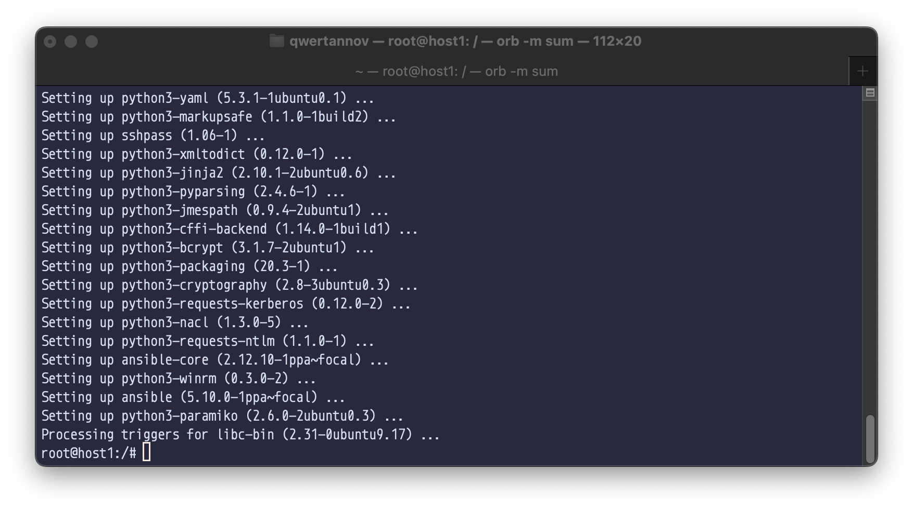

Рисунок 6 – Встановлення Ansible

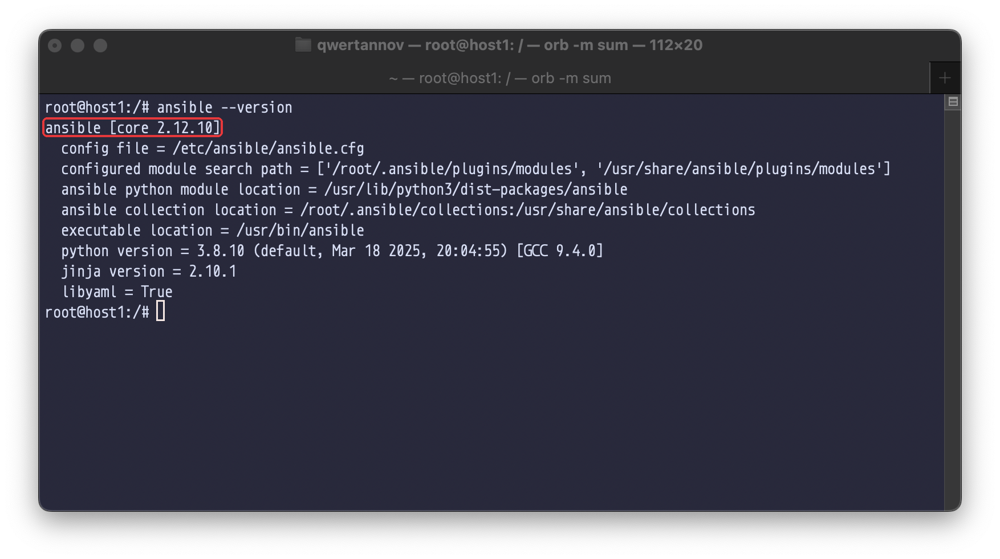

Рисунок 7 – Версія та шляхи конфігурації Ansible

Інвентар `/etc/ansible/hosts` містить групу `servers` з вузлом `server1`, адреса якого
задана змінною `ansible_host=10.10.0.3` (рис. 8). Змінна `ansible_python_interpreter`
для групи `all` вказує інтерпретатор на керованому вузлі: модулі Ansible копіюються туди
і виконуються Python. `ansible-inventory --list -y` показує, як Ansible розібрав інвентар:
неявна група `all` містить `servers` і порожню `ungrouped`.

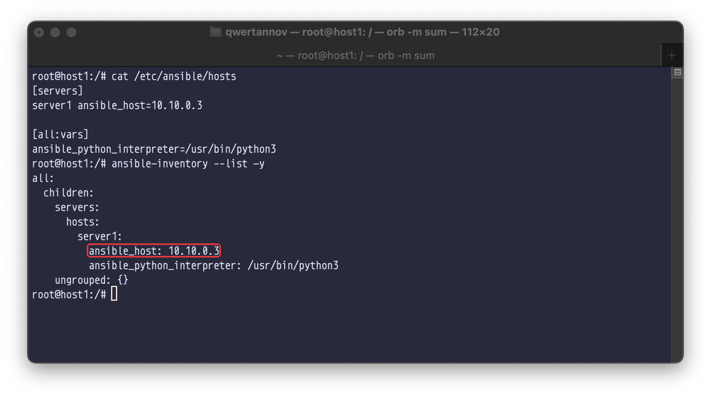

Рисунок 8 – Інвентар і його розбір

Модуль `ping` перевіряє, що Ansible може зайти на вузол і запустити там Python. Перша
спроба завершується станом `UNREACHABLE` (рис. 9): ключ хоста прийнято, але
автентифікація не пройшла, бо ключа клієнта на host2 немає, а пароль не передано.

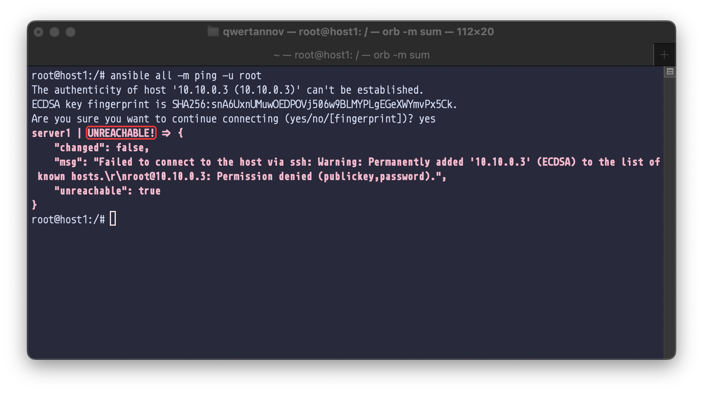

Рисунок 9 – Ansible не може підключитися до host2

### Налаштування SSH за ключем

На host1 згенеровано пару ключів RSA 3072 біт без парольної фрази, щоб Ansible міг
підключатися без участі користувача (рис. 10, 11).

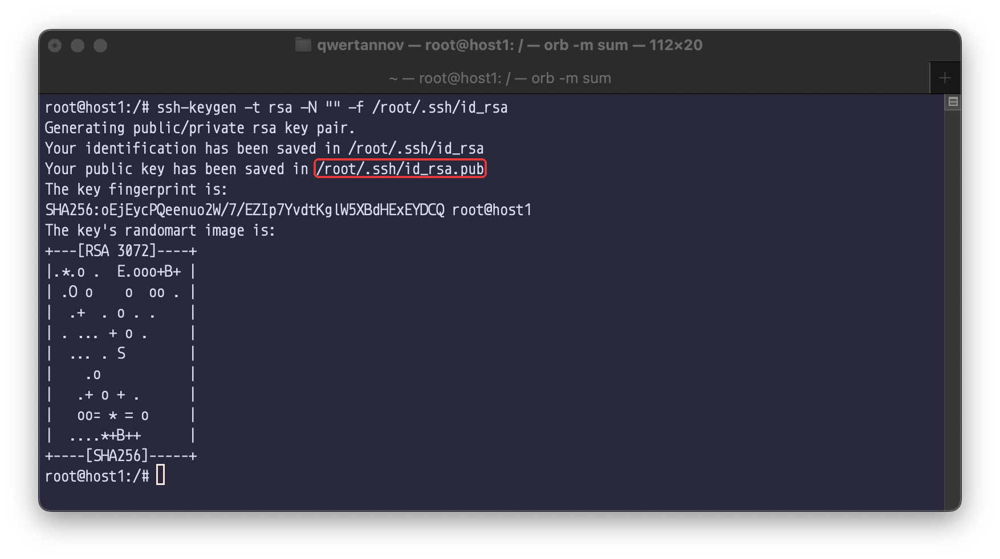

Рисунок 10 – Генерація ключів на host1

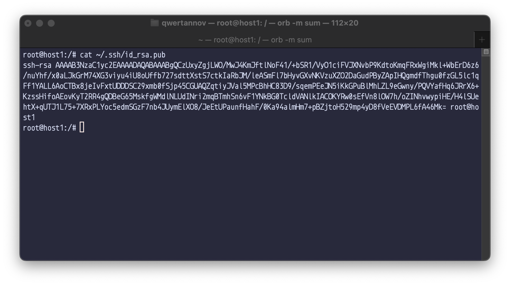

Рисунок 11 – Публічний ключ host1

Публічний ключ додано до `/root/.ssh/authorized_keys` на host2 (рис. 12).

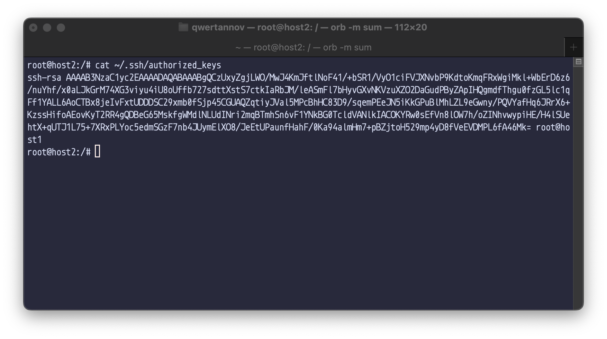

Рисунок 12 – authorized_keys на host2

У `/etc/ssh/sshd_config` на host2 встановлено `PermitRootLogin yes` і
`PasswordAuthentication no` (рис. 13). Типове значення `prohibit-password` теж дозволяє
вхід root за ключем, але явне значення прибирає залежність від типових налаштувань
пакета. Вимкнення входу за паролем залишає єдиний спосіб автентифікації – ключ. Після
перезапуску служба `ssh` активна.

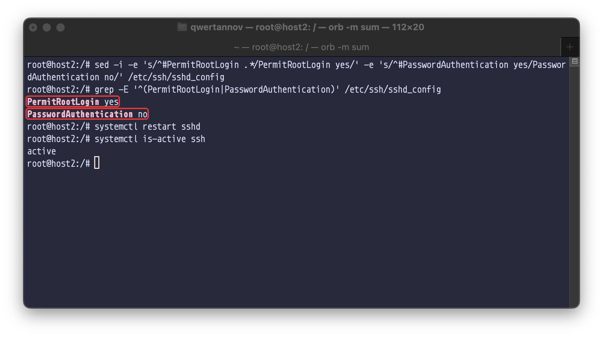

Рисунок 13 – Зміна sshd_config на host2

Вхід з host1 на host2 відбувається без запиту пароля (рис. 14).

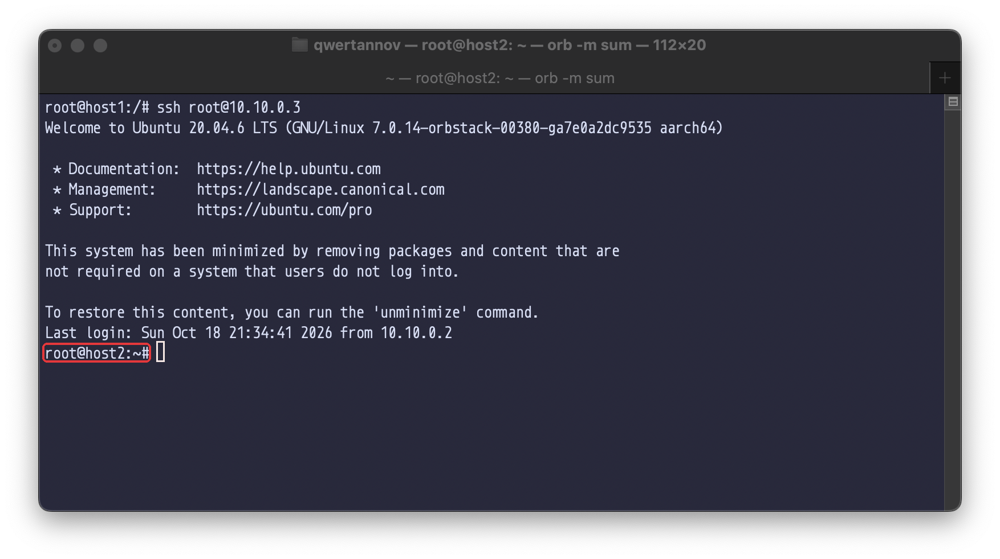

Рисунок 14 – Вхід по SSH з host1 на host2

Тепер модуль `ping` повертає `SUCCESS` з відповіддю `pong`, а ad-hoc команда
`df -h` виконується на host2 (рис. 15). Стан `CHANGED` для команди Ansible показує
завжди, бо не може знати, чи змінила довільна команда систему.

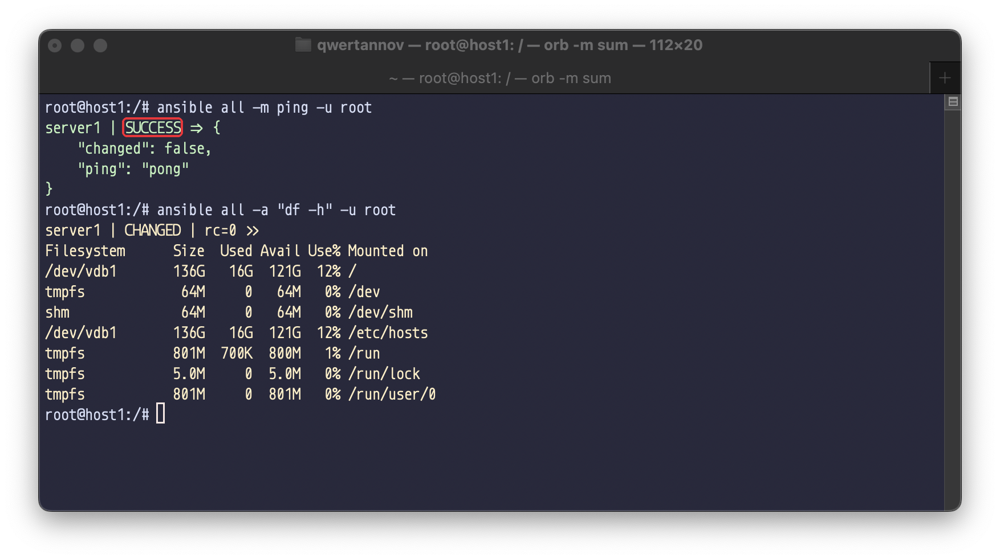

Рисунок 15 – Успішне підключення Ansible до host2

## 4.3. Налаштування файлу interfaces

На host2 створено dummy-інтерфейс eth1 і описано його в `/etc/network/interfaces` зі
статичною адресою 10.1.1.125/8 і шлюзом 10.1.1.1 (рис. 16). Для інтерфейсу
використано `auto` замість `allow-hotplug`: служба `networking` при перезапуску
піднімає командою `ifup -a` лише інтерфейси з `auto`, а `allow-hotplug` піднімається
за подією udev, якої в контейнері немає. Маршрут через шлюз отримав `metric 2000`, бо
маршрут за замовчуванням через eth0 уже існує, і без метрики `ifup` завершився б
помилкою `File exists`.

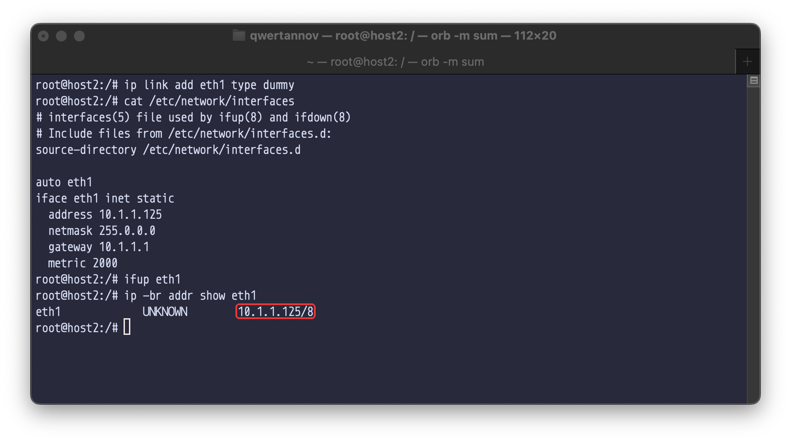

Рисунок 16 – Конфігурація eth1 у файлі interfaces

Playbook (рис. 17, 18, додаток А) містить один сценарій (play) для всіх вузлів
інвентарю. Змінні `new_ip_address` і `netmask` задають нові значення. Дві задачі з
модулем `lineinfile` знаходять за регулярним виразом рядок з `address` або `netmask` і
замінюють його. Якщо задача змінила файл, вона через `notify` викликає обробник
`Restart Network Service`, який перезапускає службу `networking` модулем `service`.
Обробник виконується один раз наприкінці сценарію, навіть якщо його викликали обидві
задачі. Збір фактів (`gather_facts`) вимкнено: playbook їх не використовує, а задача
`Gathering Facts` займає час на кожному запуску.

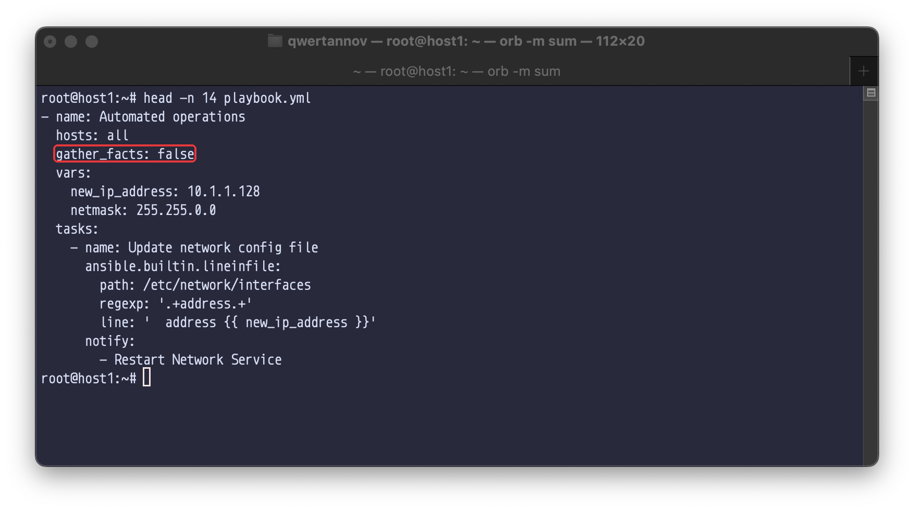

Рисунок 17 – playbook.yml, змінні й перша задача

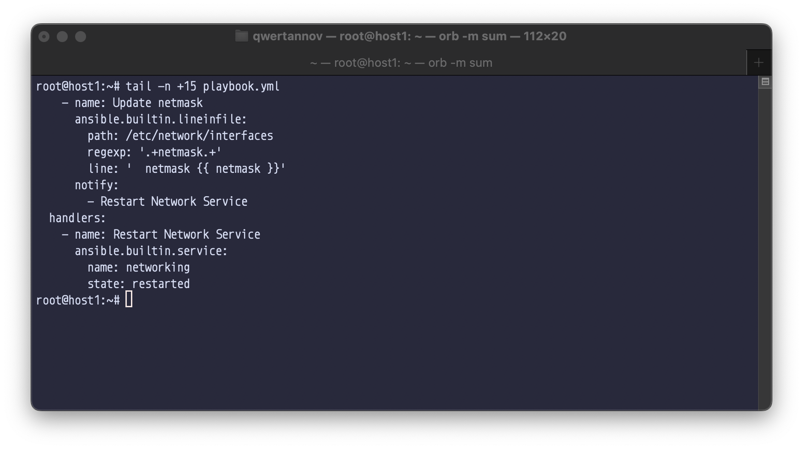

Рисунок 18 – playbook.yml, друга задача й обробник

Запуск обмежено вузлом `server1` опцією `-l`. Обидві задачі й обробник мають стан
`changed` (рис. 19).

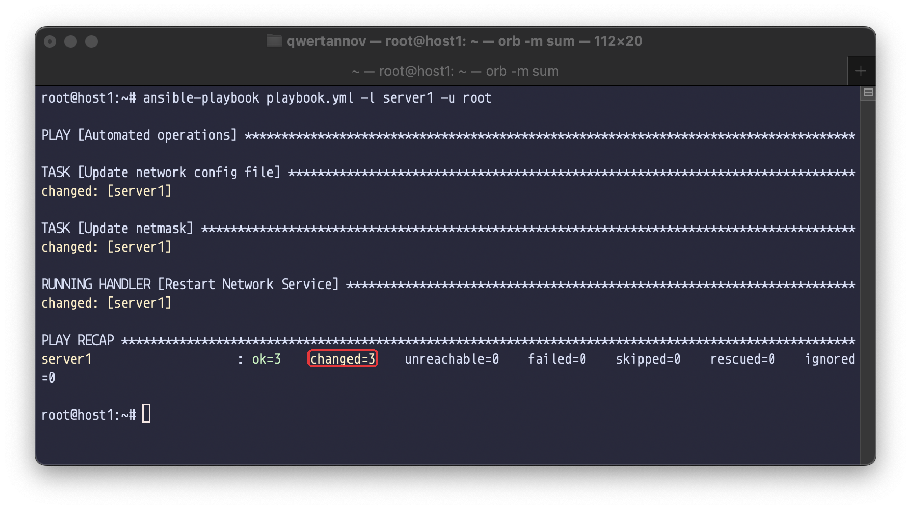

Рисунок 19 – Виконання playbook.yml

У файлі на host2 адреса й маска замінені, а після перезапуску служби eth1 має адресу
10.1.1.128/16 (рис. 20).

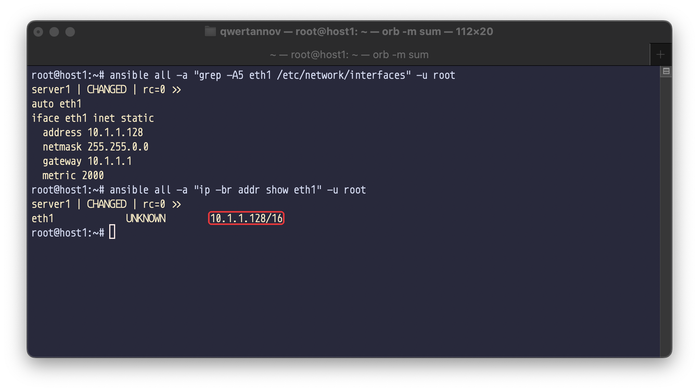

Рисунок 20 – Конфігурація і стан eth1 на host2 після playbook

Повторний запуск нічого не змінює: рядки вже мають потрібний вигляд, задачі мають стан
`ok`, і обробник не викликається (рис. 21). Це ідемпотентність – playbook описує
бажаний стан, а не послідовність дій, тому його можна виконувати багато разів.

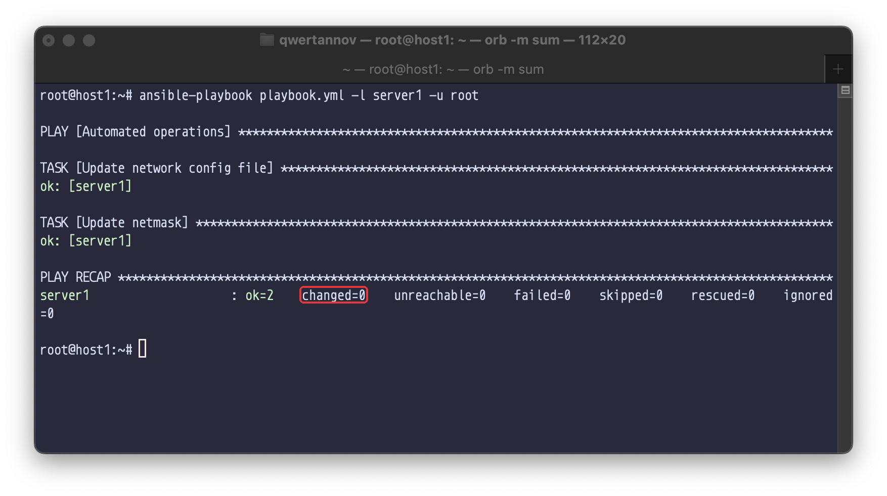

Рисунок 21 – Повторне виконання playbook.yml

## 4.4. Налаштування інтерфейсу eth1

Перед завданням eth1 і його конфігурацію видалено з host2 ad-hoc командами Ansible
(рис. 22): `ifdown eth1` знімає адресу й маршрут, модуль `lineinfile` зі
`state=absent` видаляє з `interfaces` шість рядків опису eth1, `ip link del` видаляє
сам інтерфейс. У файлі лишився тільки рядок `source-directory`, інтерфейсу eth1 немає,
host2 відповідає на ping (рис. 23).

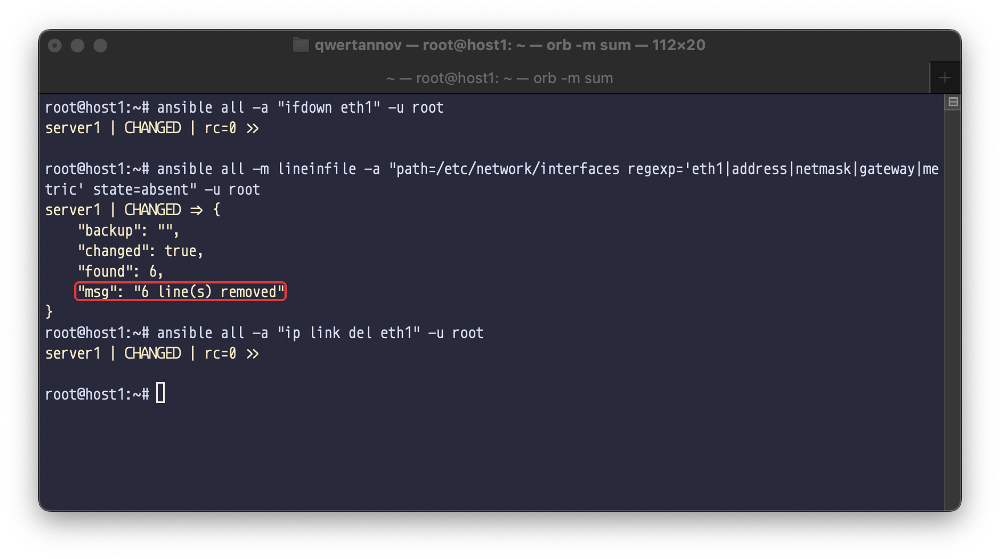

Рисунок 22 – Видалення eth1 ad-hoc командами Ansible

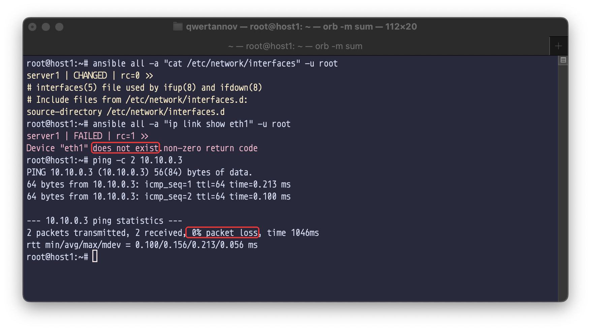

Рисунок 23 – Стан host2 перед виконанням configure_eth1.yml

Playbook `configure_eth1.yml` (рис. 24, 25, додаток Б) складається з трьох задач з
модулем `shell`, кожна виконує дію і перевіряє її результат. Якщо перевірка не
проходить, скрипт завершується з кодом 1 і Ansible позначає задачу як `failed` та
зупиняє виконання для цього вузла.

1. Інтерфейс eth1 типу dummy створюється, тільки якщо його ще немає, і переводиться
   в стан UP. Перевірка – `ip link show eth1`.
2. Адреса 10.11.0.2/24 призначається командою `ip addr replace`. На відміну від
   `ip addr add` вона не завершується помилкою, якщо адреса вже є. Перевірка – на
   інтерфейсі є хоча б одна IPv4-адреса.
3. У `/proc/sys/net/ipv4/icmp_echo_ignore_all` записується 1, і ядро перестає
   відповідати на ICMP echo request. Перевірка – параметр дорівнює 1.

Завдяки умовному створенню інтерфейсу і `ip addr replace` playbook можна запускати
повторно без помилок. Назва інтерфейсу й адреса винесені у змінні.

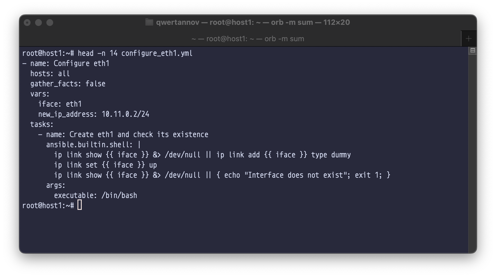

Рисунок 24 – configure_eth1.yml, змінні й перша задача

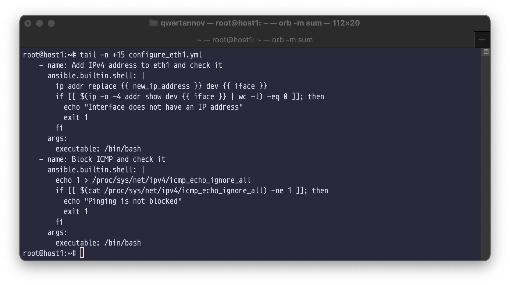

Рисунок 25 – configure_eth1.yml, призначення адреси й блокування ICMP

Усі три задачі виконано без помилок (рис. 26).

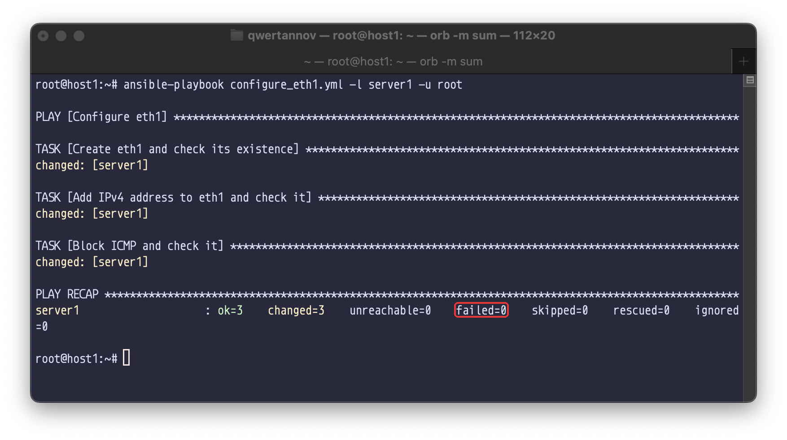

Рисунок 26 – Виконання configure_eth1.yml

На host2 інтерфейс eth1 має адресу 10.11.0.2/24, параметр `icmp_echo_ignore_all`
дорівнює 1, а ping з host1 на 10.10.0.3 дає 100% втрат (рис. 27). Параметр діє в
мережевому просторі імен контейнера host2, тому решта вузлів на ping відповідає.

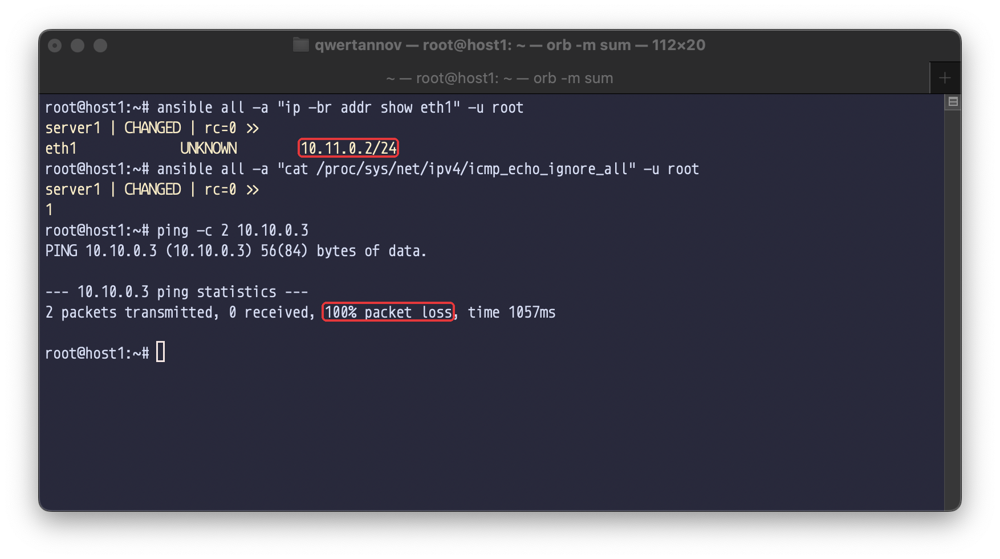

Рисунок 27 – Стан eth1 і блокування ICMP на host2

## 3.4. Скрипт моніторингу мережі

Скрипт `monitor.sh` (рис. 28, 29, додаток В) працює на host1 і опитує всі вузли з
інвентарю, або групу, задану третім аргументом. На кожному циклі одна ad-hoc команда
`ansible -m shell -o` виконує на вузлах команду, що друкує час вузла з точністю до
наносекунд, лічильники прийнятих і переданих байтів eth0 з
`/sys/class/net/eth0/statistics` і кількість TCP-з'єднань у стані ESTABLISHED. Опція
`-o` дає один рядок відповіді на вузол, який скрипт розбирає. Якщо в рядку немає
`(stdout)`, вузол недоступний.

Швидкість – різниця лічильників між двома опитуваннями, поділена на різницю часу
вузла. Інтервал `sleep` для цього не годиться: сам виклик Ansible триває близько
секунди, і фактичний проміжок між вимірами більший за заданий.

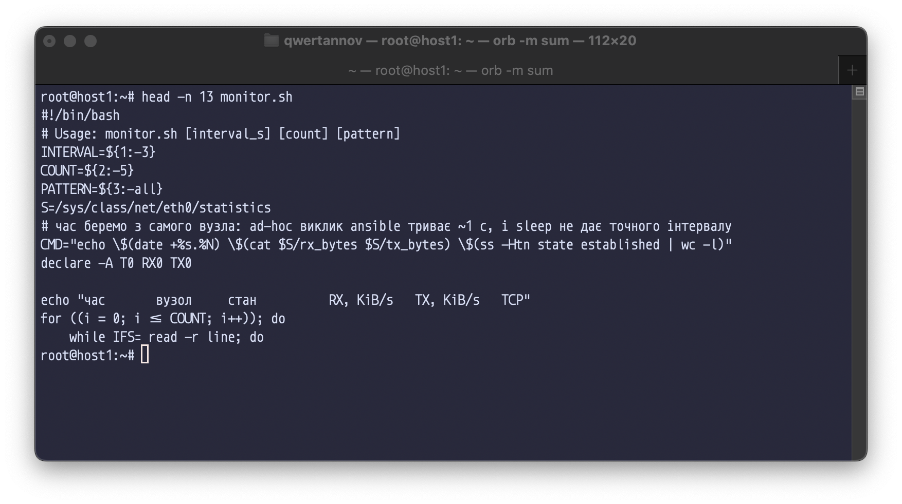

Рисунок 28 – monitor.sh, змінні й команда опитування

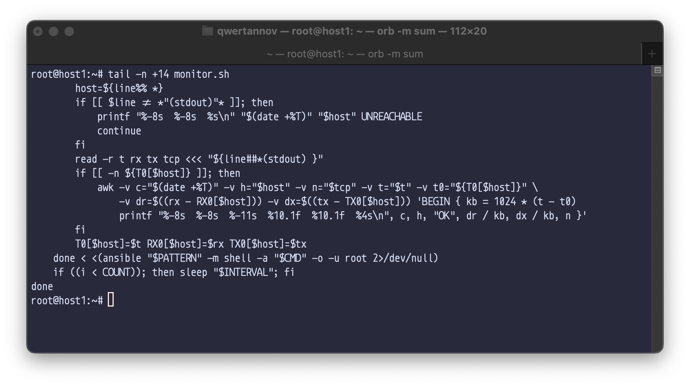

Рисунок 29 – monitor.sh, розбір відповідей і розрахунок швидкості

Для перевірки з host1 на host2 у фоні копіюється файл 40 МБ через `scp` з обмеженням
швидкості 8192 Кбіт/с (рис. 30). Скрипт з інтервалом 3 с показує прийом на host2
близько 925 КіБ/с – це обмеження `scp` за вирахуванням службових даних SSH. Вихідний
трафік 6 КіБ/с – підтвердження TCP. TCP-з'єднань два: `scp` і з'єднання Ansible.
Без навантаження прийом на host2 становить близько 40 КіБ/с – це сам Ansible, який на
кожному виклику передає на вузол код модуля.

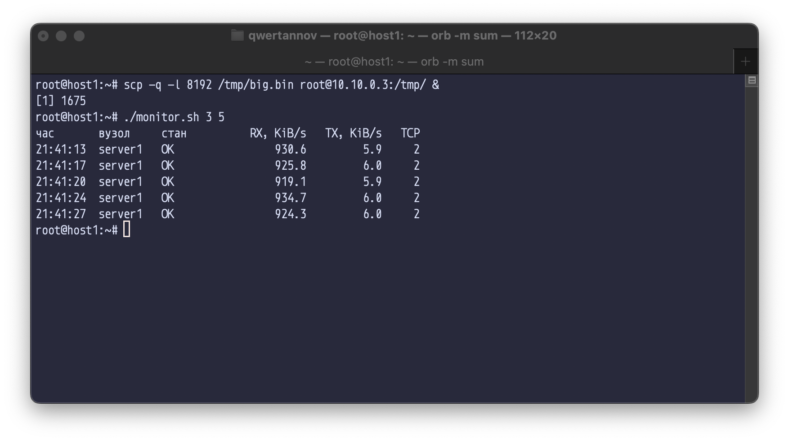

Рисунок 30 – Робота скрипта моніторингу під час копіювання файлу

Якщо на host2 зупинити SSH-сервер, кожне опитування повертає `UNREACHABLE` (рис. 31).
Скрипт не завершується, а продовжує опитування, тож видно момент, коли вузол знову
стане доступним.

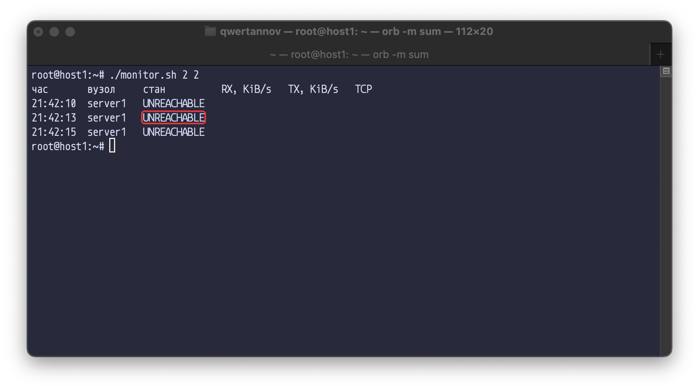

Рисунок 31 – Моніторинг недоступного вузла

## 3.5. Firewall та обмеження пропускної здатності

Playbook `firewall.yml` (рис. 32, 33, додаток Г) складається з двох груп задач, позначених
тегами. Опція `--tags` запускає лише задачі з потрібним тегом, тому firewall і
обмеження смуги застосовано й перевірено окремо.

Задачі з тегом `firewall` використовують модуль `iptables`:

1. Дозволити вхідні пакети з інтерфейсу `lo` і пакети вже встановлених з'єднань
   (`ctstate ESTABLISHED,RELATED`). Обидва правила задано одним циклом `loop`.
2. Дозволити TCP-з'єднання з мережі 10.10.0.0/24 на порти 22 (SSH) і 5201 (iperf3)
   одним правилом з модулем `multiport`.
3. Встановити політику ланцюжка INPUT `DROP` – решта вхідних пакетів відкидається.

Порядок задач важливий: якби політику DROP встановили до правила для SSH, Ansible
втратив би доступ до вузла.

Задачі з тегом `bandwidth` встановлюють `iperf3` модулем `apt`, обмежують вихідну смугу
eth0 до 2 Мбіт/с і запускають сервер `iperf3` у фоні. Обмеження задає дисципліна черги
`tbf` (Token Bucket Filter): пакети відправляються, лише поки в «відрі» є токени, а
токени додаються зі швидкістю `rate`. `burst` – розмір відра, тобто скільки даних можна
відправити підряд, `latency` – найбільший час, який пакет може чекати в черзі.
Команда `tc qdisc replace` замінює дисципліну, якщо вона вже є, тому задачу можна
виконувати повторно.

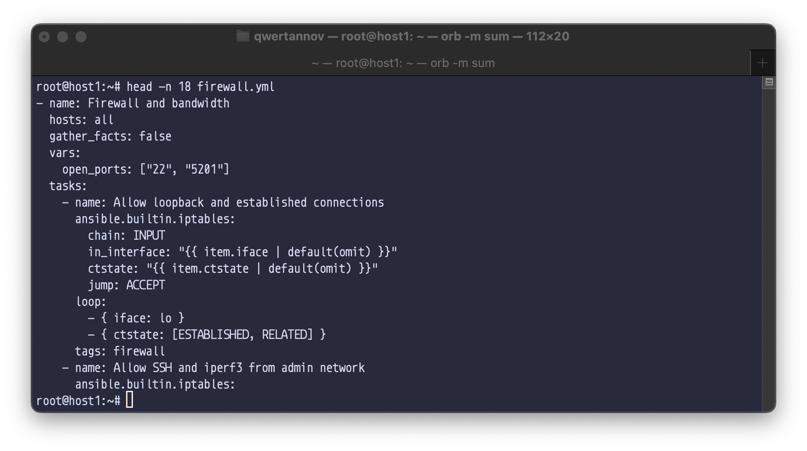

Рисунок 32 – firewall.yml, змінні й перші правила

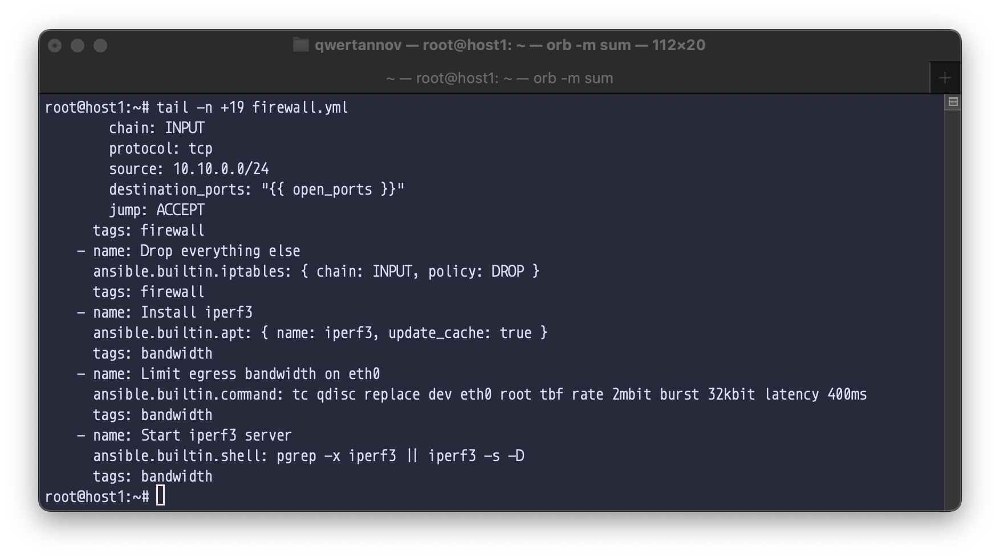

Рисунок 33 – firewall.yml, політика DROP і обмеження смуги

До застосування firewall порт 22 на host2 відкритий, а підключення до порту 80, де
нічого не слухає, отримує TCP RST – `Connection refused`. Ланцюжок INPUT порожній з
політикою ACCEPT (рис. 34).

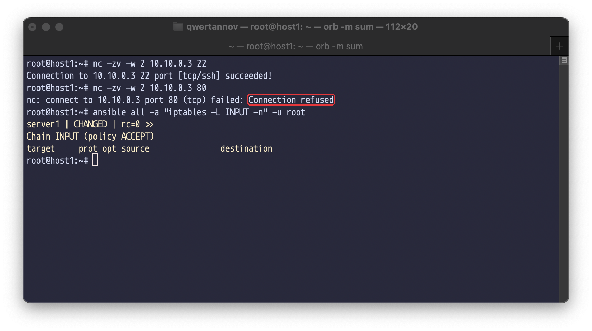

Рисунок 34 – Перевірка портів host2 до firewall

Задачі з тегом `firewall` виконано, правило для `lo` і ESTABLISHED показано як два
елементи циклу (рис. 35).

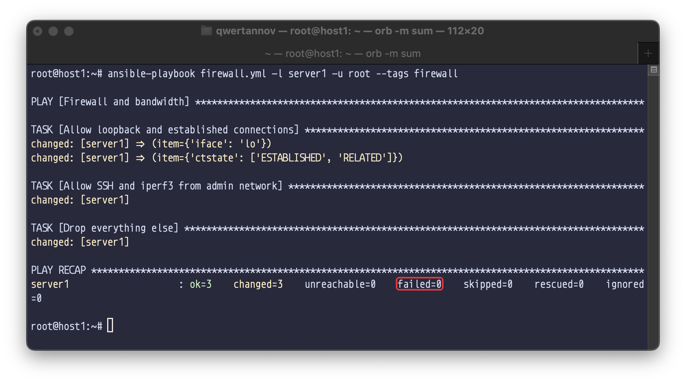

Рисунок 35 – Виконання firewall.yml з тегом firewall

Після застосування SSH, як і раніше, доступний, а підключення до порту 80 завершується
тайм-аутом: пакет SYN відкидається без відповіді, і клієнт не дізнається, чи порт
закритий (рис. 36). `iptables -S` показує політику `-P INPUT DROP` і три правила в
порядку їх додавання.

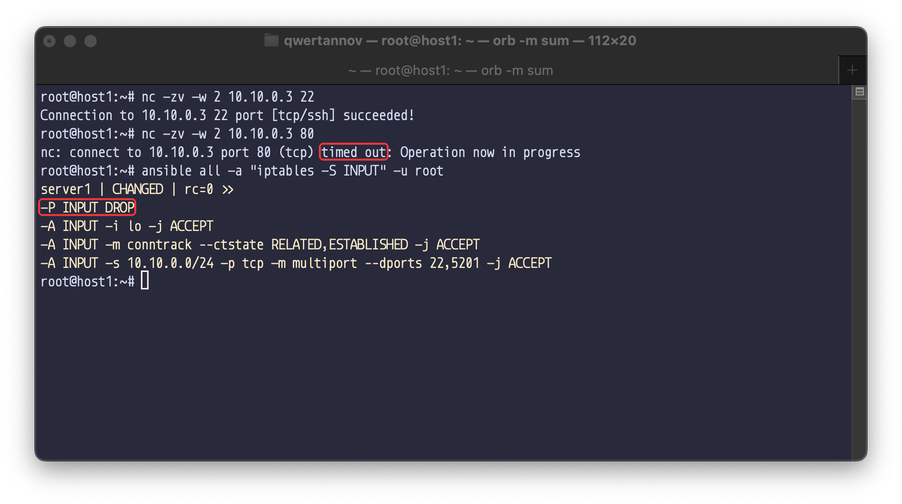

Рисунок 36 – Перевірка портів і правила iptables на host2

Задачі з тегом `bandwidth` виконано (рис. 37).

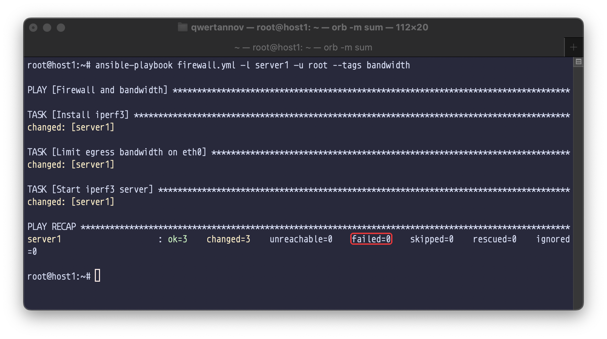

Рисунок 37 – Виконання firewall.yml з тегом bandwidth

На eth0 host2 встановлено дисципліну `tbf` з `rate 2Mbit` (рис. 38). `iperf3 -R`
вимірює потік від сервера на host2 до host1, тобто вихідний трафік host2: швидкість на
приймачі – 1,99 Мбіт/с. Перший інтервал трохи вищий за 2 Мбіт/с за рахунок початково
повного відра токенів.

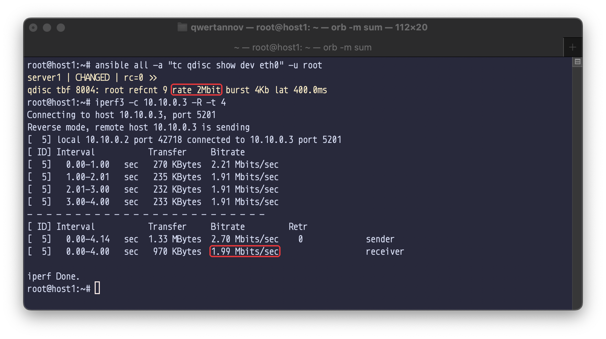

Рисунок 38 – Дисципліна tbf і швидкість вихідного трафіку host2

У зворотному напрямку, від host1 до host2, швидкість становить 4,49 Гбіт/с (рис. 39):
`tbf` обмежує лише вихідну чергу інтерфейсу, вхідний трафік host2 вона не зачіпає. Для
обмеження вхідного трафіку потрібен `ingress`-поліцер або перенаправлення на віртуальний
інтерфейс `ifb`.

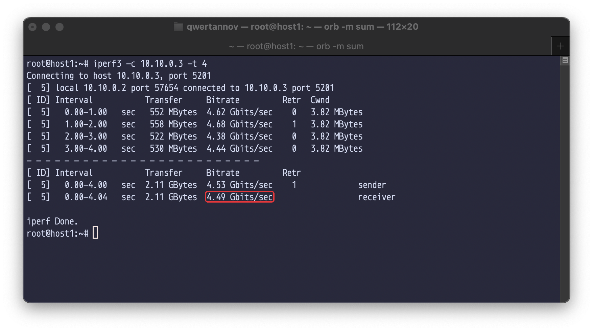

Рисунок 39 – Швидкість вхідного трафіку host2

# IV. Відповіді на контрольні запитання

1. Що таке Ansible?

   Ansible – інструмент з відкритим кодом для автоматизації керування конфігураціями,
   розгортання програм і оркестрації. Бажаний стан систем описується декларативно у
   форматі YAML, а Ansible приводить до нього керовані вузли. Агенти на вузлах не
   потрібні: керуючий вузол підключається по SSH (до Windows – по WinRM), копіює туди
   модулі й виконує їх Python. Вузли описуються в інвентарі (рис. 8), окремі дії
   виконуються ad-hoc командами (рис. 15, 22), набори дій – playbook (рис. 19).

2. Як встановити Ansible на Linux?

   З репозиторію дистрибутива (`apt install ansible` у Debian і Ubuntu,
   `dnf install ansible` у Fedora), з PPA `ppa:ansible/ansible` для новіших версій в
   Ubuntu (рис. 5, 6) або через `pip install ansible` у віртуальне середовище Python.
   Ansible ставиться лише на керуючий вузол. На керованих потрібні тільки SSH-сервер і
   Python, а доступ зручно налаштувати за ключем (рис. 10–14).

3. Що таке playbook?

   Playbook – YAML-файл зі списком сценаріїв (play). Кожен сценарій задає, на яких
   вузлах (`hosts`) і від якого користувача виконуватись, змінні (`vars`) і
   впорядкований список задач (`tasks`). Задача викликає модуль з параметрами,
   наприклад `lineinfile`, `service`, `iptables`, `apt`, `shell`. Обробники
   (`handlers`) виконуються наприкінці сценарію, лише якщо їх викликала задача через
   `notify` (рис. 17–19). Теги дають змогу запускати частину задач (рис. 35, 37).
   Задачі модулів, крім `shell` і `command`, ідемпотентні, тому повторний запуск не
   змінює систему, яка вже в потрібному стані (рис. 21).

4. Який процес створення playbook?

   Спочатку описати вузли в інвентарі й перевірити доступ модулем `ping`. Потім
   визначити бажаний стан і розбити його на задачі, підібрати для кожної модуль
   (замість `shell` – спеціалізований модуль, якщо такий є), винести змінні значення у
   `vars`, а дії, потрібні лише після змін (перезапуск служби), – в обробники. Перевірити
   синтаксис `ansible-playbook --syntax-check` і виконати пробний запуск `--check`, що
   показує зміни без їх застосування. Далі запустити playbook, обмежившись тестовим
   вузлом через `-l`, перевірити результат на вузлі (рис. 20, 27) і переконатися, що
   повторний запуск не дає змін (рис. 21).

5. Для автоматизації чого б ви використовували Ansible?

   Для однакового налаштування багатьох серверів: мережевих інтерфейсів і маршрутів
   (рис. 20, 27), правил firewall і обмеження смуги (рис. 36, 38), користувачів і
   SSH-ключів, встановлення пакетів і оновлень. Також для розгортання застосунків і
   конфігураційних файлів із шаблонів Jinja2, налаштування мережевого обладнання
   (Cisco, Juniper, MikroTik мають колекції модулів), збору стану вузлів і простого
   моніторингу (рис. 30), підготовки тестових середовищ.

# V. Висновки

У роботі за допомогою Ansible з контейнера host1 віддалено налаштовано мережу
контейнера host2.

1. Ansible встановлено з PPA, host2 описано в інвентарі. Без ключа модуль `ping`
   повертає `UNREACHABLE`, після налаштування SSH за ключем – `SUCCESS`.
2. Playbook з модулем `lineinfile` і обробником замінив адресу eth1 у файлі
   `interfaces` на 10.1.1.128/16 і перезапустив службу `networking`. Повторний
   запуск не дав змін. В контейнері інтерфейс має бути описаний як `auto`, бо
   `allow-hotplug` без udev після перезапуску служби не піднімається.
3. Playbook `configure_eth1.yml` створив eth1 з адресою 10.11.0.2/24 і заблокував
   відповіді на ICMP, після чого ping до host2 дає 100% втрат. Кожна задача перевіряє
   свій результат і завершується помилкою, якщо він не досягнутий.
4. Скрипт моніторингу через ad-hoc команди Ansible показав швидкість прийому
   925 КіБ/с під час копіювання з обмеженням 8192 Кбіт/с і стан `UNREACHABLE` при
   зупиненому SSH-сервері.
5. Playbook з тегами налаштував firewall з політикою DROP, після чого закритий порт
   перестав відповідати RST, і обмежив вихідну смугу host2: 1,99 Мбіт/с проти
   4,49 Гбіт/с у напрямку без обмеження.

# Додаток А. playbook.yml

```yaml
- name: Automated operations
  hosts: all
  gather_facts: false
  vars:
    new_ip_address: 10.1.1.128
    netmask: 255.255.0.0
  tasks:
    - name: Update network config file
      ansible.builtin.lineinfile:
        path: /etc/network/interfaces
        regexp: '.+address.+'
        line: '  address {{ new_ip_address }}'
      notify:
        - Restart Network Service
    - name: Update netmask
      ansible.builtin.lineinfile:
        path: /etc/network/interfaces
        regexp: '.+netmask.+'
        line: '  netmask {{ netmask }}'
      notify:
        - Restart Network Service
  handlers:
    - name: Restart Network Service
      ansible.builtin.service:
        name: networking
        state: restarted
```

# Додаток Б. configure_eth1.yml

```yaml
- name: Configure eth1
  hosts: all
  gather_facts: false
  vars:
    iface: eth1
    new_ip_address: 10.11.0.2/24
  tasks:
    - name: Create eth1 and check its existence
      ansible.builtin.shell: |
        ip link show {{ iface }} &> /dev/null || ip link add {{ iface }} type dummy
        ip link set {{ iface }} up
        ip link show {{ iface }} &> /dev/null || { echo "Interface does not exist"; exit 1; }
      args:
        executable: /bin/bash
    - name: Add IPv4 address to eth1 and check it
      ansible.builtin.shell: |
        ip addr replace {{ new_ip_address }} dev {{ iface }}
        if [[ $(ip -o -4 addr show dev {{ iface }} | wc -l) -eq 0 ]]; then
          echo "Interface does not have an IP address"
          exit 1
        fi
      args:
        executable: /bin/bash
    - name: Block ICMP and check it
      ansible.builtin.shell: |
        echo 1 > /proc/sys/net/ipv4/icmp_echo_ignore_all
        if [[ $(cat /proc/sys/net/ipv4/icmp_echo_ignore_all) -ne 1 ]]; then
          echo "Pinging is not blocked"
          exit 1
        fi
      args:
        executable: /bin/bash
```

# Додаток В. monitor.sh

```bash
#!/bin/bash
# Usage: monitor.sh [interval_s] [count] [pattern]
INTERVAL=${1:-3}
COUNT=${2:-5}
PATTERN=${3:-all}
S=/sys/class/net/eth0/statistics
# час беремо з самого вузла: ad-hoc виклик ansible триває ~1 с, і sleep не дає точного інтервалу
CMD="echo \$(date +%s.%N) \$(cat $S/rx_bytes $S/tx_bytes) \$(ss -Htn state established | wc -l)"
declare -A T0 RX0 TX0

echo "час       вузол     стан          RX, KiB/s   TX, KiB/s   TCP"
for ((i = 0; i <= COUNT; i++)); do
    while IFS= read -r line; do
        host=${line%% *}
        if [[ $line != *"(stdout)"* ]]; then
            printf "%-8s  %-8s  %s\n" "$(date +%T)" "$host" UNREACHABLE
            continue
        fi
        read -r t rx tx tcp <<< "${line##*(stdout) }"
        if [[ -n ${T0[$host]} ]]; then
            awk -v c="$(date +%T)" -v h="$host" -v n="$tcp" -v t="$t" -v t0="${T0[$host]}" \
                -v dr=$((rx - RX0[$host])) -v dx=$((tx - TX0[$host])) 'BEGIN { kb = 1024 * (t - t0)
                printf "%-8s  %-8s  %-11s  %10.1f  %10.1f  %4s\n", c, h, "OK", dr / kb, dx / kb, n }'
        fi
        T0[$host]=$t RX0[$host]=$rx TX0[$host]=$tx
    done < <(ansible "$PATTERN" -m shell -a "$CMD" -o -u root 2>/dev/null)
    if ((i < COUNT)); then sleep "$INTERVAL"; fi
done
```

# Додаток Г. firewall.yml

```yaml
- name: Firewall and bandwidth
  hosts: all
  gather_facts: false
  vars:
    open_ports: ["22", "5201"]
  tasks:
    - name: Allow loopback and established connections
      ansible.builtin.iptables:
        chain: INPUT
        in_interface: "{{ item.iface | default(omit) }}"
        ctstate: "{{ item.ctstate | default(omit) }}"
        jump: ACCEPT
      loop:
        - { iface: lo }
        - { ctstate: [ESTABLISHED, RELATED] }
      tags: firewall
    - name: Allow SSH and iperf3 from admin network
      ansible.builtin.iptables:
        chain: INPUT
        protocol: tcp
        source: 10.10.0.0/24
        destination_ports: "{{ open_ports }}"
        jump: ACCEPT
      tags: firewall
    - name: Drop everything else
      ansible.builtin.iptables: { chain: INPUT, policy: DROP }
      tags: firewall
    - name: Install iperf3
      ansible.builtin.apt: { name: iperf3, update_cache: true }
      tags: bandwidth
    - name: Limit egress bandwidth on eth0
      ansible.builtin.command: tc qdisc replace dev eth0 root tbf rate 2mbit burst 32kbit latency 400ms
      tags: bandwidth
    - name: Start iperf3 server
      ansible.builtin.shell: pgrep -x iperf3 || iperf3 -s -D
      tags: bandwidth
```
