# І. Мета

Отримати навички конфігурування мережі із використанням Netmiko.

# ІІ. Постановка завдання та алгоритм розв'язання

Завдання:

1. Підготувати середовище з двох Docker-контейнерів host1 і host2 (завдання 4.1).
2. Написати скрипт, який підключається з host2 до host1 і отримує список процесів
   (завдання 4.2).
3. Написати скрипт, який створює й налаштовує інтерфейс eth1 і вимикає відповіді на ICMP
   на host1 (завдання 4.3).
4. Реалізувати парсер виводу команди `ip show` і застосувати його в скрипті (додаткове
   завдання 3.4).
5. Реалізувати моніторинг вузла з використанням Netmiko (додаткове завдання 3.5).

Середовище: Debian 12 (OrbStack, macOS), Docker 20.10 і docker-compose 1.29, контейнери
на образі ubuntu:20.04, Python 3.8.10, Netmiko 3.4.0.

Алгоритм розв'язання:

1. Описати в Dockerfile образ з мережевими утилітами, systemd, OpenSSH-сервером, паролем
   root і бібліотекою Netmiko. Запустити два привілейовані контейнери з адресами
   10.10.0.2 і 10.10.0.3 у мережі з бріджем `br-lab6`.
2. На host2 (керуючий вузол) скрипт `mgmt.py` відкриває SSH-сесію до host1 через
   `ConnectHandler` з типом пристрою `linux`, виконує `ps aux` і друкує вивід. Хід сесії
   пишеться в журнал, ім'я якого містить дату й час запуску.
3. Скрипт `configure_eth1.py` у тій самій сесії створює dummy-інтерфейс eth1, призначає
   адресу 10.11.0.2/24 і вмикає `icmp_echo_ignore_all`, перевіряючи вивід після кожного
   кроку. Результат перевірити на host1 і ping з host2.
4. Модуль `ipparse.py` розбирає вивід `ip addr show` у словник інтерфейсів з індексом,
   прапорцями, MTU, MAC і адресами. На ньому побудовано таблицю інтерфейсів `ifaces.py` і
   ідемпотентний варіант налаштування `configure_eth1_v2.py`, який виконує лише ті кроки,
   яких бракує.
5. Скрипт `monitor.py` тримає одну сесію з host1, періодично читає навантаження, пам'ять
   і лічильники eth0 та рахує швидкість трафіку. При обриві з'єднання друкує
   `UNREACHABLE` і на наступному циклі підключається заново.

# ІІІ. Хід виконання

## 4.1. Налаштування середовища

Образ будується з ubuntu:20.04 (рис. 1). OpenSSH-сервер потрібен, бо Netmiko керує
вузлом через SSH. Пароль root задано через `chpasswd`, а `PermitRootLogin yes` дозволяє
root входити за паролем: типове значення в Ubuntu 20.04 пускає root лише за ключем.
Пакет `systemd` дає `/usr/sbin/init`, який запускається як процес 1 і стартує `sshd`.
Netmiko 3.4.0 ставиться через pip разом з `cryptography` 3.4.8. Новіші версії
`cryptography` на кожному імпорті друкують попередження, що Python 3.8 більше не
підтримується, а старіша відповідає часу виходу Netmiko 3.4.0.

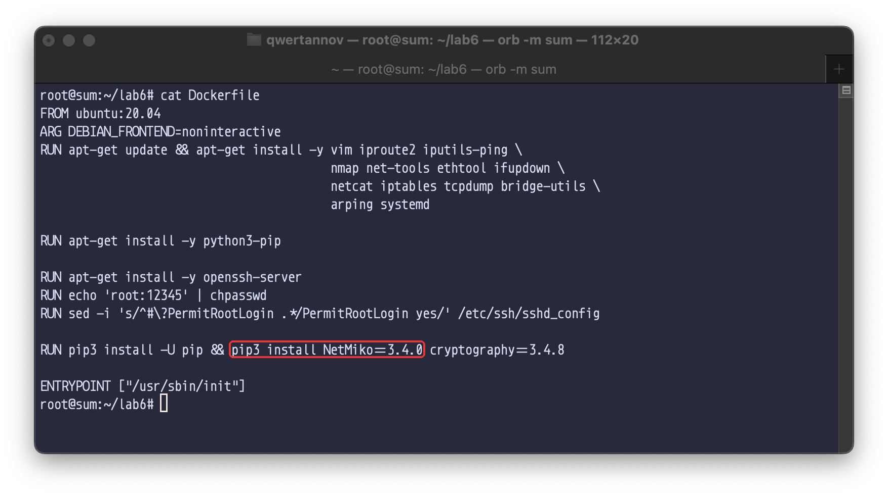

Рисунок 1 – Dockerfile

docker-compose.yml описує два привілейовані контейнери з одного образу з фіксованими
адресами (рис. 2, 3). host2 – керуючий вузол, на ньому працюють скрипти; host1 –
керований. Привілейований режим потрібен, щоб на host1 можна було створювати інтерфейси
і змінювати параметри ядра мережі.

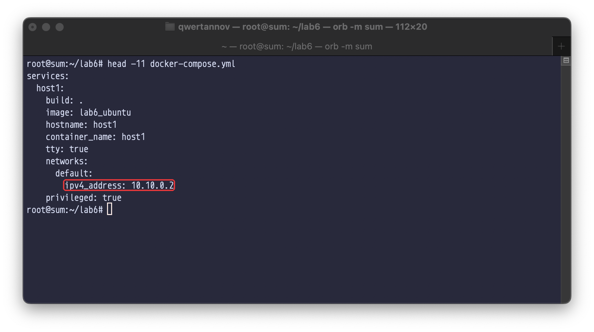

Рисунок 2 – Опис host1 у docker-compose.yml

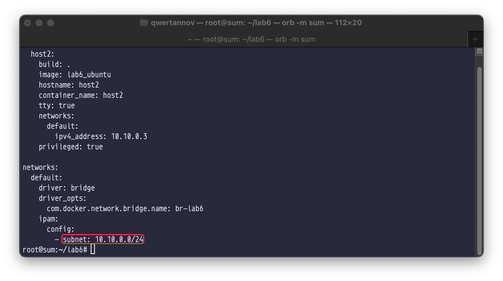

Рисунок 3 – Опис host2 і мережі в docker-compose.yml

Обидва контейнери запущено (рис. 4). Скрипти скопійовано в `/root` на host2.

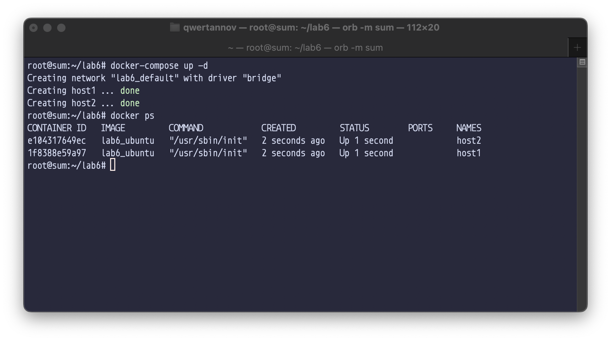

Рисунок 4 – Запуск контейнерів

## 4.2. Взаємодія із сервером

Скрипт `mgmt.py` (рис. 5, 6, додаток А) описує пристрій словником параметрів:
`device_type: linux` вибирає клас `LinuxSSH`, який знає вигляд промпту Linux-оболонки
і вміє переходити в root. `session_log` задає файл журналу сесії, `auth_timeout` –
час очікування автентифікації. `ConnectHandler` повертає об'єкт класу, що відповідає
типу пристрою, і відкриває з'єднання. `send_command` надсилає команду і читає вивід,
поки не з'явиться промпт.

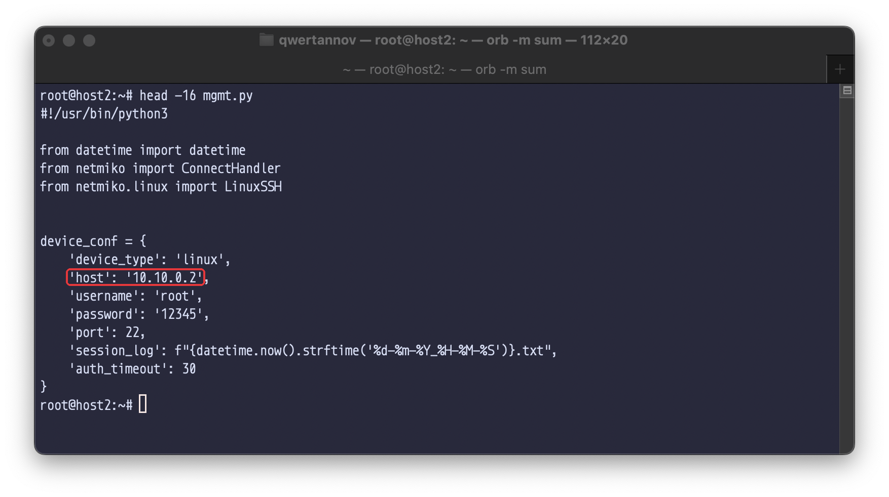

Рисунок 5 – mgmt.py, параметри підключення

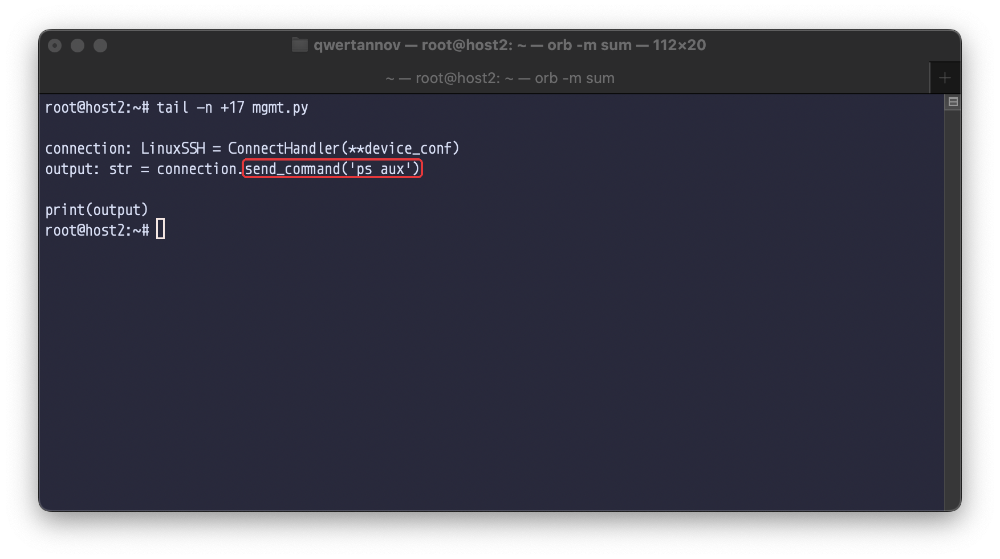

Рисунок 6 – mgmt.py, підключення й виконання команди

Скрипт виводить процеси host1 (рис. 7). Серед них процес `init` (PID 1), служби systemd,
`sshd`, а також процеси самої сесії Netmiko: `sshd: root@pts/1`, оболонка `-bash` і
`ps aux`. Netmiko відкриває інтерактивну оболонку з псевдотерміналом, а не виконує
команду через `exec`, як `ssh host cmd`.

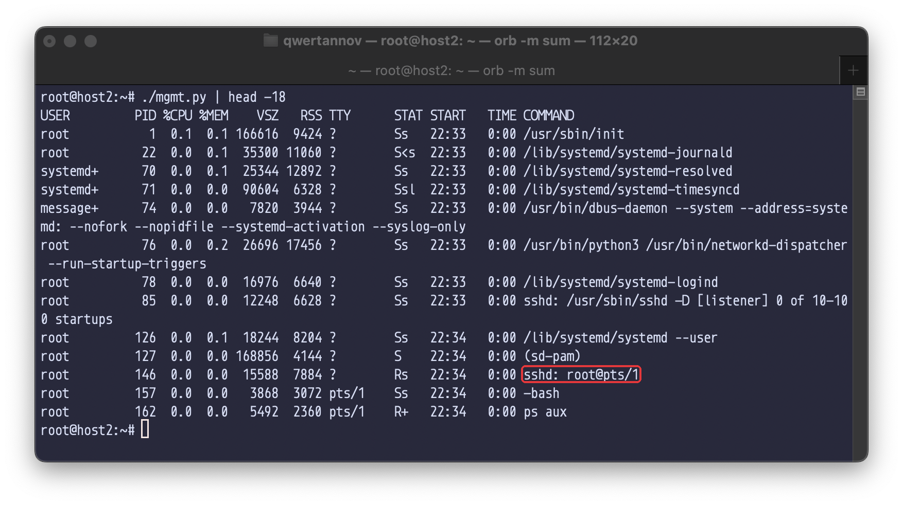

Рисунок 7 – Список процесів host1

Кожен запуск створює новий журнал (рис. 8). У ньому записано все, що пройшло через
сесію: банер входу, промпт `root@host1:~#`, надіслані команди і їх вивід. Журнал зручний
для розбору, якщо скрипт отримав не той вивід, який очікував. Ім'я журналу містить
дату за часом контейнера (UTC).

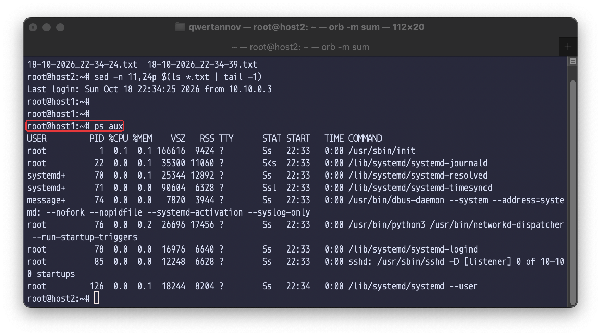

Рисунок 8 – Журнал сесії Netmiko

## 4.3. Налаштування eth1 та відключення ICMP

До запуску скрипта інтерфейсу eth1 на host1 немає, `icmp_echo_ignore_all` дорівнює 0, і
host1 відповідає на ping з host2 (рис. 9).

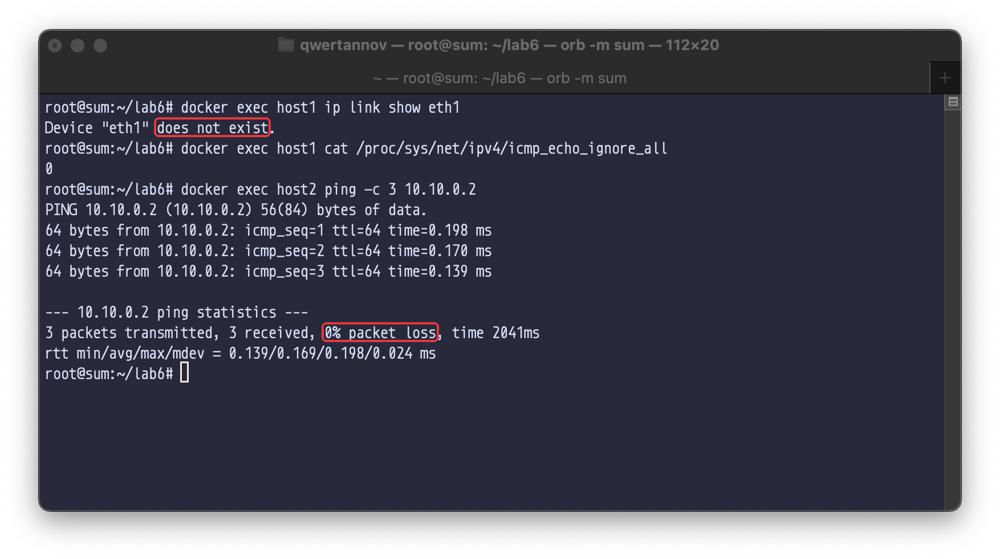

Рисунок 9 – Стан host1 до налаштування

Скрипт `configure_eth1.py` (рис. 10, 11, додаток Б) має ті самі параметри підключення,
що й `mgmt.py`. Після кожної зміни він читає стан і шукає в ньому очікуваний рядок:
`does not exist` у виводі `ip link show eth1` означає, що інтерфейс не створено,
відсутність `10.11.0.2` у `ip addr show eth1` – що адреса не призначена. Запис у
`/proc` виконується через `bash -c`, бо перенаправлення `>` у команді має обробити
оболонка на вузлі. При помилці скрипт завершується з кодом 1.

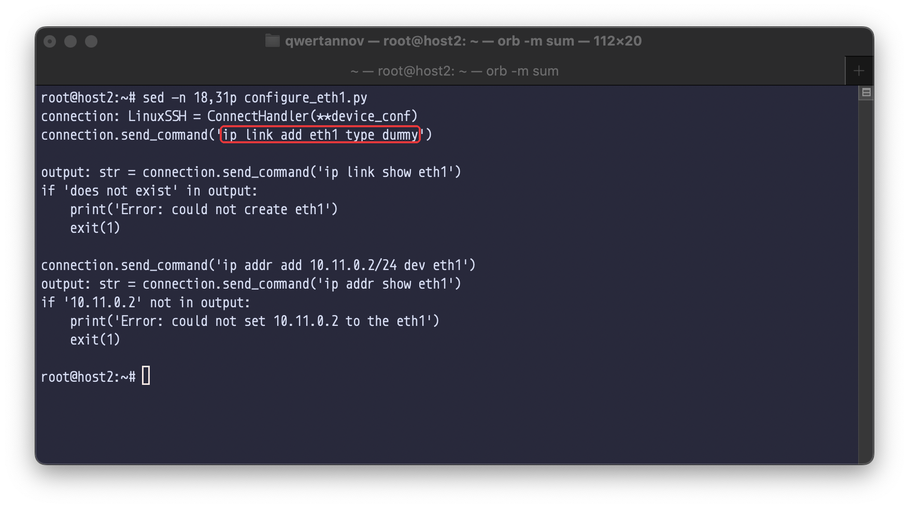

Рисунок 10 – configure_eth1.py, створення eth1 і призначення адреси

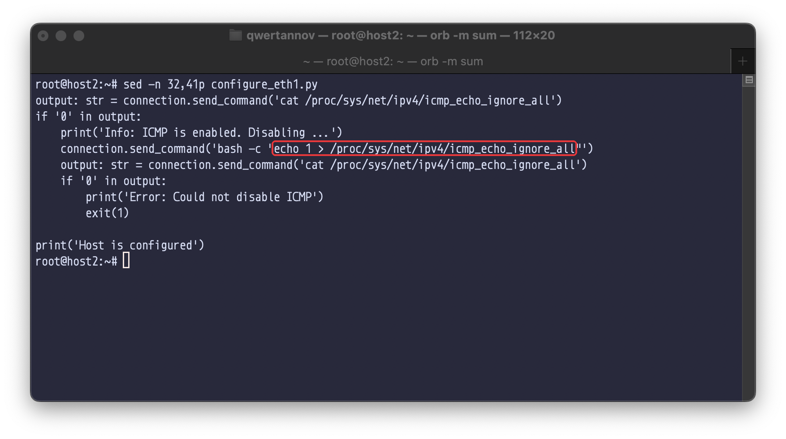

Рисунок 11 – configure_eth1.py, вимкнення відповідей на ICMP

Перший запуск вимикає ICMP і повідомляє, що вузол налаштовано (рис. 12). Другий запуск
теж завершується успішно: `ip link add` і `ip addr add` повертають помилки `File exists`,
але скрипт їх не читає, а перевірки бачать уже налаштований інтерфейс. ICMP вже вимкнено,
тому повідомлення `Info` немає.

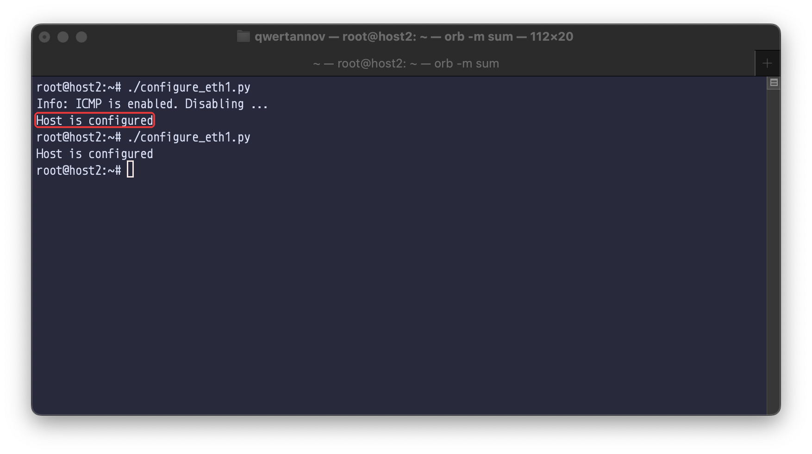

Рисунок 12 – Два запуски configure_eth1.py

Після налаштування eth1 на host1 має адресу 10.11.0.2/24, `icmp_echo_ignore_all`
дорівнює 1, і ping з host2 дає 100% втрат (рис. 13). Інтерфейс лишився в стані `DOWN`:
скрипт його не вмикає, а перевірка за входженням рядка цього не помічає.

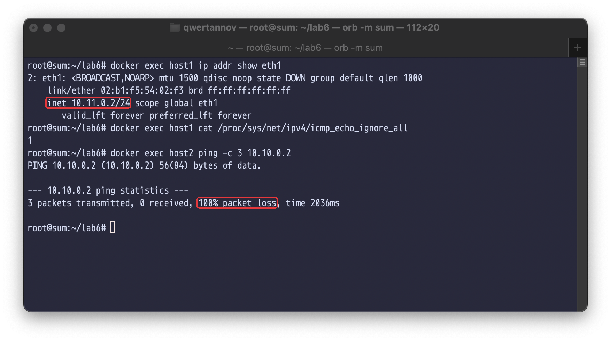

Рисунок 13 – Стан host1 після налаштування

## 3.4. Парсер команди ip show

Перевірка за входженням рядка ненадійна: `'0' in output` спрацює і на `10`, а
`'10.11.0.2'` – і на адресу 10.11.0.20. Модуль `ipparse.py` (рис. 14, 15, додаток В)
перетворює вивід `ip addr show` або `ip link show` на словник, де ключ – ім'я
інтерфейсу, а значення – індекс, список прапорців, MTU, стан, тип каналу, MAC-адреса і
списки адрес IPv4 та IPv6 з префіксами.

Розбір іде по рядках трьома регулярними виразами. Рядок заголовка має вигляд
`2: eth1: <BROADCAST,NOARP> mtu 1500 … state DOWN …`: з нього беруться індекс, ім'я
(суфікс `@ifN`, номер парного кінця veth, відкидається), прапорці в кутових дужках і пари
«ключ значення» після них. Рядок `link/ether` дає тип і MAC, рядки `inet` і `inet6` –
адреси. Решта рядків (`valid_lft`, `altname`) пропускається.

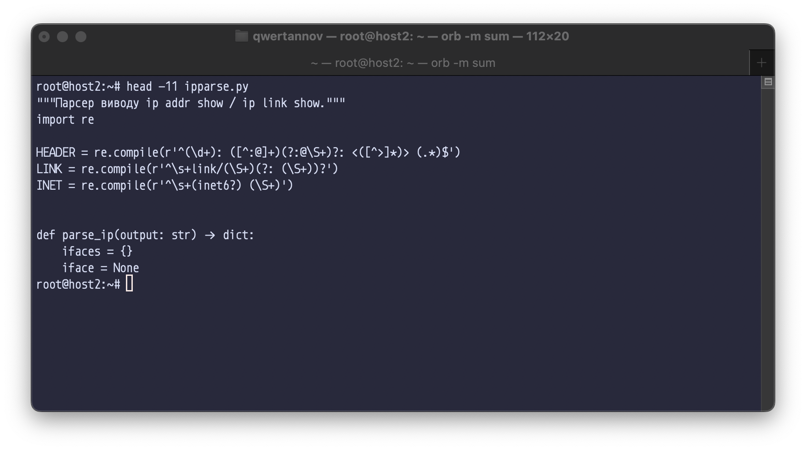

Рисунок 14 – ipparse.py, регулярні вирази

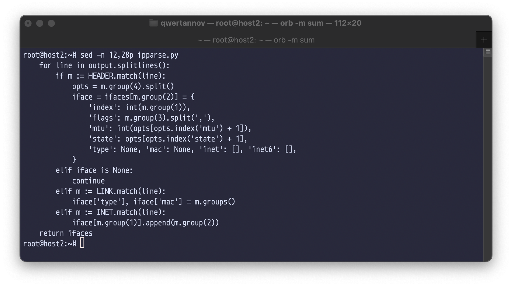

Рисунок 15 – ipparse.py, розбір рядків

Скрипт `ifaces.py` (рис. 16, додаток Г) отримує вивід `ip addr show` з вузла, адреса
якого передається аргументом (за замовчуванням host1), і друкує таблицю інтерфейсів.
Стан береться з прапорця `UP`, тобто показує, чи інтерфейс увімкнено адміністративно:
поле `state` у ввімкненого dummy-інтерфейсу має значення `UNKNOWN`.

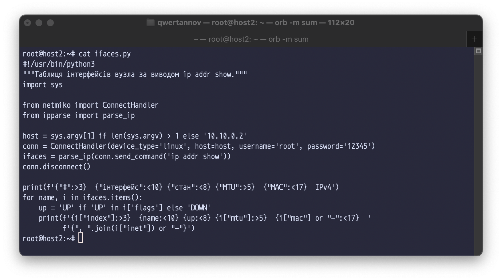

Рисунок 16 – Скрипт ifaces.py

Таблиця показує те, що пропустив `configure_eth1.py`: eth1 має адресу, але вимкнений
(рис. 17).

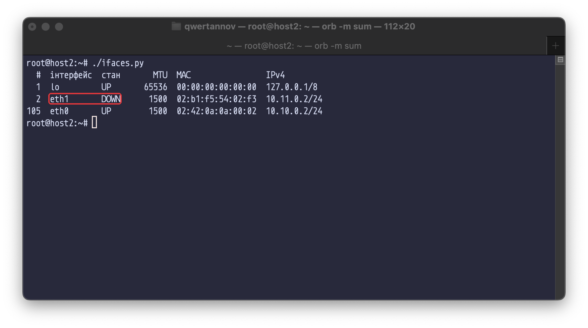

Рисунок 17 – Інтерфейси host1 після configure_eth1.py

Скрипт `configure_eth1_v2.py` (рис. 18, 19, додаток Д) застосовує парсер для
налаштування eth1. Функція `eth1()` щоразу заново читає стан інтерфейсу. Скрипт
порівнює його з бажаним і виконує тільки ті кроки, яких бракує: створити інтерфейс,
додати адресу, увімкнути. Адреса порівнюється зі списком `inet` повністю, разом з
префіксом. Наприкінці скрипт ще раз читає стан і завершується з помилкою, якщо eth1
так і не налаштовано.

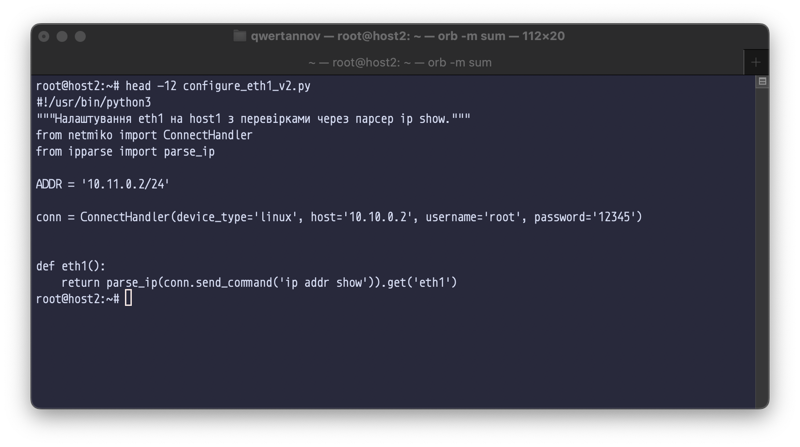

Рисунок 18 – configure_eth1_v2.py, підключення й читання стану

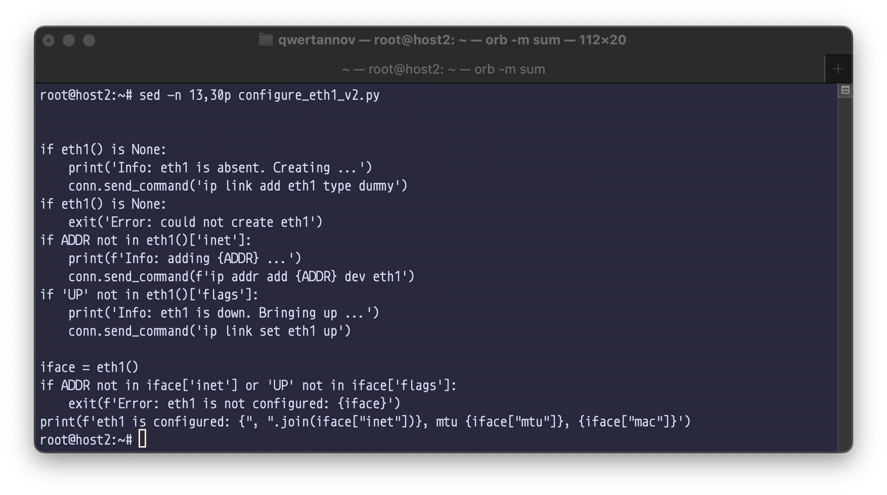

Рисунок 19 – configure_eth1_v2.py, кроки налаштування й перевірка

На host1 після `configure_eth1.py` бракує лише одного кроку. Скрипт вмикає інтерфейс,
і `ifaces.py` показує eth1 у стані `UP` (рис. 20).

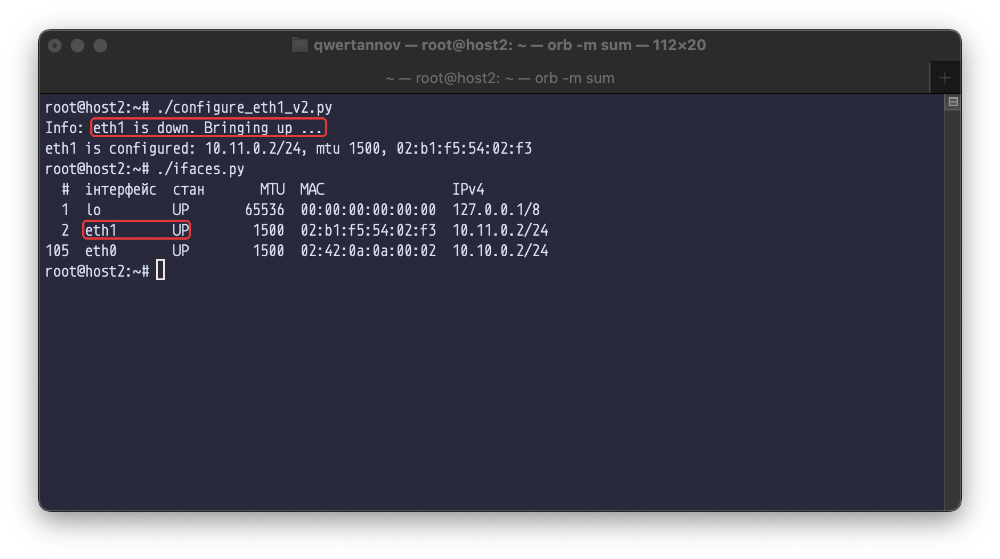

Рисунок 20 – Увімкнення eth1 скриптом configure_eth1_v2.py

Після видалення eth1 скрипт виконує всі три кроки, а повторний запуск нічого не змінює
і лише підтверджує стан (рис. 21). MAC-адреса інтерфейсу нова, бо dummy-інтерфейс
отримує випадкову адресу при створенні.

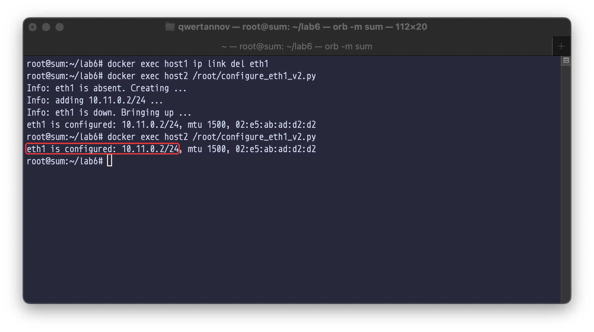

Рисунок 21 – Налаштування eth1 з нуля і повторний запуск

## 3.5. Моніторинг вузла

Скрипт `monitor.py` (рис. 22–24, додаток Е) приймає інтервал у секундах і кількість
вимірів. На кожному циклі одна команда `send_command` повертає рядок з часом вузла з
точністю до наносекунд, навантаженням за останню хвилину (`load1`) і кількістю
виконуваних і всіх процесів з `/proc/loadavg`, значеннями `MemTotal` і `MemAvailable` з
`/proc/meminfo` та лічильниками байтів eth0. Швидкість – різниця лічильників, поділена
на різницю часу вузла: сам виклик `send_command` триває близько секунди, тому
фактичний проміжок між вимірами більший за інтервал `sleep`.

Сесія відкривається один раз і використовується між циклами, тому опитування не
витрачає час на SSH-рукостискання. `conn_timeout` і `timeout` обмежують очікування
TCP-з'єднання і відповіді кількома секундами. Будь-яка помилка підключення чи читання
дає рядок `UNREACHABLE`, а сесія й попередні лічильники скидаються: на наступному циклі
скрипт підключається заново, і перший вимір після цього лише запам'ятовує лічильники.

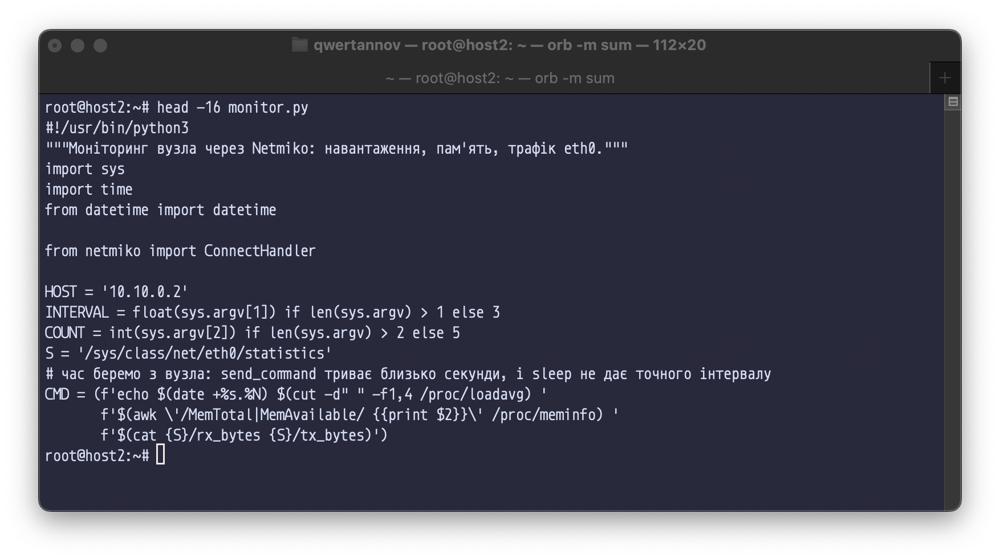

Рисунок 22 – monitor.py, параметри й команда опитування

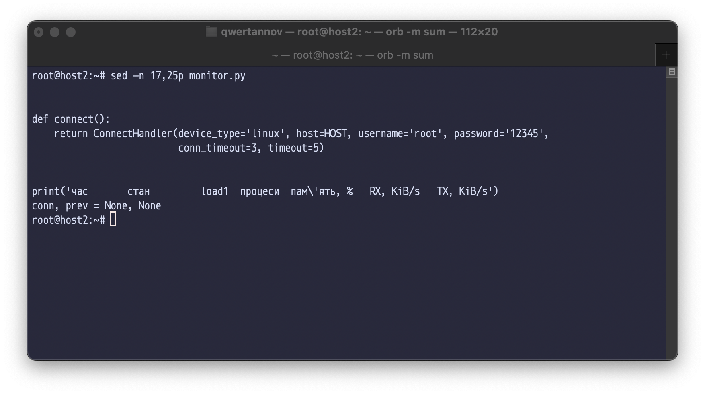

Рисунок 23 – monitor.py, функція підключення

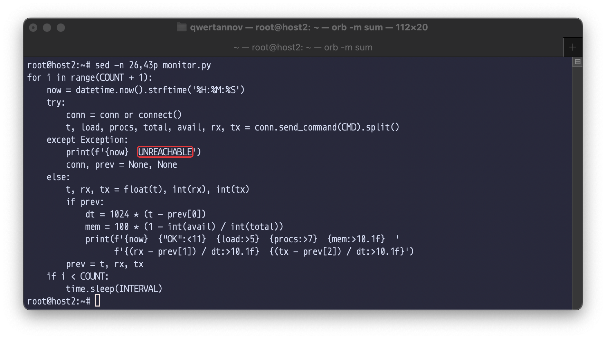

Рисунок 24 – monitor.py, цикл опитування

Для перевірки на host1 у фоні на 9 с запущено два процеси `yes`, що повністю
завантажують по ядру, а з host2 – `ping -f` з пакетами по 1400 байт (рис. 25).
Навантаження зростає з 0,26 до 1,44, кількість виконуваних процесів – з 1 до 5, прийом
eth0 – з 0,2 до близько 120 КіБ/с. Передача не змінюється: ICMP на host1 вимкнено, і
відповіді не надсилаються. `load1` повільно спадає після зупинки навантаження, бо це
експоненційне середнє за хвилину. Контейнери ділять ядро з машиною, тому навантаження
і пам'ять у `/proc` відповідають усій машині, а не лише host1.

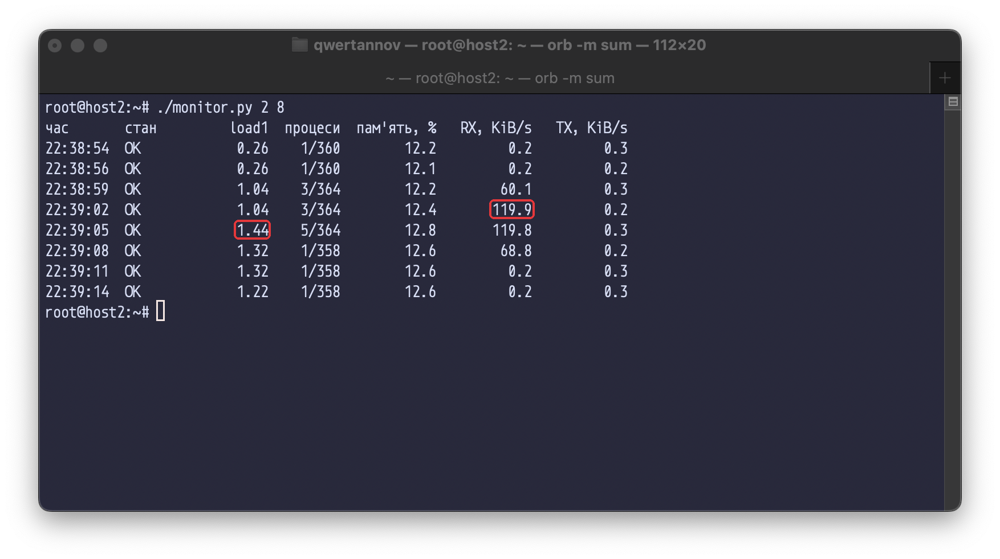

Рисунок 25 – Моніторинг host1 під навантаженням

Під час наступного запуску контейнер host1 зупинено і через 6 с запущено знову
(рис. 26). Два опитування
повертають `UNREACHABLE`, а після старту контейнера скрипт сам підключився знову і
продовжив вимірювання. Між останнім `UNREACHABLE` і відновленням минуло 12 с: в цей час
контейнер завантажувався, і спроба підключення чекала на `sshd`.

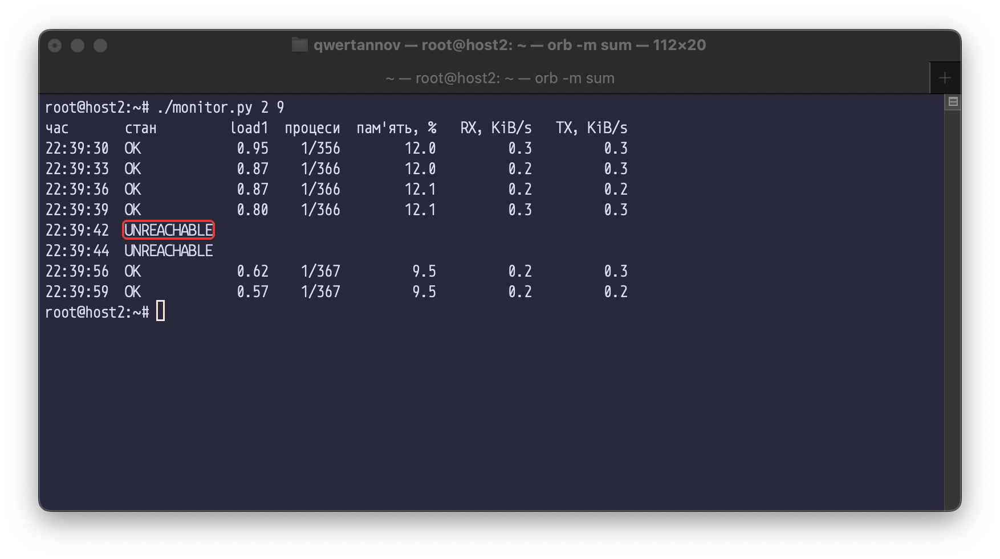

Рисунок 26 – Моніторинг під час перезапуску host1

# IV. Відповіді на контрольні запитання

1. Що таке Netmiko?

   Netmiko – бібліотека Python для керування мережевими пристроями через SSH і Telnet.
   Вона побудована на бібліотеці Paramiko і бере на себе те, що для кожного виробника
   робиться по-різному: розпізнавання промпту, перехід у привілейований режим і режим
   конфігурації, вимкнення посторінкового виводу, очікування кінця відповіді. Тип
   пристрою задається параметром `device_type` (`cisco_ios`, `juniper_junos`,
   `linux`), і `ConnectHandler` повертає об'єкт відповідного класу (рис. 5, 6).

2. Як Netmiko встановлює з'єднання?

   `ConnectHandler` створює об'єкт класу пристрою і викликає `establish_connection`.
   Через Paramiko відкривається TCP-з'єднання з портом 22, виконується обмін ключами і
   автентифікація за паролем або ключем, після чого запитується інтерактивна оболонка з
   псевдотерміналом (рис. 7). Далі `session_preparation` читає банер, визначає промпт
   (рис. 8) і готує сесію: для мережевих ОС вимикає посторінковий вивід і задає
   ширину терміналу. Для Telnet використовується `telnetlib`, а `device_type` має
   суфікс `_telnet`.

3. Які задачі Netmiko може виконувати?

   Виконувати команди і повертати їхній вивід (`send_command`), застосовувати набір
   конфігураційних команд (`send_config_set`) або команди з файлу
   (`send_config_from_file`), зберігати конфігурацію (`save_config`), передавати файли
   через SCP. Вивід можна одразу розібрати шаблонами TextFSM, TTP або Genie
   (`use_textfsm=True`). Журнал сесії (рис. 8) фіксує всю взаємодію з пристроєм. На цьому
   будуються збір стану, зміна конфігурації з перевіркою (рис. 12, 20) і моніторинг
   (рис. 25).

4. Як ви думаєте, чому був створений Netmiko?

   Більшість мережевого обладнання керується через командний рядок, а Paramiko дає лише
   «сирий» канал SSH. Скрипт мав сам чекати на промпт, підбирати затримки, обробляти
   `--More--` і запити підтвердження, і для кожного виробника це робилось по-своєму.
   Netmiko зібрав ці відмінності в класи пристроїв і дав однаковий інтерфейс до Cisco,
   Juniper, Arista, Huawei і Linux. Скрипт описує, що виконати, а не як говорити з
   конкретною ОС.

5. Для автоматизації чого б ви використовували Netmiko?

   Для пристроїв, що не мають API, а керуються лише через CLI: масове збирання
   конфігурацій і їх резервне копіювання, однакові зміни на багатьох комутаторах
   (VLAN, ACL, NTP, SNMP), перевірка стану після змін (рис. 17, 21), збирання
   показників (рис. 25), аудит відповідності конфігурації шаблону. Також як транспорт
   для фреймворку Nornir, а для серверів Linux – коли потрібен простий скрипт без
   встановлення Ansible.

# V. Висновки

У роботі за допомогою Netmiko з контейнера host2 віддалено отримано стан і налаштовано
мережу контейнера host1.

1. Скрипт `mgmt.py` підключився до host1 через `ConnectHandler` і отримав список
   процесів. Серед них видно процеси самої сесії: Netmiko працює через інтерактивну
   оболонку з псевдотерміналом. Журнал сесії записав банер, промпт і всі команди.
2. Скрипт `configure_eth1.py` створив eth1 з адресою 10.11.0.2/24 і вимкнув відповіді
   на ICMP, після чого ping до host1 дає 100% втрат. Перевірка за входженням рядка
   пропустила, що інтерфейс лишився вимкненим.
3. Парсер `ip show` перетворює вивід на словник інтерфейсів. Таблиця `ifaces.py`
   показала вимкнений eth1, а `configure_eth1_v2.py` виконує лише кроки, яких бракує:
   на налаштованому вузлі він лише ввімкнув інтерфейс, після видалення eth1 виконав
   усі три кроки, а повторний запуск нічого не змінив.
4. Скрипт моніторингу показав зростання навантаження до 1,44 і прийому до 120 КіБ/с під
   час навантаження на host1, стан `UNREACHABLE` на час зупинки контейнера і
   самостійне відновлення сесії після його старту.

# Додаток А. mgmt.py

```python
#!/usr/bin/python3

from datetime import datetime
from netmiko import ConnectHandler
from netmiko.linux import LinuxSSH


device_conf = {
    'device_type': 'linux',
    'host': '10.10.0.2',
    'username': 'root',
    'password': '12345',
    'port': 22,
    'session_log': f"{datetime.now().strftime('%d-%m-%Y_%H-%M-%S')}.txt",
    'auth_timeout': 30
}

connection: LinuxSSH = ConnectHandler(**device_conf)
output: str = connection.send_command('ps aux')

print(output)
```

# Додаток Б. configure_eth1.py

```python
#!/usr/bin/python3

from datetime import datetime
from netmiko import ConnectHandler
from netmiko.linux import LinuxSSH


device_conf = {
    'device_type': 'linux',
    'host': '10.10.0.2',
    'username': 'root',
    'password': '12345',
    'port': 22,
    'session_log': f"{datetime.now().strftime('%d-%m-%Y_%H-%M-%S')}.txt",
    'auth_timeout': 30
}

connection: LinuxSSH = ConnectHandler(**device_conf)
connection.send_command('ip link add eth1 type dummy')

output: str = connection.send_command('ip link show eth1')
if 'does not exist' in output:
    print('Error: could not create eth1')
    exit(1)

connection.send_command('ip addr add 10.11.0.2/24 dev eth1')
output: str = connection.send_command('ip addr show eth1')
if '10.11.0.2' not in output:
    print('Error: could not set 10.11.0.2 to the eth1')
    exit(1)

output: str = connection.send_command('cat /proc/sys/net/ipv4/icmp_echo_ignore_all')
if '0' in output:
    print('Info: ICMP is enabled. Disabling ...')
    connection.send_command('bash -c "echo 1 > /proc/sys/net/ipv4/icmp_echo_ignore_all"')
    output: str = connection.send_command('cat /proc/sys/net/ipv4/icmp_echo_ignore_all')
    if '0' in output:
        print('Error: Could not disable ICMP')
        exit(1)

print('Host is configured')
```

# Додаток В. ipparse.py

```python
"""Парсер виводу ip addr show / ip link show."""
import re

HEADER = re.compile(r'^(\d+): ([^:@]+)(?:@\S+)?: <([^>]*)> (.*)$')
LINK = re.compile(r'^\s+link/(\S+)(?: (\S+))?')
INET = re.compile(r'^\s+(inet6?) (\S+)')


def parse_ip(output: str) -> dict:
    ifaces = {}
    iface = None
    for line in output.splitlines():
        if m := HEADER.match(line):
            opts = m.group(4).split()
            iface = ifaces[m.group(2)] = {
                'index': int(m.group(1)),
                'flags': m.group(3).split(','),
                'mtu': int(opts[opts.index('mtu') + 1]),
                'state': opts[opts.index('state') + 1],
                'type': None, 'mac': None, 'inet': [], 'inet6': [],
            }
        elif iface is None:
            continue
        elif m := LINK.match(line):
            iface['type'], iface['mac'] = m.groups()
        elif m := INET.match(line):
            iface[m.group(1)].append(m.group(2))
    return ifaces
```

# Додаток Г. ifaces.py

```python
#!/usr/bin/python3
"""Таблиця інтерфейсів вузла за виводом ip addr show."""
import sys

from netmiko import ConnectHandler
from ipparse import parse_ip

host = sys.argv[1] if len(sys.argv) > 1 else '10.10.0.2'
conn = ConnectHandler(device_type='linux', host=host, username='root', password='12345')
ifaces = parse_ip(conn.send_command('ip addr show'))
conn.disconnect()

print(f'{"#":>3}  {"інтерфейс":<10} {"стан":<8} {"MTU":>5}  {"MAC":<17}  IPv4')
for name, i in ifaces.items():
    up = 'UP' if 'UP' in i['flags'] else 'DOWN'
    print(f'{i["index"]:>3}  {name:<10} {up:<8} {i["mtu"]:>5}  {i["mac"] or "-":<17}  '
          f'{", ".join(i["inet"]) or "-"}')
```

# Додаток Д. configure_eth1_v2.py

```python
#!/usr/bin/python3
"""Налаштування eth1 на host1 з перевірками через парсер ip show."""
from netmiko import ConnectHandler
from ipparse import parse_ip

ADDR = '10.11.0.2/24'

conn = ConnectHandler(device_type='linux', host='10.10.0.2', username='root', password='12345')


def eth1():
    return parse_ip(conn.send_command('ip addr show')).get('eth1')


if eth1() is None:
    print('Info: eth1 is absent. Creating ...')
    conn.send_command('ip link add eth1 type dummy')
if eth1() is None:
    exit('Error: could not create eth1')
if ADDR not in eth1()['inet']:
    print(f'Info: adding {ADDR} ...')
    conn.send_command(f'ip addr add {ADDR} dev eth1')
if 'UP' not in eth1()['flags']:
    print('Info: eth1 is down. Bringing up ...')
    conn.send_command('ip link set eth1 up')

iface = eth1()
if ADDR not in iface['inet'] or 'UP' not in iface['flags']:
    exit(f'Error: eth1 is not configured: {iface}')
print(f'eth1 is configured: {", ".join(iface["inet"])}, mtu {iface["mtu"]}, {iface["mac"]}')
```

# Додаток Е. monitor.py

```python
#!/usr/bin/python3
"""Моніторинг вузла через Netmiko: навантаження, пам'ять, трафік eth0."""
import sys
import time
from datetime import datetime

from netmiko import ConnectHandler

HOST = '10.10.0.2'
INTERVAL = float(sys.argv[1]) if len(sys.argv) > 1 else 3
COUNT = int(sys.argv[2]) if len(sys.argv) > 2 else 5
S = '/sys/class/net/eth0/statistics'
# час беремо з вузла: send_command триває близько секунди, і sleep не дає точного інтервалу
CMD = (f'echo $(date +%s.%N) $(cut -d" " -f1,4 /proc/loadavg) '
       f'$(awk \'/MemTotal|MemAvailable/ {{print $2}}\' /proc/meminfo) '
       f'$(cat {S}/rx_bytes {S}/tx_bytes)')


def connect():
    return ConnectHandler(device_type='linux', host=HOST, username='root', password='12345',
                          conn_timeout=3, timeout=5)


print('час       стан         load1  процеси  пам\'ять, %   RX, KiB/s   TX, KiB/s')
conn, prev = None, None
for i in range(COUNT + 1):
    now = datetime.now().strftime('%H:%M:%S')
    try:
        conn = conn or connect()
        t, load, procs, total, avail, rx, tx = conn.send_command(CMD).split()
    except Exception:
        print(f'{now}  UNREACHABLE')
        conn, prev = None, None
    else:
        t, rx, tx = float(t), int(rx), int(tx)
        if prev:
            dt = 1024 * (t - prev[0])
            mem = 100 * (1 - int(avail) / int(total))
            print(f'{now}  {"OK":<11}  {load:>5}  {procs:>7}  {mem:>10.1f}  '
                  f'{(rx - prev[1]) / dt:>10.1f}  {(tx - prev[2]) / dt:>10.1f}')
        prev = t, rx, tx
    if i < COUNT:
        time.sleep(INTERVAL)
```

