# І. Мета

Ознайомитись із SDN-мережами та отримати навички конфігурування такої мережі.

# ІІ. Постановка завдання та алгоритм розв'язання

Завдання:

1. Підготувати середовище: контейнер host1 з Mininet і Open vSwitch та контейнер host2 з
   контролером Floodlight, перевірити веб-інтерфейс контролера (завдання 4.1).
2. Створити віртуальну мережу в Mininet і переглянути її у веб-інтерфейсі (завдання 4.2).
3. Перевірити вузли й зв'язність мережі, передати UDP-трафік за допомогою iperf,
   переглянути статистику комутатора й налаштувати firewall, що відфільтровує UDP
   (завдання 4.3).
4. Додати правило в Access Control Lists (додаткове завдання 4.4).
5. Передати TCP-трафік за допомогою iperf (додаткове завдання 4.5).

Середовище: Debian 12 (OrbStack, macOS), Docker 20.10 і docker-compose 1.29, host1 на
образі ubuntu:20.04 з Mininet 2.2.2 і Open vSwitch 2.13.8, host2 на образі
`latarc/floodlight` (Floodlight 1.2, OpenJDK 8), браузер Google Chrome.

Алгоритм розв'язання:

1. Запустити два привілейовані контейнери з адресами 10.10.0.2 і 10.10.0.3. На host1
   встановити Mininet і Open vSwitch та запустити службу `openvswitch-switch`. На host2
   контролер стартує сам; відкрити його веб-інтерфейс на порту 8080.
2. Створити в Mininet топологію з одного комутатора s1 і трьох вузлів h1–h3. Комутатор
   працює за OpenFlow 1.3 і підключається до віддаленого контролера 10.10.0.3:6653.
3. Перевірити вузли (`nodes`) і зв'язність (`pingall`, `ping`), встановити відсутні
   утиліти з другого підключення до host1. Запустити на h1 UDP-сервер iperf, надіслати
   на нього трафік з h2 і переглянути таблицю потоків комутатора у веб-інтерфейсі.
4. Увімкнути firewall контролера, дозволити потрібні протоколи й додати правило, що
   відкидає UDP від h2 до h1. Перевірити, що UDP від h2 не доходить, а решта трафіку
   проходить.
5. Додати правило ACL, що забороняє TCP від h3 до порту 5001 на h1. Перевірити
   передачу TCP iperf з h3 і h2 та запис ACL у таблиці потоків комутатора.

# ІІІ. Хід виконання

## 4.1. Налаштування середовища

docker-compose.yml описує два привілейовані контейнери (рис. 1, 2). host1 – звичайний
ubuntu:20.04, на ньому працюватиме емулятор мережі. host2 – готовий образ з контролером
Floodlight. Образ зібрано лише для amd64, тому `platform: linux/amd64` запускає його
через трансляцію Rosetta на arm64-машині. Порт 8080 контролера опубліковано на адресі
віртуальної машини 192.168.139.71: мережа 10.10.0.0/24 існує лише всередині неї, а
браузер працює в macOS.

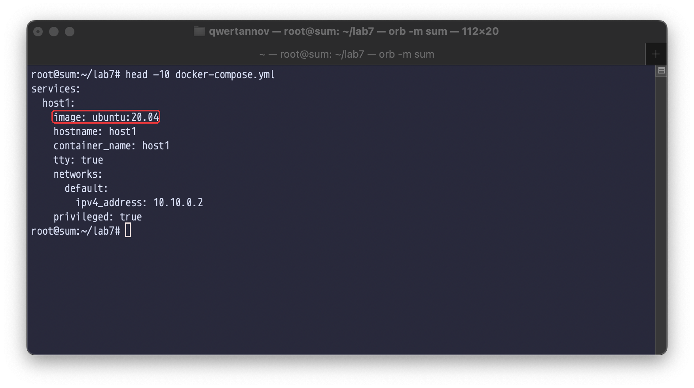

Рисунок 1 – Опис host1 у docker-compose.yml

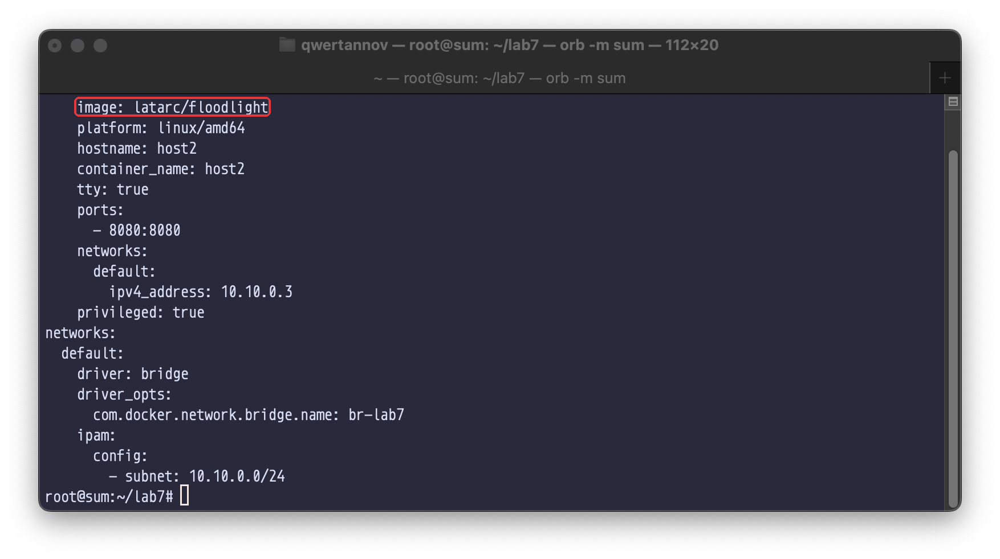

Рисунок 2 – Опис host2 і мережі в docker-compose.yml

Обидва контейнери запущено (рис. 3).

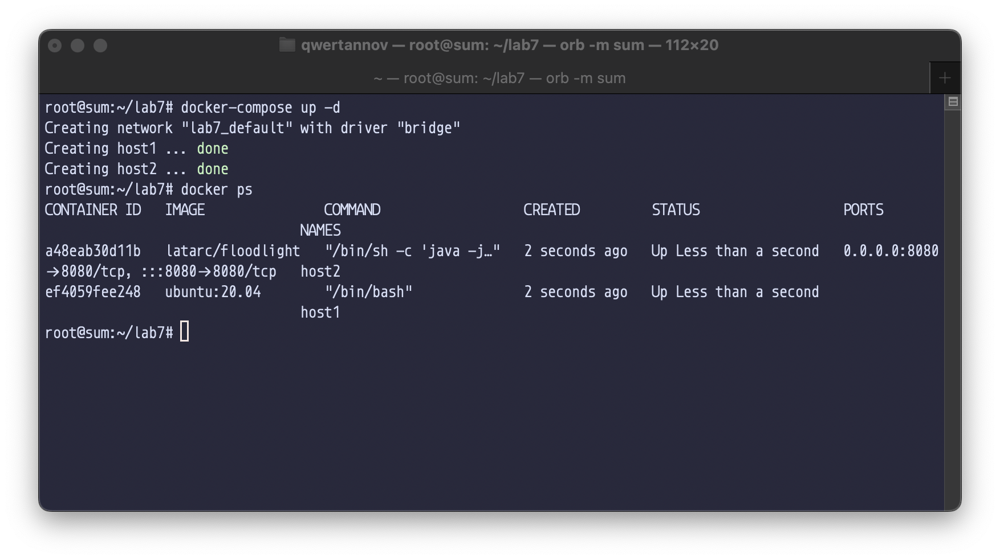

Рисунок 3 – Запуск контейнерів

На host1 встановлено Mininet і Open vSwitch (рис. 4). Пакет `openvswitch-switch-dpdk`
містить `ovs-vswitchd` зі збіркою під DPDK і залежить від звичайного
`openvswitch-switch`. Пакети ставляться для arm64, а сам комутатор працює через модуль
ядра `openvswitch`: контейнери ділять ядро з віртуальною машиною, тому модуль
завантажено в ній.

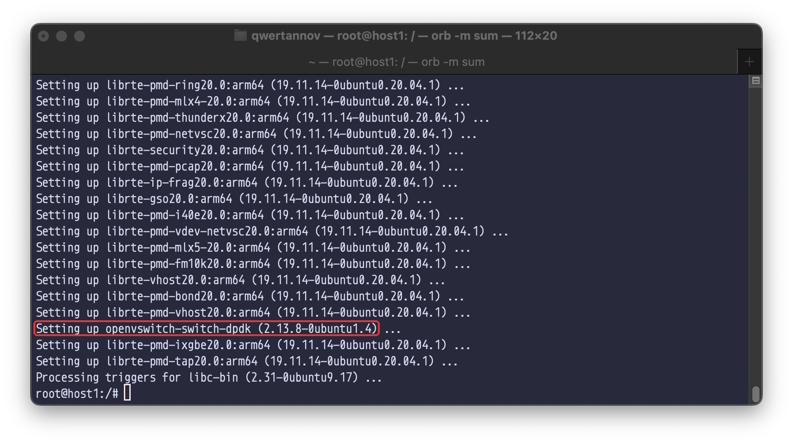

Рисунок 4 – Встановлення Mininet і Open vSwitch на host1

Після встановлення служба не запущена: в контейнері немає init-системи, яка стартувала
б її сама. `service openvswitch-switch start` створює базу конфігурації
`/etc/openvswitch/conf.db` і запускає два процеси (рис. 5): `ovsdb-server` зберігає
конфігурацію мостів і портів, `ovs-vswitchd` пересилає пакети й спілкується з
контролером за OpenFlow.

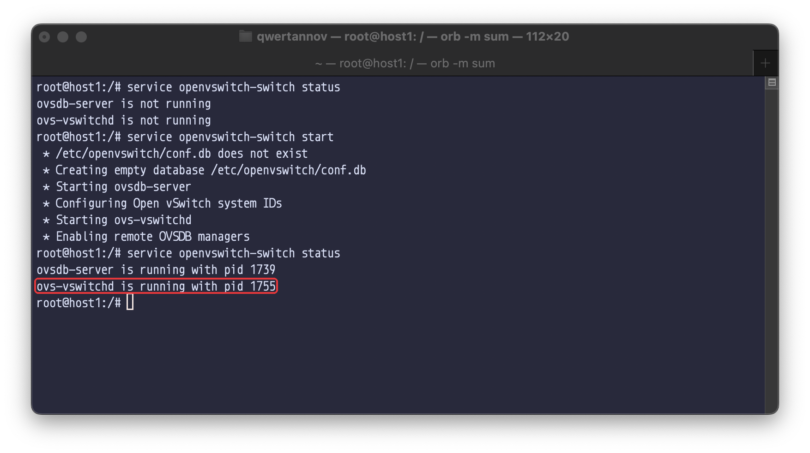

Рисунок 5 – Запуск Open vSwitch

Веб-інтерфейс контролера відкривається в браузері (рис. 6). Контролер активний, але
комутаторів і вузлів ще немає.

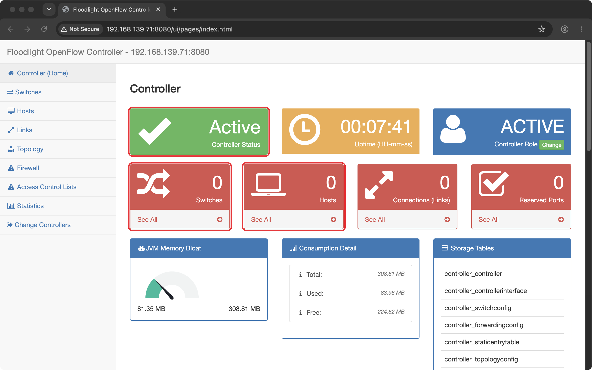

Рисунок 6 – Головна сторінка веб-інтерфейсу Floodlight

## 4.2. Створення віртуальної мережі

Mininet створює мережу командою з параметрами (рис. 7):

- `--controller=remote,ip=10.10.0.3,port=6653` – зовнішній контролер Floodlight
  замість вбудованого;
- `--switch ovsk,protocols=OpenFlow13` – комутатор Open vSwitch у режимі ядра з
  протоколом OpenFlow 1.3;
- `--topo single,3` – один комутатор s1 і три вузли h1–h3.

Кожен вузол – оболонка в окремому мережевому просторі імен з інтерфейсом `hN-eth0`,
з'єднаним парою veth з портом комутатора. Перед запуском ліміт відкритих файлів
зменшено командою `ulimit -n 65536`: у контейнері він дорівнює 1073741816, а утиліта
`mnexec` перед запуском вузла закриває всі можливі дескриптори по одному, і без цього
Mininet зависає на створенні вузлів. Попередження `Error setting resource limits`
означає, що Mininet не зміг змінити параметри ядра, які в контейнері доступні лише
для читання; на роботу мережі це не впливає.

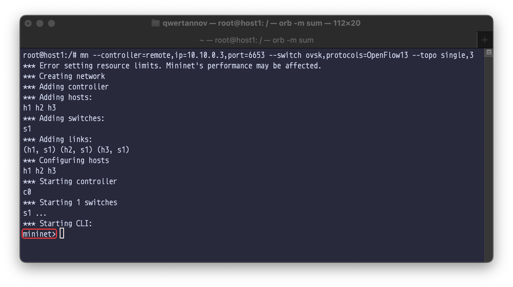

Рисунок 7 – Створення мережі в Mininet

Контролер бачить один комутатор і три вузли (рис. 8). Вузли він знаходить за пакетами,
які комутатор пересилає йому через запис таблиці потоків за замовчуванням (table-miss):
одразу після запуску вузли надсилають пакети IPv6 Neighbor Discovery.

Рисунок 8 – Комутатор і вузли на головній сторінці

На сторінці Topology видно комутатор з DPID 00:00:00:00:00:00:00:01 і три вузли
(рис. 9). Підписи вузлів складаються з літери `h` та IPv4-адреси, яку контролер ще не
знає, бо вузли поки не передавали IPv4-пакетів.

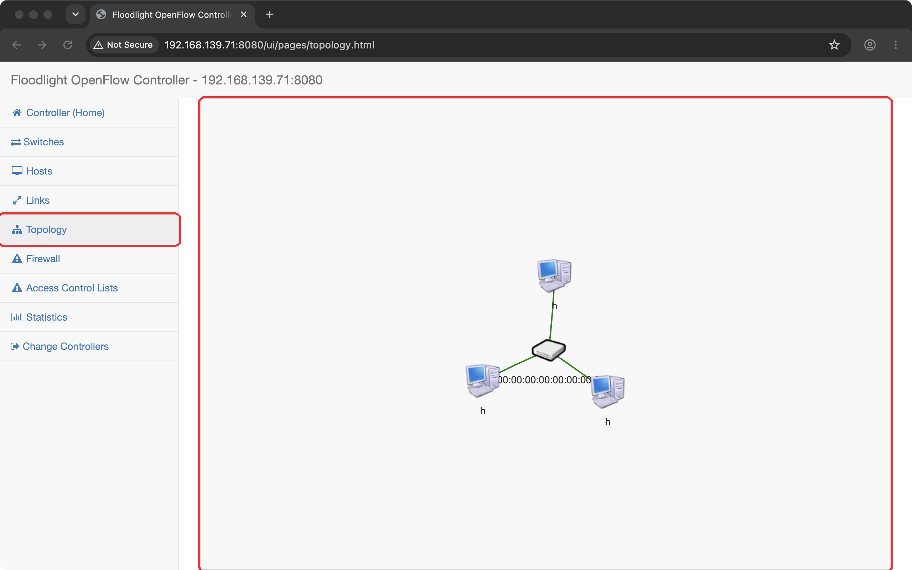

Рисунок 9 – Топологія мережі

## 4.3. Взаємодія з віртуальною мережею в Mininet

### Вузли та їх доступність

Команда `nodes` показує контролер c0, вузли h1–h3 і комутатор s1 (рис. 10).

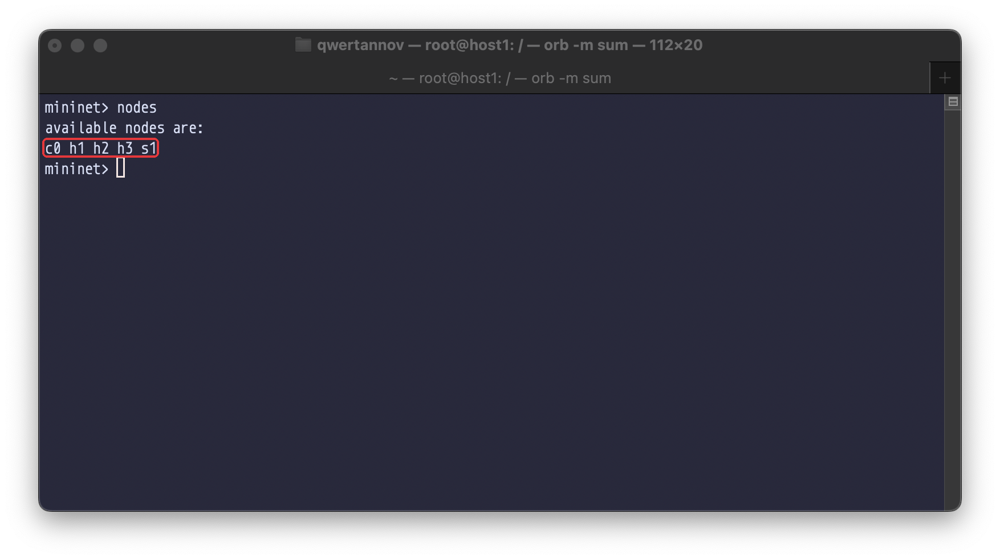

Рисунок 10 – Вузли мережі

Перший `pingall` не проходить (рис. 11): в образі ubuntu:20.04 немає утиліти `ping`.
Це не помилка мережі – Mininet запускає `ping` в оболонці кожного вузла і не може
розібрати її вивід.

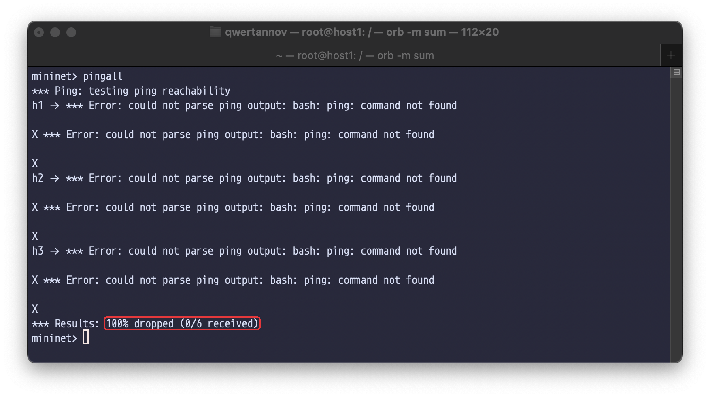

Рисунок 11 – pingall без утиліти ping

Термінал з Mininet зайнятий його командним рядком, тому утиліту встановлено з другого
підключення до host1 (рис. 12). Вузли Mininet використовують файлову систему host1,
тому встановлений пакет одразу доступний їм усім. `iperf` і `net-tools` прийшли раніше
як залежності Mininet.

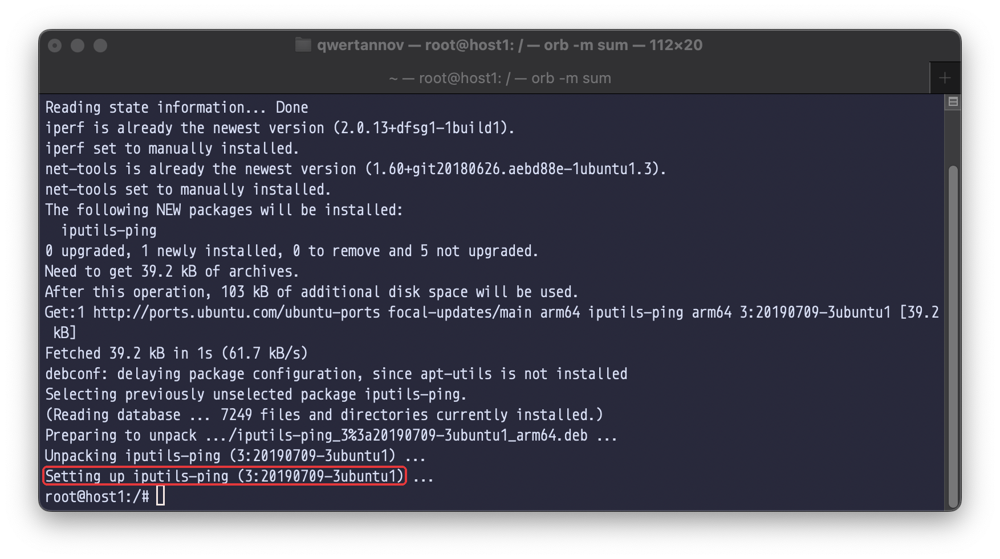

Рисунок 12 – Встановлення iputils-ping з другого підключення

Тепер усі шість пар вузлів досяжні (рис. 13), і ping з h1 до h2 проходить без втрат
(рис. 14). Перший пакет кожного нового потоку комутатор надсилає контролеру, модуль
Forwarding прокладає маршрут і записує потоки в комутатор, а наступні пакети
пересилаються без участі контролера.

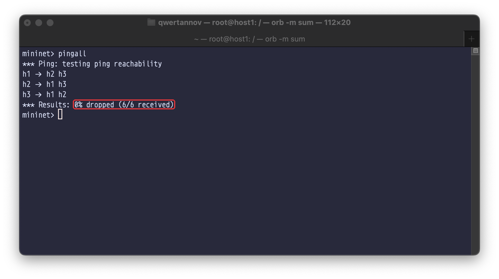

Рисунок 13 – Повторний pingall

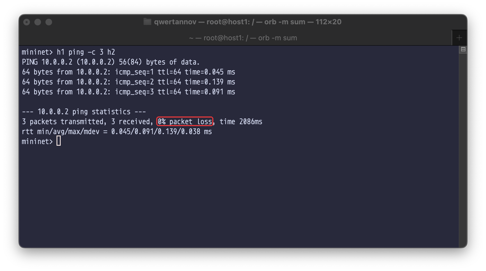

Рисунок 14 – ping з h1 до h2

Інтерфейс h1-eth0 має адресу 10.0.0.1/8 (рис. 15). Адреси 10.0.0.1–10.0.0.3 Mininet
призначає вузлам за порядком, а MAC-адреси генеруються випадково.

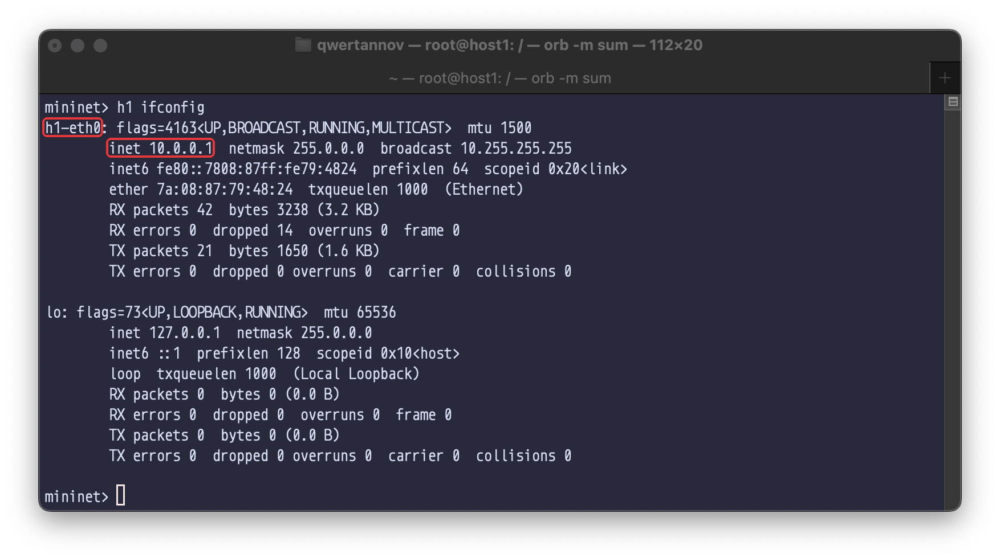

Рисунок 15 – Інтерфейси вузла h1

Після обміну IPv4-пакетами контролер дізнався адреси вузлів, і вони з'явились у
підписах на топології (рис. 16).

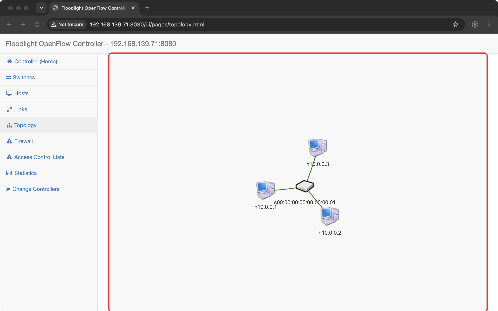

Рисунок 16 – Топологія з IP-адресами вузлів

### UDP-трафік

Вузли мають окремі мережеві простори імен, але спільні простори процесів і файлову
систему з host1, тому `h1 ps aux` показує всі процеси контейнера (рис. 17): процеси
Open vSwitch, сам Mininet і оболонки вузлів.

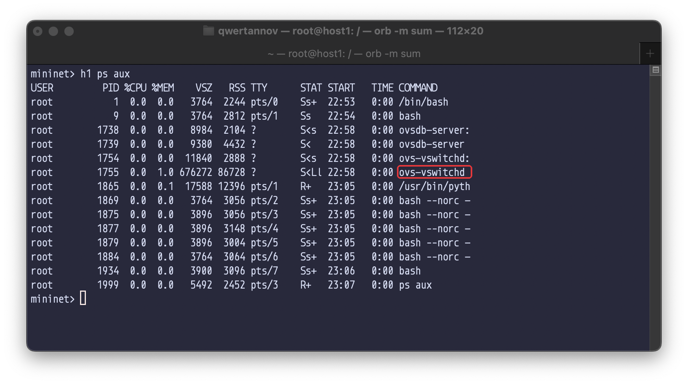

Рисунок 17 – Список процесів на h1

На h1 у фоні запущено UDP-сервер iperf, він слухає порт 5001 (рис. 18).

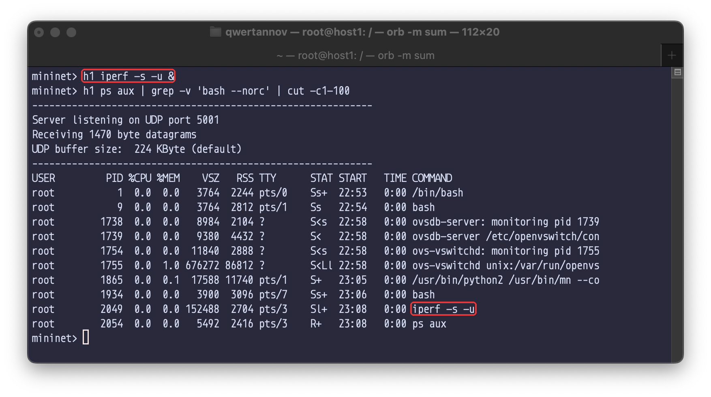

Рисунок 18 – Запуск UDP-сервера iperf на h1

Клієнт на h2 протягом 10 с надсилає датаграми по 1470 байт зі швидкістю за
замовчуванням 1 Мбіт/с (рис. 19). Сервер прийняв усі 892 датаграми: втрат немає,
джитер 0,006 мс.

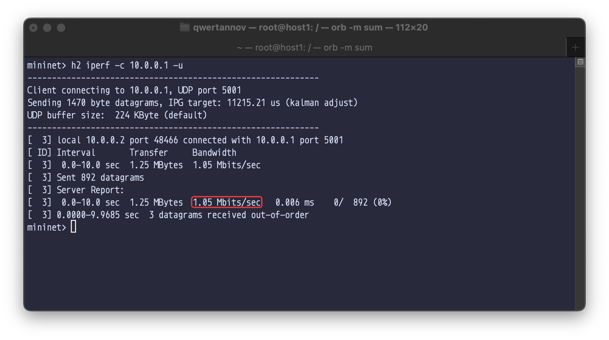

Рисунок 19 – Передача UDP з h2 на h1

Сторінка Switches показує підключений комутатор і адресу, з якої він підключився до
контролера (рис. 20).

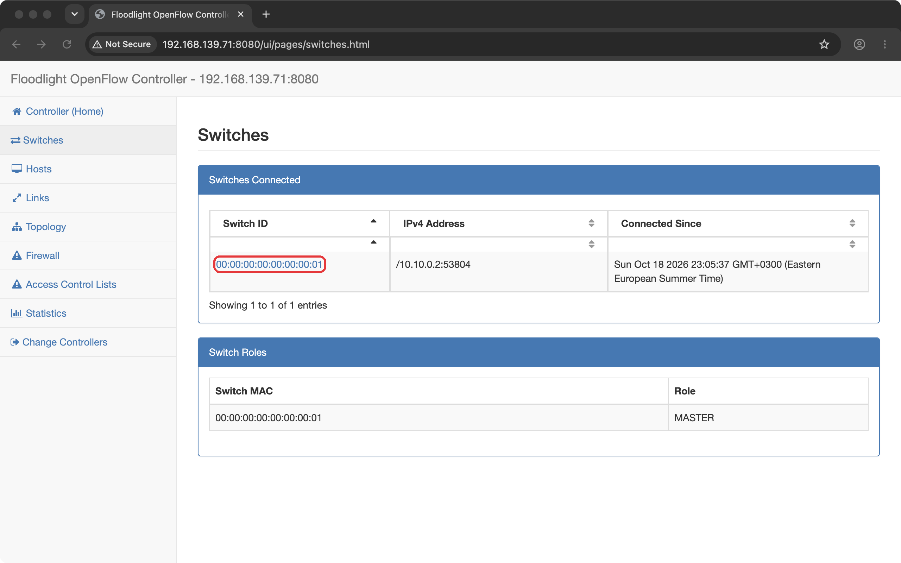

Рисунок 20 – Підключені комутатори

У таблиці потоків комутатора лишився один запис – table-miss з пріоритетом 0, що
надсилає пакети контролеру (рис. 21). Через нього пройшло 56 пакетів, 12436 байт:
перші пакети кожного потоку, ARP і Neighbor Discovery. Потоки, які записав Forwarding
для UDP, мають тайм-аут простою 5 с і на момент перегляду вже видалені. Що трафік
пройшов через таблицю, видно з лічильників у таблиці Tables: 2749 пошуків у таблиці 0,
з них 2746 зі збігом.

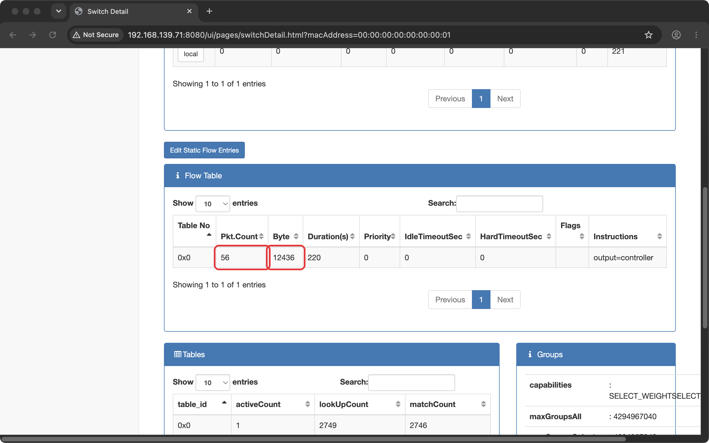

Рисунок 21 – Статистика таблиці потоків комутатора

### Налаштування firewall

Firewall контролера за замовчуванням пасивний. Його увімкнено в діалозі Change Firewall
Status (рис. 22, 23).

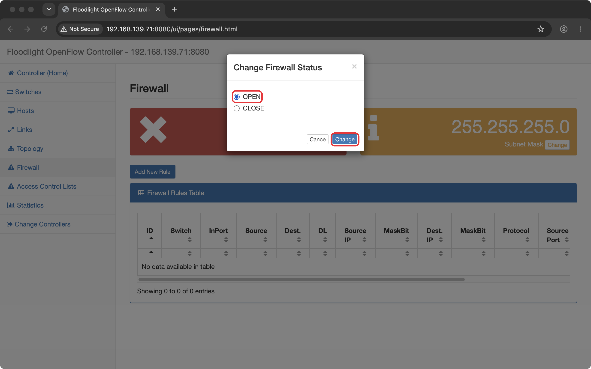

Рисунок 22 – Увімкнення firewall

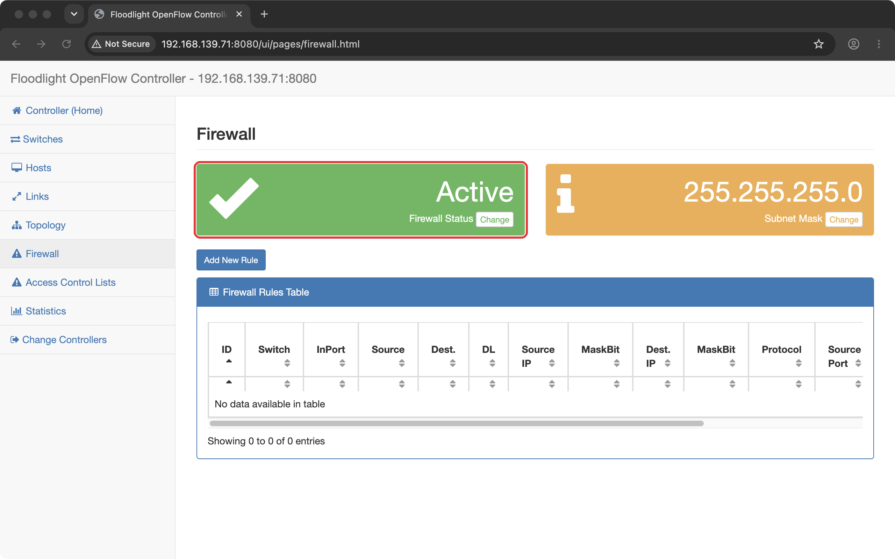

Рисунок 23 – Firewall активний

Увімкнений firewall без правил відкидає все (рис. 24). Він працює за білим списком:
кожен пакет, що надійшов до контролера, перевіряється за правилами, і якщо жодне не
збіглося, контролер записує в комутатор потік з дією drop.

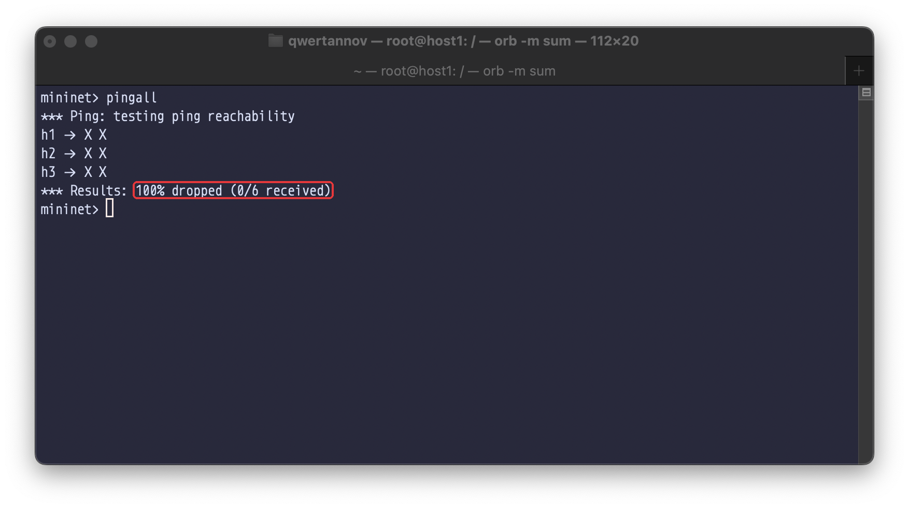

Рисунок 24 – pingall з увімкненим firewall без правил

Правила перевіряються за зростанням значення Priority, спрацьовує перше, що збіглося.
Правило, що відкидає UDP від h2 (10.0.0.2/32) до h1 (10.0.0.1/32) на комутаторі s1,
має пріоритет 1 (рис. 25). Дозвільні правила для ICMP, UDP і TCP мають пріоритет 10
(рис. 26), тож для UDP від h2 до h1 першим спрацює правило DENY.

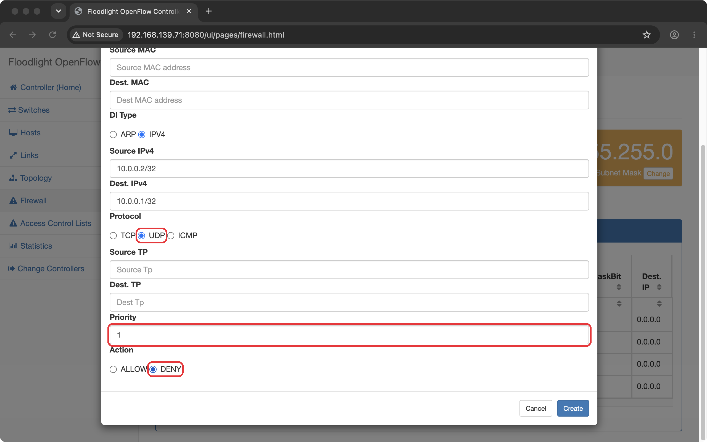

Рисунок 25 – Правило, що відкидає UDP від h2 до h1

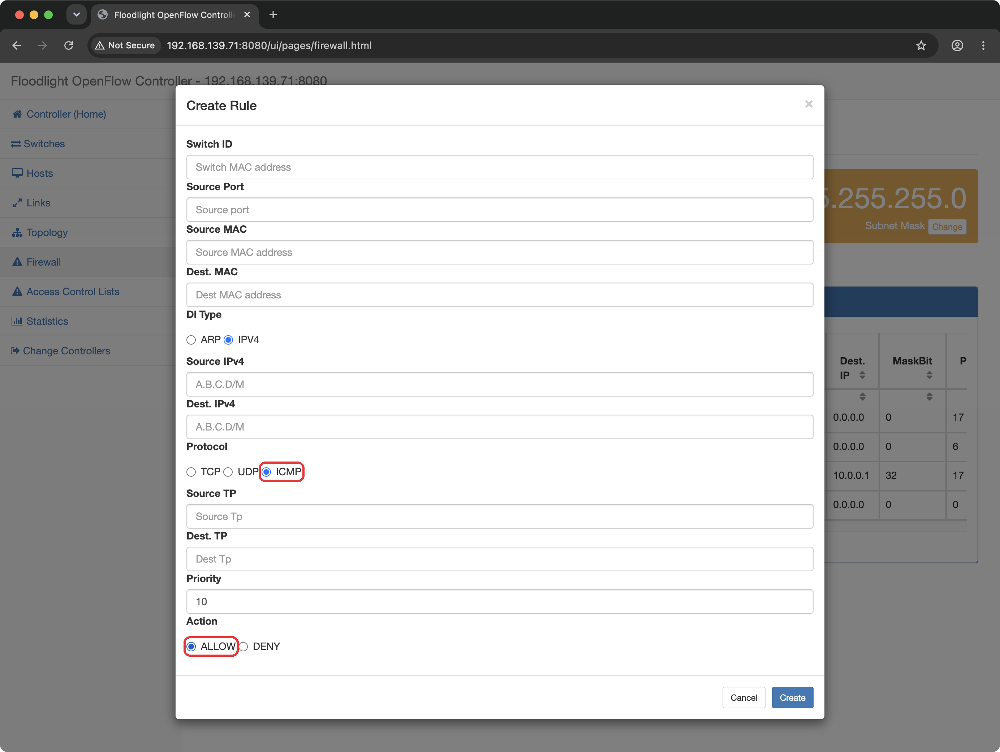

Рисунок 26 – Дозвільне правило для ICMP

Форма веб-інтерфейсу завжди передає тип кадру й протокол: без вибраного TCP чи UDP
правило отримує протокол ICMP. Тому правило для ARP, без якого вузли не дізнаються
MAC-адрес одне одного, додано напряму через REST API контролера, яким користується і
сам веб-інтерфейс (рис. 27).

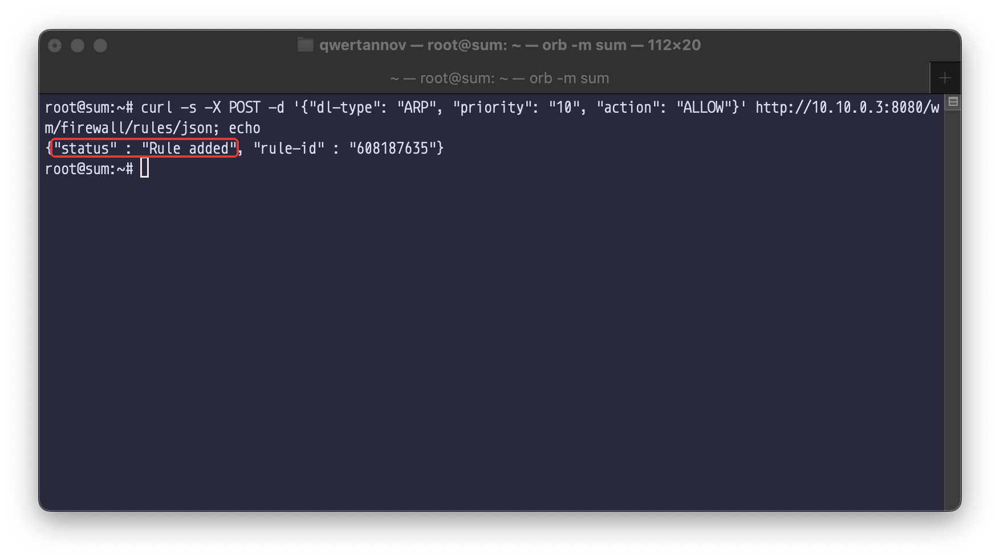

Рисунок 27 – Додавання правила для ARP через REST API

У таблиці правил п'ять записів (рис. 28): DROP для UDP від 10.0.0.2 до 10.0.0.1 з
пріоритетом 1 і чотири ALLOW з пріоритетом 10 для протоколів 17 (UDP), 6 (TCP), 1 (ICMP)
і типу кадру 2054 (ARP).

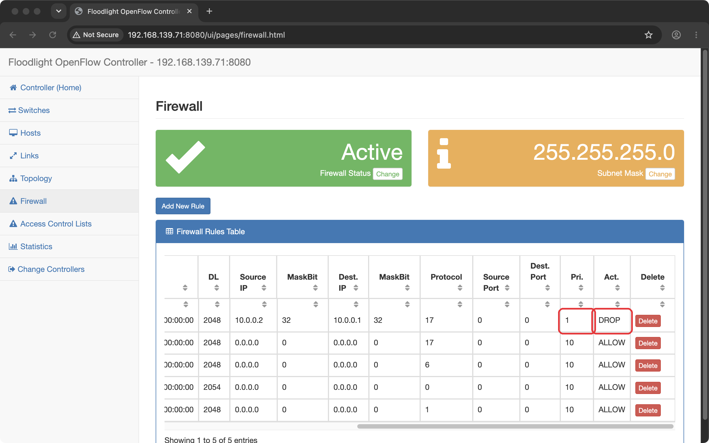

Рисунок 28 – Правила firewall

Тепер UDP від h2 до h1 не доходить (рис. 29). Клієнт iperf надіслав 893 датаграми,
але не отримав від сервера підсумкового звіту: після 10 спроб він виводить
попередження, і рядка Server Report немає. У таблиці потоків з'являється запис з
`actions=drop` для цього потоку.

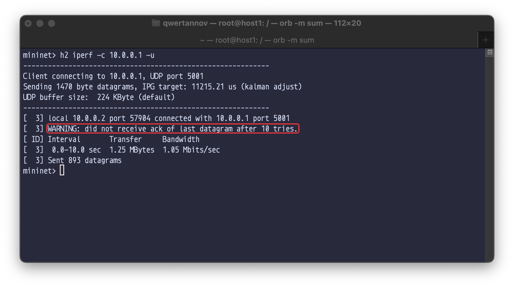

Рисунок 29 – UDP від h2 до h1 відкидається

Решта трафіку проходить (рис. 30): `pingall` без втрат, UDP від h3 до h1 доходить
повністю, 268 датаграм за 3 с.

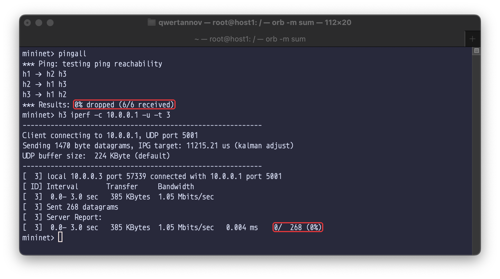

Рисунок 30 – ICMP і UDP від h3 проходять

## 4.4–4.5. Access Control Lists і TCP-трафік

Для перевірки ACL використано TCP із завдання 4.5. На h1 запущено TCP-сервер iperf
(рис. 31). До додавання ACL TCP від h3 до h1 проходить зі швидкістю 90,5 Гбіт/с:
пакети не залишають ядра машини, комутатор пересилає їх між парами veth у пам'яті.
Firewall пропускає TCP завдяки правилу ALLOW для протоколу 6.

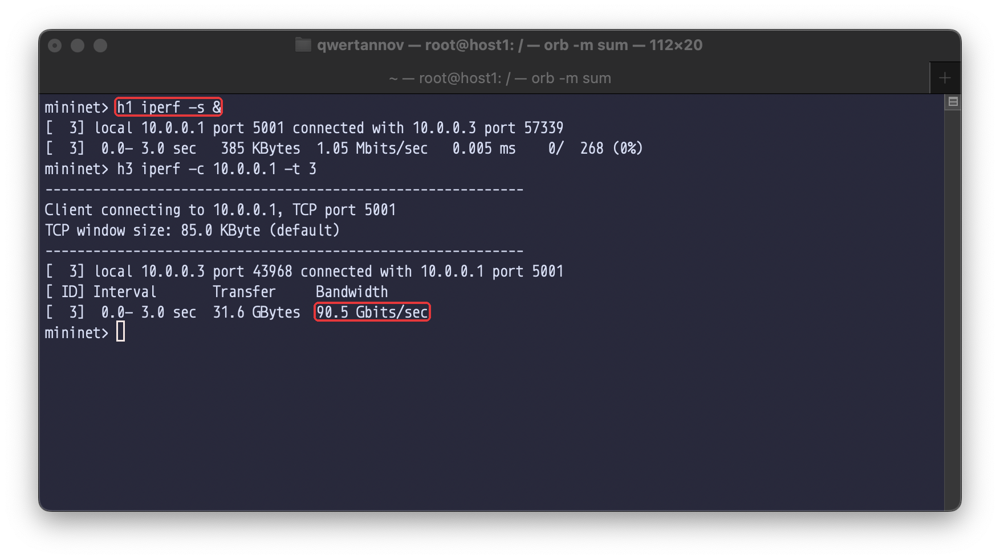

Рисунок 31 – TCP від h3 до h1 до додавання ACL

Правило ACL забороняє TCP від 10.0.0.3/32 до 10.0.0.1/32 на порт 5001 (рис. 32, 33).
На відміну від firewall, форма ACL не має поля комутатора: правило стосується всієї
мережі.

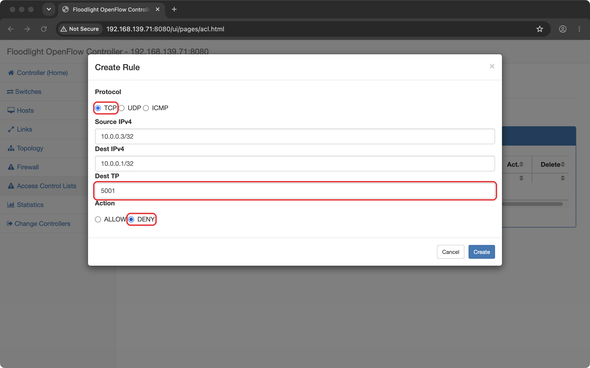

Рисунок 32 – Нове правило ACL

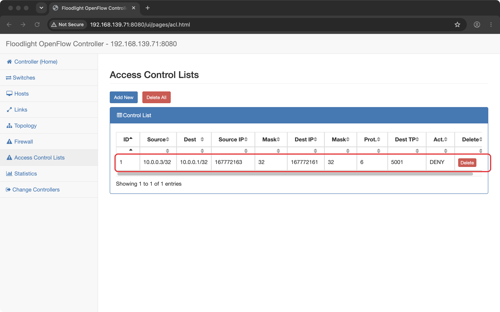

Рисунок 33 – Список правил ACL

Після цього клієнт на h3 не може встановити з'єднання, а з h2 TCP проходить зі
швидкістю 90,7 Гбіт/с (рис. 34).

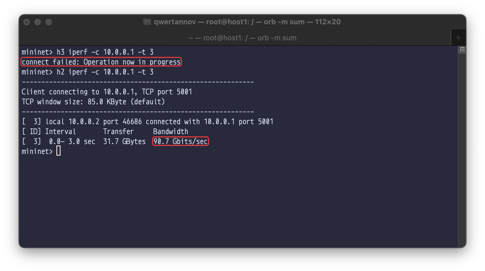

Рисунок 34 – TCP від h3 заблоковано, від h2 проходить

Модуль ACL працює проактивно (рис. 35): відразу після додавання правила він записує в
комутатор потік з пріоритетом 30000 і дією drop, і пакети h3 відкидаються на
комутаторі без звернення до контролера. Firewall, навпаки, реактивний: він приймає
рішення для першого пакета кожного потоку, що надійшов до контролера. Запис ACL
постійний, а потоки firewall і Forwarding видаляються після 5 с простою, тому в
таблиці лишились лише запис ACL і table-miss.

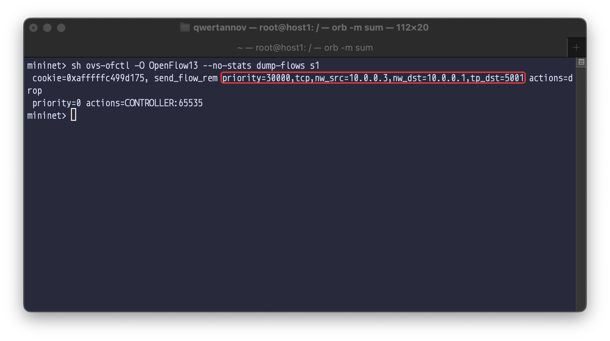

Рисунок 35 – Запис ACL у таблиці потоків комутатора

# IV. Відповіді на контрольні запитання

1. Що таке SDN?

   SDN (Software-Defined Networking, програмно-визначена мережа) – підхід, у якому
   площина керування відокремлена від площини даних. Комутатори лише пересилають пакети
   за таблицями потоків, а рішення про маршрути, фільтрацію й QoS приймає централізований
   контролер, який має повну картину мережі (рис. 9) і записує потоки в комутатори
   через південний інтерфейс, наприклад OpenFlow. Застосунки керують мережею через
   північний інтерфейс контролера – REST API (рис. 27) або веб-інтерфейс. У роботі
   контролер Floodlight виконував комутацію (модуль Forwarding), фільтрацію (Firewall,
   ACL) і збирав статистику (рис. 21).

2. Яка історія розвитку SDN-мереж?

   Ідея програмованих мереж іде від активних мереж 1990-х і проєктів розділення
   площин 2000-х: ForCES в IETF і 4D. У 2007 році в Стенфорді проєкт Ethane показав
   централізоване керування доступом у корпоративній мережі, а в 2008 році стаття
   «OpenFlow: Enabling Innovation in Campus Networks» запропонувала відкритий протокол
   керування таблицями потоків комутатора. Тоді ж з'явився перший контролер NOX, у 2009
   році – специфікація OpenFlow 1.0 і Open vSwitch. У 2011 році засновано Open Networking
   Foundation, яка розвиває OpenFlow. Далі з'явились контролери Floodlight, Ryu,
   OpenDaylight (2013) і ONOS (2014), Google розгорнула SDN у своїй глобальній мережі
   B4, а SDN стала основою віртуалізації мереж у хмарах (NSX, OpenStack Neutron, OVN) і
   SD-WAN.

3. Що таке OVS?

   Open vSwitch – багаторівневий програмний комутатор з відкритим кодом (ліцензія
   Apache 2.0). Складається з бази конфігурації `ovsdb-server`, демона
   `ovs-vswitchd` і шляху даних: модуля ядра Linux, користувацького простору з DPDK або
   AF_XDP чи апаратного прискорення мережевої карти (рис. 5, 17). Підтримує OpenFlow
   1.0–1.5, протокол керування OVSDB, VLAN, тунелі VXLAN, GRE і Geneve, агрегацію
   каналів LACP, QoS, дзеркалювання портів, NetFlow і sFlow.

4. Для чого використовується OVS?

   Для з'єднання віртуальних машин і контейнерів на хості та між хостами через тунелі:
   у гіпервізорах KVM і Xen, в OpenStack Neutron, у віртуальних мережах OVN, у мережевих
   плагінах Kubernetes (OVN-Kubernetes, Antrea). Також як комутатор, керований
   SDN-контролером за OpenFlow, і для навчальних і дослідницьких стендів – Mininet
   будує на ньому віртуальні мережі (рис. 7).

5. Які операційні системи підтримують Open vSwitch?

   Основна платформа – Linux: модуль ядра входить до основного дерева з версії 3.3, а
   пакети є в усіх великих дистрибутивах (Debian, Ubuntu, RHEL, Fedora). Також
   підтримуються FreeBSD і NetBSD (користувацький шлях даних) і Windows як розширення
   комутатора Hyper-V. OVS працює в XenServer і Citrix Hypervisor, а користувацький
   шлях даних з DPDK – на будь-якій системі, яку підтримує DPDK.

# V. Висновки

У роботі побудовано SDN-стенд: мережа Mininet з комутатором Open vSwitch на host1,
керована за OpenFlow 1.3 контролером Floodlight на host2.

1. Комутатор підключився до контролера, і той сам виявив топологію: один комутатор і
   три вузли, IP-адреси яких з'явились після першого IPv4-трафіку.
2. Після встановлення `ping` усі вузли досяжні, UDP iperf від h2 до h1 пройшов без
   втрат (892 датаграми). Потоки, які записує модуль Forwarding, живуть 5 с простою,
   тому в статистиці таблиці потоків лишається лише запис table-miss.
3. Firewall контролера працює за білим списком: увімкнений без правил, він відкидає
   весь трафік, включно з ARP. З дозвільними правилами для ARP, ICMP, UDP і TCP та
   правилом DROP з вищим пріоритетом UDP від h2 до h1 відкидається, а ICMP і UDP від
   h3 проходять.
4. Правило ACL заборонило TCP від h3 до порту 5001 на h1: з h3 з'єднання не
   встановлюється, з h2 TCP проходить зі швидкістю 90,7 Гбіт/с. ACL записує в
   комутатор постійний потік з пріоритетом 30000, тоді як firewall приймає рішення
   реактивно для кожного нового потоку.
